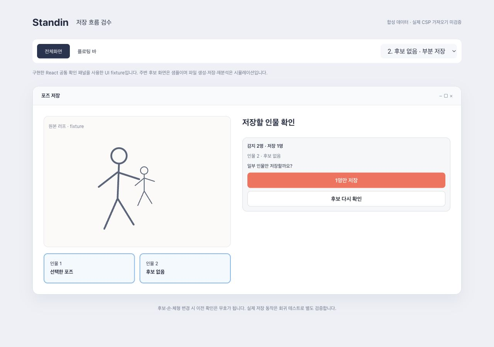
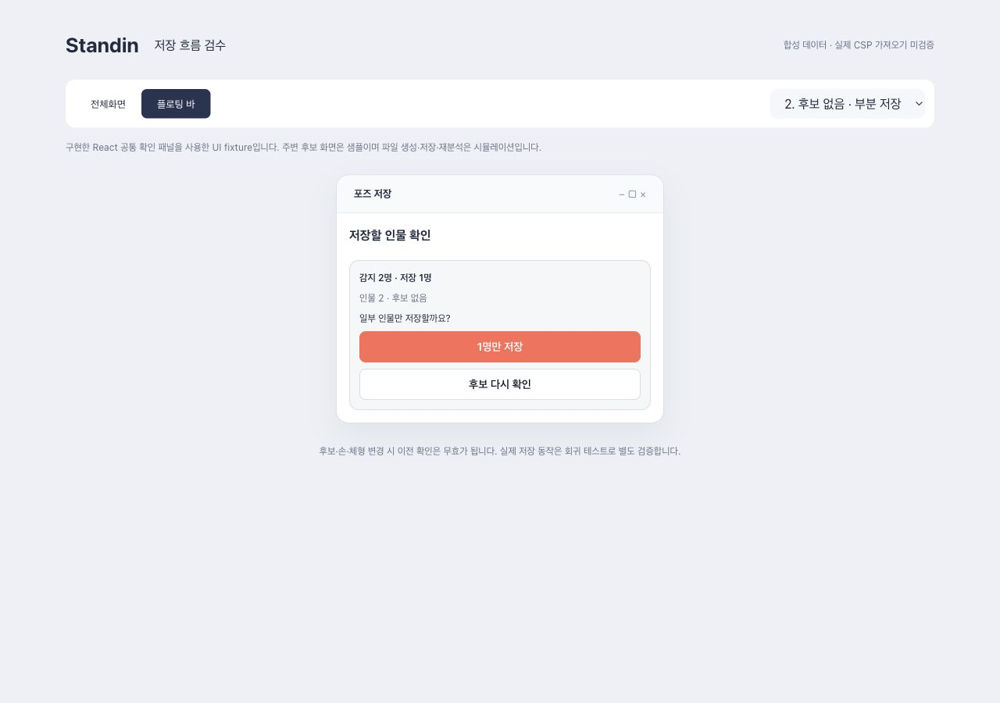

# 감지 인원·부분 저장 및 CSP 구도 상태 (2026-10-28)

기존 `scene-save-v1`, original-selection/auto-correct-v4, 인물별 체형·손·범위 검수와 reviewKey·SHA 검증을 재사용한다. 이번 변경은 기능 활성화·배포 또는 포즈/상대 배치 계산을 수행하지 않는다.

## 사용 흐름

앱 `SavePage`와 바 `BarSavePage`는 같은 `useSaveFlow`, `SaveCoveragePanel`을 사용한다. 감지 인원과 실제 저장 인원, 후보 없음/저장 가능한 후보 없음/사용자 직접 제외/선택 안 함을 구분한다. 일부만 저장하면 “N명만 저장” 또는 “후보 다시 확인”을 먼저 고른다. 선택·제외·소유자·체형·손·범위 변경은 기존 확인과 검수 자료를 무효화한다. 앱/바 전환은 동일 입력에 대한 확인만 공유하며 확인 상태는 영속 저장하지 않는다.

FBX 통합이 불가능하면 짧은 사유와 “개별 파일로 저장” 확인을 표시한다. 포맷이 BVH로 내려가는 경우도 FBX를 요청한 이미지 작업에는 같은 확인을 적용한다. 실패한 scene 호출을 개별 파일로 자동 전환하지 않는다. 단축키·폴더 변경·재시도도 확인을 우회하지 못한다. 선택하지 않은 generation 후보는 막지 않으며 선택된 최종 후보에 대한 BFF eligibility와 기존 release 권한을 사용한다. BFF는 prepare/release 때 실제 선택·검수 URL·revision·SHA를 재검증한다.

## BFF 연결

`capabilities.sceneSaveContract.manifestVersion=csp-scene-manifest-v1`을 협상한 작업은 기본 통합도 `/scene` prepare/release를 사용한다. `sceneAvailability`의 모드별 available/reasons와 candidateEligibility를 읽고, metadata 저장소 사용 가능 여부도 확인한다. 구 전체 binary 계약은 유지한다.

prepare의 job/원본 identity·이미지 SHA/크기(제공된 경우)·saveMode·layoutVersion·FBX SHA·인원 집합·누락 사유·fileCount=1을 검사한다. release는 같은 references, excludedPersonIds, reviewKey, artifact SHA를 사용하고 부분 저장이면 확인한 snapshot SHA를 제출한다. binary의 manifest 버전·snapshot SHA·인원·파일 수·모드·버전·실제 SHA·FBX magic이 불일치하면 쓰기 전에 거부한다. 기존 v4 summary·만료·미리보기 검증도 유지한다.

검증된 manifest는 `SaveCandidateInput.sceneMetadata`로 같은 FBX writer에 전달한다. Tauri는 충돌 없는 FBX 이름에 맞춰 `.scene.json`을 함께 생성하며 둘 중 하나라도 기존 파일이면 새 일련번호를 사용한다. 보조 파일 쓰기 실패 시 이번에 만든 파일만 정리하고 실패를 보고한다. 일반 파일 확장자 허용 목록은 늘리지 않는다. 브라우저 fixture 어댑터는 선택 폴더 또는 ZIP 안에 FBX와 JSON을 함께 둔다. 보조 JSON은 CSP가 자동 적용하는 파일이 아니다.

현재 BFF는 Converter의 전체 카메라 레시피를 받지 못한다. 따라서 검증 가능한 계약은 `scene-camera-v1/status=unavailable/recipe=null/automaticApplication=unsupported/cspValidation=unverified`다. 알 수 없는 레시피/캡처 매핑 계약을 임의 해석하지 않고 거부한다. 향후 실제 레시피와 캔버스 매핑을 제공할 때 별도 계약 및 소비자 검증이 필요하다.

## 원본과 파일명

현재 job의 `sourceImage.originalName`을 우선한다. 구 BFF 라이브 분석은 요청 시 사용한 File.name을 해당 응답 job에 묶는다. 다른 draft 이름은 사용하지 않는다. 구 작업에 이름이 없으면 jobId 기반 중립 이름을 쓴다. 썸네일/선택/출력/파일명이 T001을 가리키고 p0718 초안이 섞이지 않는 실제 공통 hook 회귀가 있다.

## 시간 초과

BFF `ANALYSIS_TIMEOUT`, 상류 `ANALYSIS_UPSTREAM_TIMEOUT`, 클라 deadline 안내는 실시간과 기록에서 같은 분석 단계 문구를 사용한다. 원인 코드는 유지한다. `SCENE_TIMEOUT`은 “장면 준비 시간이 초과됐어요”로 구분하고 새 준비·확인을 요청한다. HTTP 종료가 서버 작업 취소를 보장하지 않으며, 서버의 지속 가능 안내를 표시한다.

분석 query의 retry/refetchOnMount/reconnect 차단을 유지한다. 명시적 재시도는 동시 클릭을 한 번으로 제한한다. 실패한 기록의 원본을 내려주는 BFF 경로는 없으므로 기록에서는 “원본 다시 선택”으로 새 입력 미리보기→분석 시작에 연결한다. 현재 다른 초안을 자동으로 재분석하지 않는다. 원본을 보유하지 않는 기록의 원클릭 재분석은 이번 구현에 없다.

## CSP 지원 조사와 실제 검증 범위

공식 문서는 [FBX 포함 3D 파일 가져오기/드롭](https://help.clip-studio.com/en-us/manual_en/660_3d/Importing_3D_Files.htm), [CSP 내부 카메라 조작/숫자 설정](https://help.clip-studio.com/en-us/manual_en/660_3d/Set_camera_angle.htm), [투영·위치·주시점·롤 설정](https://help.clip-studio.com/en-us/manual_en/810_subtools/C.htm)을 설명한다. 이 문서에서 외부 JSON 레시피 자동 적용 인터페이스는 확인하지 못했다. 일부 소재의 카메라 프리셋 지원이 임의 FBX/JSON의 자동 적용을 보장한다고 해석하지 않는다. 직접 연결은 현재 클라이언트에서 미지원이다.

합성 큐브 2개와 카메라 1개의 FBX를 Blender로 생성하고 별도 1000×768 CSP 캔버스에서 가져오기를 시도했다. 앱 외부 조작이 감지되어 파일 열기 완료 전에 UI 검증을 중단했다. **CSP 가져오기 성공이나 카메라 반영 증거가 아니다.** 원문 5컷/실제 FBX/evidence는 전달되지 않아 재현하지 않았다. Windows/macOS 설치 앱의 native 저장·CSP 적용 E2E는 미완료다.

## 샘플과 회귀

`npm run dev -- --config preview/vite.config.ts --host 127.0.0.1 --port 1437` 실행 후 `/preview/csp-layout.html`을 연다. `node preview/build.mjs`는 네트워크 자산 없이 열 수 있는 `../outputs/preview/index.html`도 만든다.

샘플은 구현 React 공통 패널을 사용하는 합성 UI fixture다. 주변 원본·후보와 저장/재시도는 시뮬레이션이며 실제 앱 전체의 동작을 대체하지 않는다. 앱/바 각각 전체 저장·후보 누락·사용자 제외·통합 불가·CSP 카메라 상태·기록 파일명·분석 timeout·장면 timeout을 전환한다. 16개 상태를 캡처하고 확인/저장/중복 재시도 차단을 화면에서 검사했다.

`api/fixtures/csp-scene-bff-wire.json`은 별도 BFF worktree 실제 핸들러의 로컬 응답이다. 인증 소유 저장소·원본·Converter·FBX 바이트는 synthetic이며 실제 S3/설치 앱/CSP E2E가 아니다. `sceneMetadata.test.ts`와 `cspSceneFlow.test.tsx`가 해당 scene wire, 실제 HTTP adapter와 hook, 메타데이터 보관/불일치 거부를 검사한다. 후자의 인물별 review 다운로드와 native writer는 격리 경계다. 기존 v4 joined-handler 재생 테스트는 그대로 유지한다.

