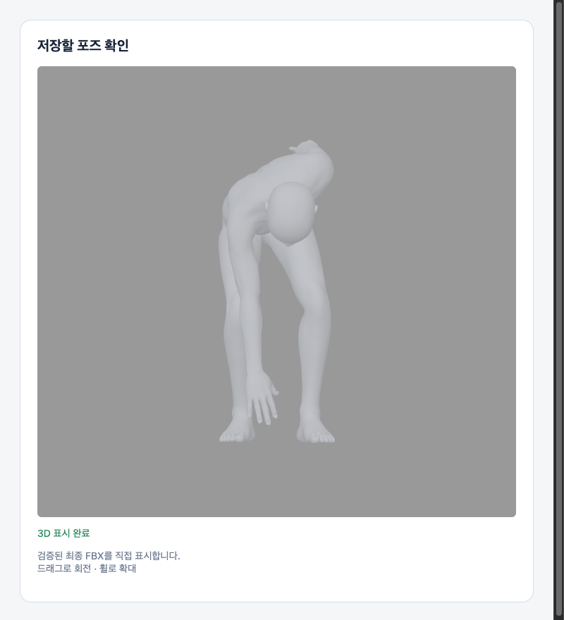

# 최종 결과 미리보기: 검증된 FBX 직접 표시

기존 `ready → final PNG → img` 대신 `ready → final FBX → 앱 3D`로 표시한다.
전체화면·플로팅바의 공통 `useFramedReview`/`ReviewModelPreview` 경로에 적용한다.
최종 체형·수치·손·출력 범위와 카메라가 이미 적용된 **같은 FBX**를 사용한다.
기본 인체로 임의 대체하거나 FBX 검증을 생략하지 않는다. Top5·RC4·interactive solver는 그대로다.

## 서버 연결과 호환성

- BFF의 검증 응답에 `X-Standin-Local-Preview: fbx-v1`이 있을 때만 활성화한다.
- `format=review-fbx`는 다운로드와 동일한 소유권·확정 선택·체형·손·runtime·receipt 검사를 수행하고 같은 바이트를 전달한다. Converter 재실행·PNG 렌더·내보내기 통계 증가는 없다.
- 매번 review key, FBX/BVH/체형 SHA, 출력 범위, 체형·손 revision을 대조하고 파일 SHA256까지 검증한다.
- 구 BFF에는 기존 PNG 경로를 사용한다. FBX 파싱·WebGL 실패 때만 정확한 최종 파일의 PNG로 복구한다.
- 다운로드 준비 상태는 3D/PNG 표시 성공을 기다리지 않는다. 파일이 검증되면 기존대로 버튼을 활성화한다.

## 파일 재사용

미리보기에 받은 바이트는 설치별 메모리에 최대 3개·60 MiB·5분만 보관한다. 디스크에 별도 저장하지 않는다.
저장 버튼을 누르면 동일한 다운로드 URL에 **HEAD 요청**을 보내 서버가 소유권·현재 선택을 다시 검증하게 한다.
서버 응답의 모든 lineage가 같을 때만 기존 바이트를 기존 저장 흐름에 전달한다. 변경·철회·오류 시 저장을 차단한다.
캐시가 없으면 기존 GET 다운로드를 사용한다. 체형·손·선택 변경 시 관련 미리보기와 캐시를 무효화한다.

## 표시 정확성

FBX의 첫 저장 프레임을 평가한다. 스킨·모프 변형과 원래 부드러운 법선을 정적 표면에 반영하므로 셰이더가 원본 T포즈로 그리지 않는다.
최종 파일의 좌표 변환을 사용하고 카메라 회전을 중복 적용하지 않는다. 최종 미리보기는 회전·휠 확대가 가능하며 이동은 비활성화한다.
외부 텍스처 요청은 차단한다. 지원되지 않는 파일은 PNG로 복구한다. 최종 FBX 바이트 자체는 변경하지 않는다.

## 검증과 성능 범위

- 클라 전체 테스트, 타입 검사, 빌드 통과. Node 26 로컬 테스트는 `NODE_OPTIONS=--no-experimental-webstorage npm test`로 실행한다(CI는 Node 22).
- 기존 다운로드 검증, 늦게 도착한 응답 취소, 파일·체형·손 변경, 권한 철회, legacy fallback, 3D 실패 후 PNG 복구를 확인했다.
- 로컬 FBX 4개(남성 걷기·깊은 굽힘, 여성 굽힘, yaw 35° 파일), 각각 15만 표시 정점: 파싱·표면 준비 약 **0.13~0.17초**.
- Blender 5.2 재로드 표면과 비교: 모델 최대 길이 대비 최대 표면 오차 < **0.0001%**, 법선 각도 오차 최대 **0.08°**. 원래 스무딩을 보존한다.
- 아래 화면은 실제 새 렌더러를 실행한 로컬 Chrome WebGL 검수 화면이다. 앱 전체 E2E나 스테이징 검증 화면은 아니다. Windows 네이티브 검증은 미실행이다.
- 기존 스테이징 로그 두 사례의 PNG 단계 6.636/7.081초가 정상 3D 경로에서는 없어지는 구조다. **전체 대기시간 단축 실측으로 보고하지 않는다.** 다운로드·JS 파싱·GPU 표시 비용은 남고, 최초 FBX 생성·체형·손 계산도 남는다.
- 별도 서버/인프라 최종 FBX 캐시 최적화와 함께 적용 가능하지만 이 변경의 필수 의존성은 BFF의 local-preview 계약뿐이다.
- 이번 작업에서는 병합·스테이징/운영 배포를 수행하지 않았다.

[표면·법선 비교 수치](validation/final-review-direct-3d-20261112/geometry-comparison.json)
