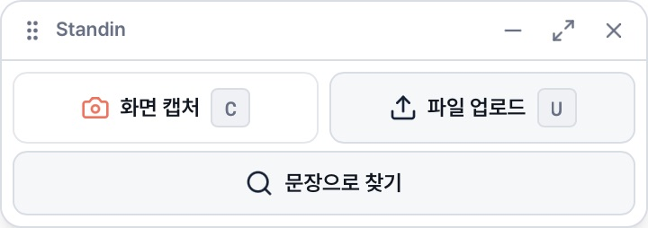
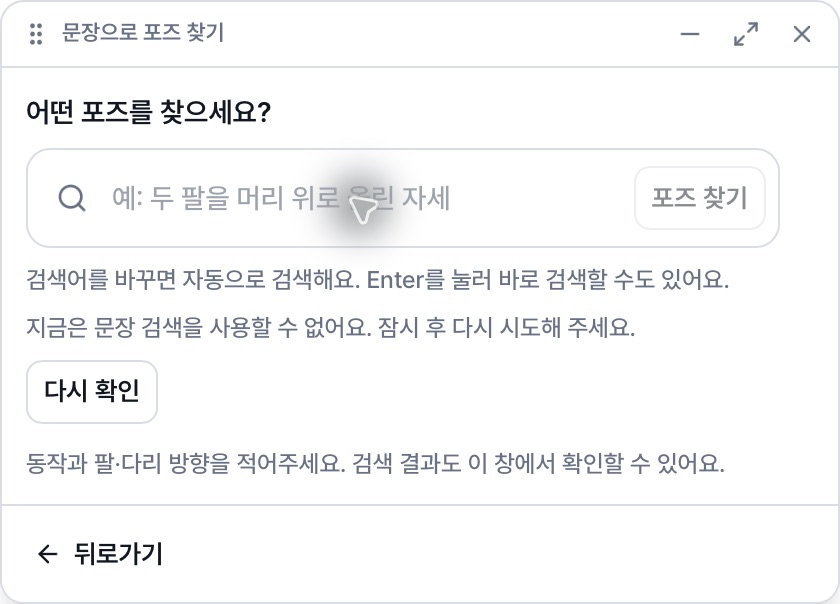
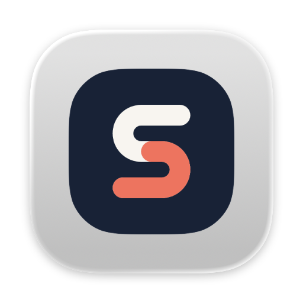
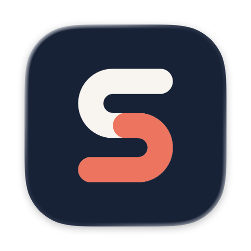

# 플로팅 바·브랜드 자산 최종 검증 (2026-10-20)

## 최종 확정 로고

사용자가 `Standin Icon QA`에서 확인하고 승인한 최신 정사각형 PNG를 앱 아이콘으로 사용한다. 원본은 `src-tauri/icons/standinLogo.png`, 웹 favicon은 동일한 `public/standinLogo.png`다. 이 PNG로 desktop 아이콘 17개를 생성했고 macOS ICNS에는 불투명 남색 정사각형 배경을 유지한다. 사용자가 별도로 지정한 원형 SVG는 `public/favicon_circle.svg`에서 접힌 플로팅 바 전용으로 그대로 유지한다.

2026-10-21 Windows 아이콘 수정: Windows 실행 파일·NSIS 설치/제거 아이콘은
`src-tauri/icons/windows-icon.svg`의 남색 정사각형 바탕과 흰색·코랄색 S 로고를 사용한다.
`npm run icons:generate -- --windows`로 `icon.ico`만 생성하고,
`npm run icons:check -- --windows`로 원본과의 일치를 검증한다.
ICO 변경은 Rust 빌드 입력으로 추적하며, NSIS 설치·업데이트 완료 시
Windows Shell에 실행 파일과 등록 아이콘의 변경을 알려 이전 바로가기 캐시를 갱신한다.

새 앱 아이콘과 기존 원형 바를 함께 담은 별도 macOS debug QA 번들을 생성하고 실행했으며 사용자가 최종 조합을 승인했다. 추가 테스트·전체 제품 빌드는 요청에 따라 생략했다. 헤더·검색 뒤로가기와 클릭 가로채기 코드는 바꾸지 않았다. **아래 테스트·이미지·해시 및 시스템 아이콘 비교는 이전 SVG 앱 아이콘 버전의 기록이다.**

## 이전 SVG 앱 아이콘 버전 검증 기록

## 최종 사용자 요구 반영

- 헤더: `[점 6개] 제목 · 드래그 영역 [−][확대][×]`. 헤더에는 뒤로/앞으로 버튼을 두지 않는다.
- `−`는 원형 로고로 접고, 확대는 현재 단계를 앱 창에서 이어 열며, `×`는 기존 native close command로 창을 닫는다.
- 메인 본문은 develop의 BarActionsPage와 바이트 단위로 같다. 추가했던 `현재 작업 이어보기`와 resume route-state 처리는 제거했다. 메인에만 불필요한 scrollbar gutter를 예약하지 않아 좌우 여백도 같게 했다. 후보 화면의 gutter는 유지한다.
- 캡처·이미지 후보 화면의 기존 `처음으로`·확인/저장 단계의 기존 동작은 유지한다. 새 뒤로가기를 중복으로 넣지 않는다.
- 자연어 입력 화면 하단 왼쪽의 `← 뒤로가기`는 `/bar/actions`로, 자연어 결과 화면 하단 왼쪽은 현재 검색어를 route state로 넘겨 `/bar/search`로 돌아간다. `history(-1)`는 사용하지 않는다.
- 뒤로가기는 job·초안·인물별 후보/체형·손/체형 Query 캐시·저장 결과를 초기화하거나 분석/저장을 새로 시작하지 않는다. 검색어는 기존 in-memory draft와 명시적 query seed로 유지한다.
- 후보에서 보던 인물 커서는 installation + job 키로 보존한다. 다른 작업에는 이전 인물 위치를 섞지 않는다.

메인 복원·헤더 (macOS native fixture):

자연어 하단 뒤로가기 (서버를 연결하지 않은 fixture이므로 검색 불가 안내가 있다):

## macOS 드래그 확인

기존 bare `data-tauri-drag-region`은 점 SVG·제목 span을 직접 누르는 경로를 놓칠 수 있다. 실제 native fixture에서 `deep` 속성 변경만으로는 이동이 확인되지 않았다. 최종 구현은 점·제목·빈 영역 핸들의 primary mousedown을 명시적으로 `startDragging()`에 전달하고, 해당 SDK를 adapter와 함께 로드해 첫 드래그 도중의 동적 import 지연을 없앤다. 우클릭/Control-click과 핸들 밖 창 제어 버튼은 드래그에서 제외한다. 새 패키지/권한·native 위치 추적 코드는 추가하지 않았다.

macOS 26.6.2 arm64 실행본의 실제 좌표가 최초 `(500,400)`에서 `(631,406)`, 이후 `(622,410)`으로 바뀐 것을 관측했다. fixture 계측은 실제 native API 호출 횟수와 클릭 대상 SVG/SPAN을 기록했다. [AX 좌표 증거](qa/floating-brand-20261020/native-drag-after.ax.txt). 자동화의 빠른 drag gesture만으로는 이동이 안정적으로 재현되지 않았으므로 이 관측을 Windows 검증이나 모든 macOS 드래그 조건의 보장으로 확대하지 않는다.

## 로고 원본과 플랫폼별 생성

- 제공된 원본 `favicon.svg`를 `src-tauri/icons/favicon.svg`와 `public/favicon.svg`에 바이트 그대로 유지한다. `.gitattributes`로 원본 CRLF도 보존한다.
- 제공된 `favicon_circle.svg`는 그대로 `public/favicon_circle.svg`에서 접힌 바의 이미지로 사용한다. 바깥 배경·border·shadow가 없고 원형 clip과 안쪽 focus outline을 적용한다.
- `npm run icons:generate`는 원본에서 desktop PNG 15개·Windows ICO를 만들고, macOS ICNS는 아래의 파생 배경으로 생성한다. 모바일 자산은 저장하지 않는다.
- macOS에만 원본 배경 rect의 `rx`를 제거한 `favicon-macos.svg`를 재현 가능하게 생성한다. S 경로·색·위치·비율은 그대로이고 정사각형 배경만 끝까지 불투명하다. 원본 배경 형식이 바뀌면 스크립트가 실패해 검토 없이 다른 로고로 생성하지 않는다.
- `icons:check`는 두 source 경로에서 임시 재생성해 모든 desktop 자산과 public 원본·macOS 파생 원본의 일치를 검사한다. ICNS chunk 순서는 비결정적이라 typed payload를 정렬해 비교한다.

### macOS Dock의 회색 이중 배경

사용자가 확인한 대상은 미머지 코드의 `Standin Click QA`다. 기존 설치 Staging 앱에 새 로고가 적용됐다는 뜻이 아니다. 원본 및 기존 ICNS에는 회색 padding이 없었지만, macOS Icon Services가 기존 QA 번들을 합성한 결과에서는 회색 판 안에 작은 남색 로고가 들어간 현상을 재현했다.

[Apple HIG](https://developer.apple.com/design/human-interface-guidelines/app-icons)는 iOS/iPadOS/macOS의 square layout과 시스템 마스킹, 불투명 full-bleed 배경을 안내한다. macOS용 파생 원본을 사용하는 비교 번들에서는 시스템 합성 결과가 남색 바탕 한 겹으로 바뀌었다.

| 변경 전 OS 합성 | 변경 후 OS 합성 |
| --- | --- |
|  |  |

위 이미지는 Swift의 `NSWorkspace.icon(forFile:)`와 CGImage API로 macOS Icon Services의 렌더링을 읽은 것이며, 임의로 그린 그림이나 Dock screenshot이 아니다. 비교본 경로는 전용 워크트리 `src-tauri/target/debug/bundle/macos/Standin Dock QA.app`, 식별자는 `app.standin.dock-qa-20261020`이다. 이 별도 번들의 Info.plist가 참조하는 ICNS와 생성 자산의 SHA도 일치한다. 설치 앱 교체·Dock 설정 변경·icon cache 초기화는 하지 않았다. 별도 QA 앱을 다시 띄운 뒤 사용자가 `Standin Dock QA는 제대로 떠`라고 확인했다. 이 응답을 실제 Dock 표시 대조 결과로 기록한다. macOS 15 이하 표시는 미검증이다.

## 검증 결과

| 검사 | 결과 |
| --- | --- |
| 전체 Vitest, bundled Node 24 | 최신 develop 통합 후 991 통과, 기존 skip 1 (123 files 통과) |
| bar + mode route 테스트 | 64 통과: 헤더 순서·close·접기·본문 뒤로가기·상태/검색어 보존·드래그 대상/버튼 분리·기존 클릭/메뉴·창/캡처 왕복 |
| typecheck / lint / production build | 통과. 기존 BodyCandidates fast-refresh 경고 1개, bundle 크기 경고와 드래그 API 선로딩에 따른 event 모듈 정적/동적 import 안내 |
| `icons:check` | desktop 자산 17개와 파생 원본 일치 |
| PNG/ICO/ICNS 검사 | PNG 15개와 ICO 모든 size는 기존 투명 모서리 유지, ICNS 모든 frame은 alpha 255의 불투명 square, S 중심 색/위치 유지 |
| macOS debug app bundle | 생성 성공, CFBundleIconFile가 참조하는 ICNS와 생성 자산 일치 |
| 원본 SHA | public 원본 SVG 두 개가 제공된 사본과 바이트 일치 |
| native UI | 복원 메인, 하단 뒤로가기, 메인 복귀와 실제 창 좌표 변경 관측 |
| Rust | native 코드를 바꾸지 않았다. 종전 창 모드 테스트 5개와 PR의 macOS/Windows CI 통과 이력이 있다. 최신 remote CI는 PR에서 확인 |

## 남은 문제와 검증 한계

- **원 밖 사각 창 영역의 클릭 가로채기는 아직 미해결이다.** 이전 native fixture에서 로고 중심은 정상 펼침, 창 바깥 양성 대조는 아래 Chrome 카운터 0→1, 원 밖 네 모서리는 모두 1→1로 수신되지 않았다. [원래 재현 JSON](qa/floating-brand-20261020/native-click-check.json). 이번 헤더/본문/Dock 작업이 이 문제를 해결했다고 주장하지 않는다.
- 기존 설치 앱은 교체하지 않았다. Windows native UI, 실제 캡처·서버 분석·저장, 다중 모니터/DPI 전체 수동 흐름은 미검증이다. fixture는 설치 인증/동의 초기화를 수행하지 않았다.
- 이전 `bar-header-browser.png`는 헤더 반복이 있는 잘못된 증거여서 제거했다. 이후 native 화면에서는 헤더 한 줄로 정상 표시됐다. 캡처 원인은 확정하지 않았다.
- 최초 전체 Rust 테스트의 기존 secure_store roundtrip이 기본 서비스의 레거시 refresh_token 삭제를 시도한 뒤 키체인 쓰기에서 실패한 이력이 있다. 이전 token 존재 여부를 알 수 없어 영향을 단정할 수 없다. 설치 인증정보/동의 계정은 그 테스트 대상이 아니다. 이후 QA bundle은 별도 식별자/키체인 서비스를 사용하고 전체 native 테스트를 재실행하지 않았다.
- #121·#122와 #124가 합쳐진 최신 develop `42d40f5`를 merge commit `7996259`로 통합했다. AppTitleBar/WindowControls와 다른 세션의 BodyCustomPage/LiveBodyView/shapeRuntime은 수정하지 않았다. BarActionsPage는 최신 develop과도 바이트 단위로 같다. PR 머지·배포는 하지 않는다.
