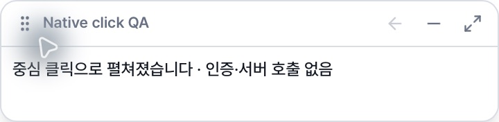

# 플로팅 바 뒤로가기·브랜드 자산 검증 (2026-10-20)

## 변경과 상태 경계

헤더에 아이콘 전용 `뒤로가기`를 접기 바로 왼쪽에 추가했다. 브라우저 이력을 읽지 않으며 로그인·전체 앱·이전 작업으로 이동하지 않는다.

| 현재 단계 | 뒤로가기 |
| --- | --- |
| 입력 선택 `/bar/actions` | 비활성 |
| 문장 입력 `/bar/search` | 입력 선택 |
| 작업 생성 `/bar/progress` | 비활성 (재진입 시 새 작업 생성 방지) |
| 후보 `/bar/candidates` | 입력 선택 + 같은 job에만 `현재 작업 이어보기` |
| 저장 전 확인 `/bar/review` | 현재 작업 후보 |
| 저장 `/bar/save` | 저장 전 확인 (해당 작업이 저장 중이면 비활성) |
| 작업 없는 확인/저장·알 수 없는 경로 | 비활성 |

뒤로가기는 스토어 reset/clear, 후보 선택 변경, 쿼리 invalidate를 호출하지 않는다. 초안·인물별 후보/체형·손/체형 Query 캐시·조정본·저장 경로는 기존 상태를 유지한다. 후보에서 보던 인물 커서는 installation + job 키로 보존하고 다른 작업에는 0부터 시작한다. 입력 선택의 이어보기는 후보에서 돌아올 때 전달한 job과 현재 job이 같을 때만 나타난다. 새 입력/새 검색 시작은 기존의 명시적인 새 작업 동작이다.

## 로고와 투명 범위

- 제공된 `favicon.svg`를 바이트 그대로 `src-tauri/icons/favicon.svg`에 보관한다. 브라우저의 `public/favicon.svg`도 동일하다. `.gitattributes` 예외로 원본 CRLF까지 보존한다.
- 제공된 `favicon_circle.svg`는 바이트 그대로 `public/favicon_circle.svg`에서 접힌 바의 ``로 사용한다.
- `npm run icons:generate`: 둥근 사각형 SVG로 desktop PNG 15개·ICO·ICNS를 갱신한다. 모바일 자산은 추가하지 않는다.
- `npm run icons:check`: 임시 디렉터리에서 재생성 후 17개 파일과 브라우저 원본의 일치를 검사한다. ICNS는 비결정적인 chunk 순서를 정규화하고 typed payload를 비교한다.
- 접힌 버튼의 코랄 배경·ring을 제거했다. 이미지의 native drag를 끄고 원형 clip으로 버튼의 웹 hit 영역을 제한한다. 투명한 padding에는 pointer-events가 없다. 포커스는 원 안쪽 outline으로 표시한다.
- 기존 `WindowModeSync`의 bar 모드 전용 html/body/root 투명 처리와 Tauri `transparent: true`, `shadow: false`, macOSPrivateApi 및 macos-private-api를 확인했다. 확대된 BarShell은 기존 불투명 surface/border/shadow를 유지하며 전역 CSS나 네이티브 창·모니터 코드는 변경하지 않았다.

## 확인한 증거

| 검사 | 결과 |
| --- | --- |
| 전체 Vitest (bundled Node 24) | 986 통과, 1 기존 skip (최종 변경 기준 재실행) |
| 최신 bar 테스트 | 58 통과: 뒤로가기/상태 보존·이어보기·커서 remount·클릭/드래그·우클릭/Control-click·메뉴 키보드·창/캡처 왕복 |
| typecheck / lint / build | 통과. 기존 BodyCandidates fast-refresh 경고 1개, 기존 bundle 크기 경고 |
| `icons:check` | desktop 자산 17개 일치 |
| Pillow 자산 검사 | PNG 15개 및 ICO/ICNS 모든 frame의 크기 확인, 모서리 alpha 0·중심 alpha 255 |
| 원본 비교 | 사용자 SVG 사본과 public SVG 바이트/SHA-256 일치 |
| macOS debug `.app` 생성 | 성공. Info.plist의 CFBundleIconFile이 icon.icns를 참조하고 번들 내부 ICNS가 생성 자산과 바이트 일치 |
| Rust 창 모드 테스트 | 5개 통과 (모니터 크기, Retina·fractional DPI, 잘못된 제한값 포함) |
| headless Chrome 로컬 fixture | 에러 0, 64×64/2x 접힌 로고의 html/body/root 투명, 버튼 border 0·shadow none·circle clip; Enter 펼치기, 첫 단계 비활성, review→candidates→actions→현재 작업 이어보기 확인 |

PNG/ICO/ICNS 크기와 alpha, SVG hash, 브라우저 computed style, 번들 검사는 [증거 디렉터리](qa/floating-brand-20261020)에 JSON으로 저장했다. 스크린샷은 실제 컴포넌트를 MemoryRouter/QueryClient에 마운트한 fixture이며 설치 앱의 화면이 아니다. 서버 분석/저장은 호출하지 않았다.

접힘과 키보드 포커스 (Chrome fixture):

펼친 바의 macOS native fixture 헤더 (뒤로가기 비활성):

기존 `bar-header-browser.png`는 헤더가 반복되는 잘못된 이미지여서 정상 UI 검증 근거에서 제외했다. 원인은 아직 확정하지 않았다. 이후 macOS Tauri/WKWebView native fixture를 다시 실행해 직접 펼친 화면에서는 헤더 한 줄과 버튼 3개가 정상 렌더링됐고 반복 현상은 재현되지 않았다. 이는 실제 컴포넌트와 Rust 백엔드를 쓰는 격리된 검증 실행본의 결과이며, 기존 설치 앱을 교체하거나 전체 사용자 흐름을 검증한 결과는 아니다.

## 후속 macOS 네이티브 클릭 검사 — 실패 재현

사용자 요청으로 macOS 26.6.2 (25G83), arm64에서 별도 `Standin Click QA.app`을 실행했다. PR 커밋 `31abc63`의 실제 BarCollapsedPage·BarShell·WindowModeSync와 수정하지 않은 Rust 창 백엔드를 사용한 native debug fixture다. 식별자·키체인 서비스는 `app.standin.click-qa-20261020`으로 분리했고 인증/동의 초기화·서버 호출·기존 설치 앱 교체는 하지 않았다.

아래 Chrome에는 클릭 카운터가 있는 로컬 페이지를 놓고 CUA의 native 좌표 클릭을 사용했다. 브라우저 DOM 클릭을 이 검사에 사용하지 않았으며, DOM은 카운터를 읽는 데만 사용했다. 창은 64×64 logical px, 스크린샷은 Retina 128×128 px다.

| 실제 포인터 클릭 대상 | 아래 앱 카운터 | 바 결과 |
| --- | --- | --- |
| 원형 로고 중심 (스크린샷 64,64) | 0 → 0 | 정상 펼침 |
| 접은 뒤 바깥 padding (2,2) | 0 → 0 | 접힘 유지, HTML content에 포커스 |
| 바와 떨어진 Chrome 영역 — 양성 대조 | 0 → 1 | 아래 앱이 정상 수신 |
| 원 밖 좌상단 (12,12) | 1 → 1 | 아래 앱 수신 없음 |
| 원 밖 우상단 (116,12) | 1 → 1 | 아래 앱 수신 없음 |
| 원 밖 좌하단 (12,116) | 1 → 1 | 아래 앱 수신 없음 |
| 원 밖 우하단 (116,116) | 1 → 1 | 아래 앱 수신 없음 |

**결과: 현재 macOS native fixture에서 원 밖 사각 창 영역이 아래 앱의 클릭을 가로챈다.** 웹 버튼의 circle clip/pointer-events 설정만으로 OS 창의 hit 영역은 줄어들지 않은 상태다. 이 검사는 문제 확인이며 아직 코드 수정은 적용하지 않았다. 검증 앱은 검사 후 종료했다. Windows native UI는 여전히 미검증이다.

좌표별 결과는 [native-click-check.json](qa/floating-brand-20261020/native-click-check.json), 실제 창과 아래 앱은 [native bar](qa/floating-brand-20261020/native-bar.png), [below counter](qa/floating-brand-20261020/below-counter.png)에 남겼다. 앱 단위 캡처는 다른 앱의 창을 합성하지 않으므로 두 이미지는 서로 별도 캡처다. 캡처의 흰 배경만으로 compositor alpha를 판정하지 않았다.

## 검증하지 않은 범위와 후속 확인

- 설치 앱은 교체/실행하지 않았다. macOS native fixture의 클릭 가로채기는 위에서 실패 재현했다. 설치 앱 compositor 투명도와 Windows 클릭 통과, native 이동·우클릭 메뉴, 다중 모니터/배율에서의 실제 조작은 미검증이다. Windows installer도 빌드하지 않았다.
- Chrome에서 투명 모서리는 button이 아닌 root DIV로 hit-test된다. 버튼의 웹 hit 영역 확인을 OS 차원의 click-through 증거로 취급하지 않는다. macOS native fixture에서 모서리 클릭 가로채기가 재현됐으므로 native hit-test 처리가 필요하며 PR은 draft로 유지한다.
- 수동 확인: 각 OS에서 다른 앱 위에 접힌 바를 놓고 투명 모서리/중심을 각각 클릭한다. 모서리에서는 아래 앱이, 중심에서는 펼치기가 동작해야 한다. 드래그 후 펼침 억제, 우클릭/Control-click/Shift+F10 닫기 메뉴, Tab 포커스·Enter/Space, 항상 위·모니터 이동·배율 변경·앱/바/캡처 왕복을 확인한다. 확대된 창은 불투명해야 한다.
- 전체 Rust 테스트의 기존 `secure_store::tests::roundtrip`은 기본 `app.standin.desktop` 서비스의 레거시 `refresh_token` 삭제를 시도한 뒤 키체인 쓰기에서 실패했다. 실행 전에 테스트 서비스를 격리하지 못했다. 이전 refresh token 존재 여부를 알 수 없어 영향을 단정할 수 없다. 설치 인증정보/동의 계정은 이 테스트의 대상이 아니다. 추가 실행은 창 모드 테스트로 한정했다. 이후 전체 native 테스트는 반드시 `STANDIN_KEYRING_SERVICE`를 별도 QA 서비스로 설정해야 한다. 이 PR은 인증/키체인 코드를 수정하지 않는다.

## 통합 경계

기준 develop `d35e159`. #121 `c9101b5`, #122 `1d72810`은 별도 OPEN PR로 유지한다. AppTitleBar/WindowControls와 다른 세션의 BodyCustomPage/LiveBodyView/shapeRuntime은 수정하지 않았다. 최신 develop 및 두 PR을 함께 합친 `git merge-tree` 검사는 충돌 없이 통과했다. 합성 tree의 AppTitleBar/WindowControls가 #122 버전과 정확히 같은 것도 확인했다.
