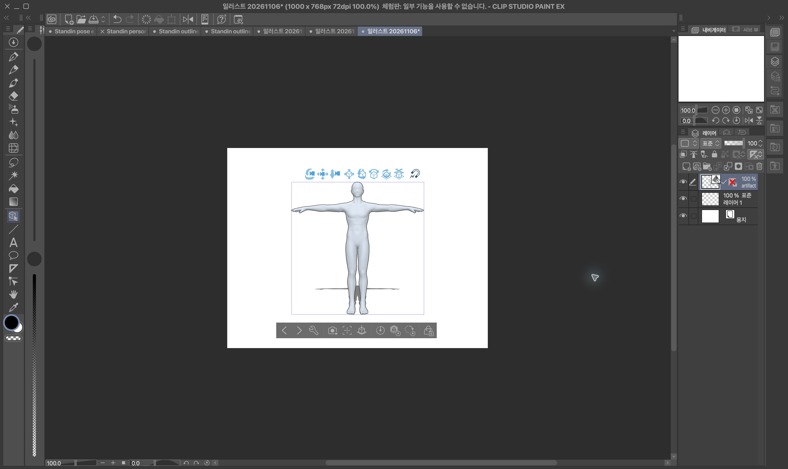
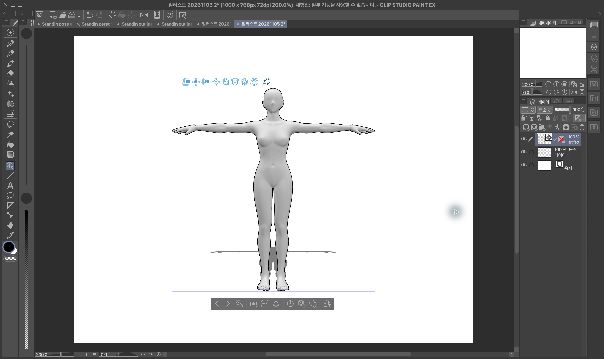
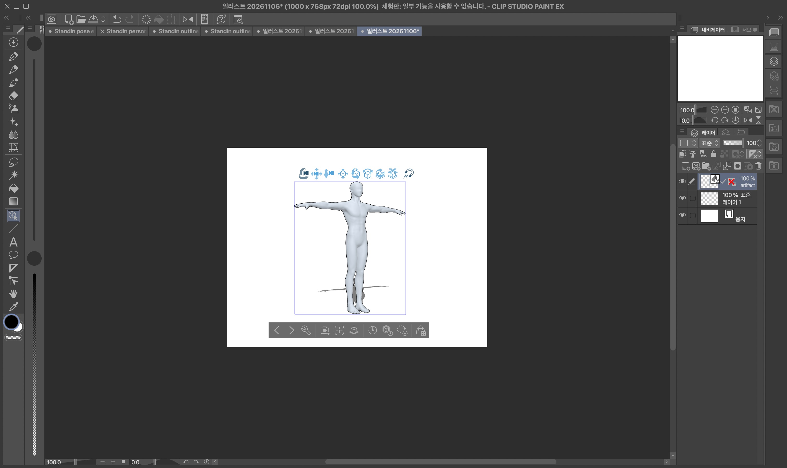
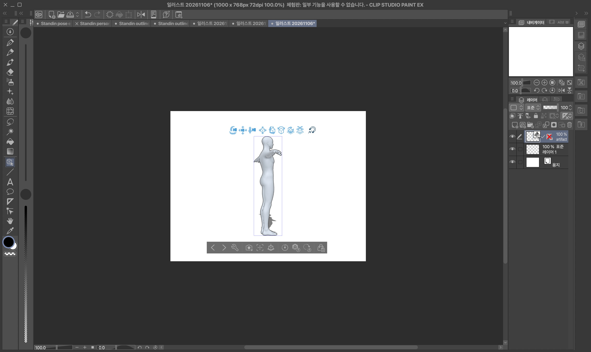
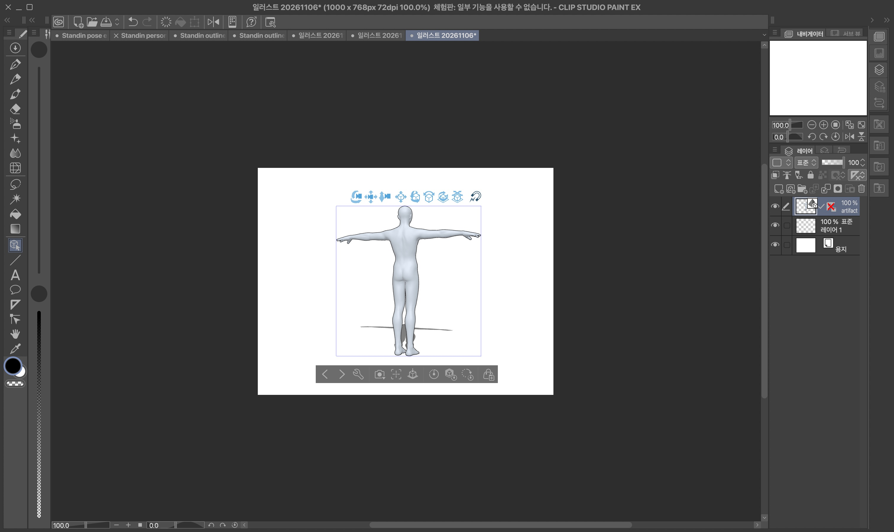
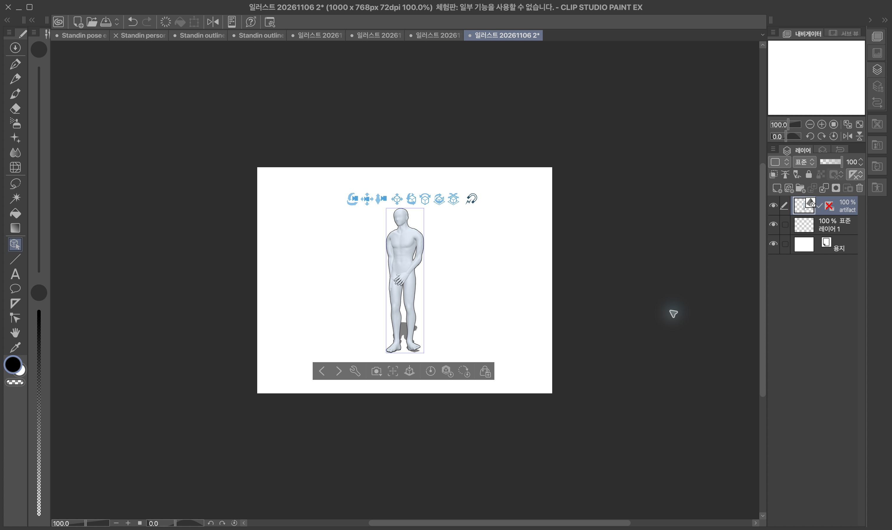
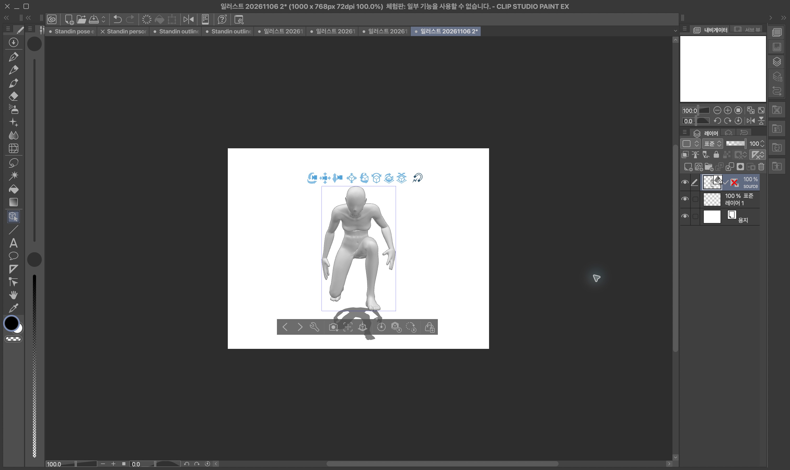
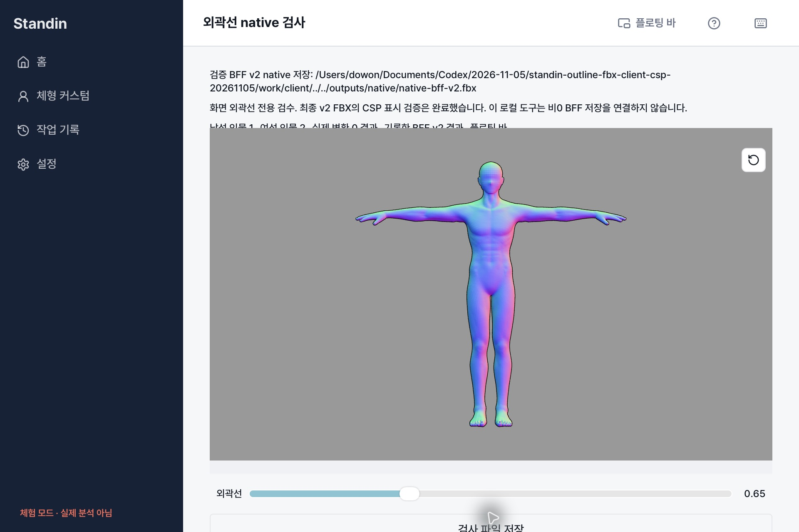
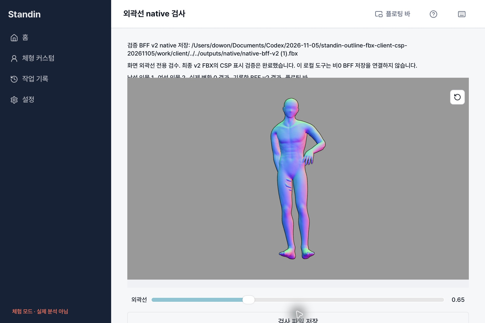
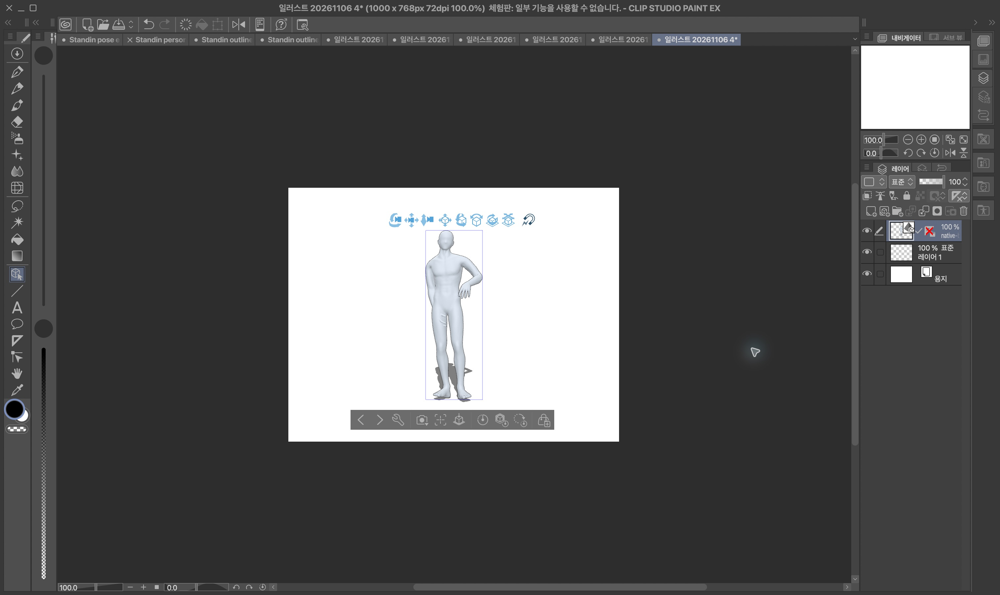

# 최종 FBX 외곽선과 CSP 검증 — 2026-11-06

**v2 최종 FBX를 CSP에 자동으로 가져오면 회색 몸체와 검은 외곽선이 함께 표시된다.** 최종 남성 파일의 정면·사선·측면·후면, 여성 파일의 정면·측면·후방 사선, 포즈가 적용된 최종 남성 발 동작·여성 crouch에서 확인했다. CSP 외곽선/컬링 설정을 수동으로 켜지 않았다.

현재 제품 범위는 **포즈 적용 → 개별 FBX 내보내기 → CSP 가져오기**다. 사용자 확인에 따라 `.clip` 저장·재열기와 CSP 내부 관절 재편집은 지원 범위 밖이며 완료의 필수 조건이 아니다. 과거 opaque inverted-hull v1의 검은 몸 실패는 이 v2의 현재 결과와 구분한다.

## 현재 표현과 저장 계약

논리 appearance는 `{version:"fbx-outline-v1",width}`를 유지한다. 표현은 `skinned-outward-transparent-native-outline-v2`, 매핑은 `csp-native-scope-stature-v2-experimental`, CullingOff + outward-transparent guide다. 원본 표면을 보존한 skinned guide와 CSP의 자동 native contour 표시를 이용한다. CSP native contour가 꺼진 환경이나 다른 3D 앱의 동일 표시를 보증하지 않는다. 물리 guide 폭은 Converter가 full stature와 출력 범위로 계산하며 고정 화면 픽셀 약속은 없다.

클라이언트는 v2 표현/매핑/guide surface/culling을 명시적으로 검사하고 v1을 계속 거부한다. 현재 #168 남녀 기본 모델의 정확한 SHA만 수용한다. 실제 CSP 표본은 full .5/.65/1/2이고, v2 매핑 계약에 따라 full은0<width≤2 연속 값을 지원한다. cropped half/bust/shoulder_head/head는 현재 검사한2만 수용한다. 범위 밖 모델·선폭·증명은 거부한다. 서버의 명시적 capability, 최종 receipt의 true 인증과 파일/원본/선택 binding/runtime/appearance/SHA/길이 검증을 모두 요구한다. allowlist 연결은 배포·전역 feature flag 활성화가 아니다.

인물별0~2 설정은 선택 상태에 보관한다. 제스처 동안 GPU만 갱신하고 끝난 뒤 서버 준비를 진행한다. 설정·포즈·체형·손·refine이 달라지면 이전 준비/저장을 즉시 무효화하고 늦은 응답을 차단한다.0은 appearance 생략으로 기존 요청/바이트 경로를 유지한다. 미지원 서버·형식에서 외곽선 없는 파일을 비0 성공으로 저장하지 않는다. scene/VRM ZIP/개인 모델 지원은 넓히지 않는다. native 쓰기는 기존 exportTauri 경로다.

## 실제 CSP 성공 증거

CSP EX5.1.1 build202607291835. 새1000×768px72dpi 테스트 캔버스만 사용했다. File→Import→3D Data 자동 가져오기이며 Basic/Realistic의 정확한 속성은 읽지 못했다. 모드 선택 창은 없었다.

| 최종 파일 | SHA256 |
| --- | --- |
| 현재 남성 full2 | `02799598d9f60899e83627446c80bf9c6f7f737a47b8b2de7e7f92612200a4e3` |
| 현재 여성 full2 | `07295db35bb6a148f14da4fad91d459ee05d1f5859225b29638b71dce9754e3b` |
| 남성 발 동작 full2 | `81a559fb4279440858a62a73f7abb6c3304039c01095ed3160c772d7ffcaa84d` |
| 여성 crouch full2 | `c47f586d0bebfeaa05f2334338734fe0d0de7b315c2d490d0a3aee5d3e35aa5e` |

최종 남성 파일의 실제 카메라 회전이다. 기존 후보 SHA505a... 사진을 최종 파일의 증거로 바꾸지 않았다. 정확한 각도·고도 보증은 없다.

| 사선 | 측면에 가까운 시점 | 후면에 가까운 시점 |
| --- | --- | --- |
|  |  |  |

| 최종 포즈 원본0 | 최종 포즈 외곽선2 |
| --- | --- |
|  |  |
|  |  |

두 포즈 모두 자세·회색 표면을 유지하고 손가락·팔·굽힌 무릎 경계의 검은 선이 표시됐다. 테스트 배율에서 큰 검은 면 채움·뚜렷한 흰 틈·이중 외곽선은 관찰되지 않았다. 남녀 full0/.5/1/2 및8개 cropped0/2비교도 완료했다. cropped head0에도 native contour가 있어2의 차이는 완만하다. 남성 bust/shoulder_head의 옆 절단면 요철은0에도 존재한다.

잔여 제한: 남성 측면 종아리/여성 측면 무릎·정강이 안쪽에 가는 점선 형태 가림 경계가 보인다. 임의의 모든 포즈/시점에서 결함 없음, 고정 화면 선폭, CSP 안에서 관절을 재조작한 성공은 주장하지 않는다. [정확한 해시·검사 범위·관찰 JSON](qa/outline-fbx-csp-20261105/csp-v2/evidence.json).

## 과거 검증과 현재 앱 연결

이전 v1 표현은 CSP에서 검은 몸으로 실패했고 계속 거부한다. [과거17개 가져오기 기록](qa/outline-fbx-csp-20261105/validation.json)은 역사적 회귀 증거다. 이전 noWindowsAvailable/Mac잠금은 해소되어 위 실제 orbit을 완료했다. 이전 Save As 라이선스 창은 현재 지원 범위 밖인 .clip에 관한 기록이다.

이전 로컬 Tauri WebView에서는 인물별 UI/앱↔바와 실제 native0 저장을 확인했다. client adapter→BFF Hono/PGlite→실제 Converter TCP/Blender의0검사도 통과했다. 그0파일을 별도 단계에서 native 저장하고 CSP에 가져왔다. 이는 비0 전체 앱 저장 성공의 증거가 아니다. tools/outline-native-qa는 로컬 재현 도구이며 제품 라우터에 연결하지 않았다. 원본 모델·토큰·패킷은 commit하지 않는다.

현재 후속 v2 BFF→client→native 비0 연결 검증은 아래 결과에서 구분해 기록한다. 서버 default-off, 병합·배포·전역 활성화·유료 추론은 수행하지 않는다.

## 검사와 companion

`NODE_OPTIONS=--no-experimental-webstorage npm test`, `npm run typecheck`, `npm run lint`, `npm run build`. Opt-in 실제 BFF/Converter wire는 `scripts/interactive-bff-wire.test.mjs`. Production installation auth/PostgreSQL advisory locking/S3와 Windows 실기는 이 로컬 검증 범위가 아니다.

- [Client #162](https://github.com/04JUNG/Standin-client/pull/162)
- [BFF #161](https://github.com/04JUNG/Standin-app-server/pull/161)
- [Converter #170](https://github.com/04JUNG/Standin-server/pull/170)

실제 로컬 HTTP에서 새로 생성된 남녀 full0.65도 자동 CSP 초기 가져오기에서 회색 표면·가는 검은 외곽선이 유지됐다. [두 정확한 SHA와 사진](qa/outline-fbx-csp-20261105/csp-v2/midpoint-results.json). 이 검사는 정면 초기 표시이며 BFF/native 저장과 구분한다.

## 후속 실제 native 저장 결과

BFF의 실제 `/outline-fbx` HTTP 처리·증명·바이트 검증을 통과한 남성 full0.65 기록을 클라이언트 receipt parser와 SHA/길이 검사에 통과시켰다. 별도 식별자 Tauri QA 앱이 기존 `exportTauri.saveCandidates`로 실제 파일을 저장했다. 저장본은 BFF 최종 파일과 바이트 단위로 같고 SHA `0d7eb8befd90ccc3203265c3527e85c2cb6ce4c222552cc2d24af7eb638cd87b`,3,896,396bytes다. [결과 JSON](qa/outline-fbx-csp-20261105/csp-v2/native-v2-results.json).

**이는 기록된 검증 원본을 이용한 BFF 실제 postprocess → client 검증 → 별도 기록 단계 → native 쓰기다. 단일 실시간 제품 저장 트랜잭션은 아니다.** BFF source/operation proof·edge auth·메모리 저장은 로컬 fixture 범위다. WebView의 diagnostic normal material을 CSP 표면 증거로 쓰지 않는다.

## 새 runtime 실제 전체 로컬 wire + native + CSP 통과

초기 실제 연결에서 발생한 head 누락은 Converter 담당의 승인 모델 import 호환 수정으로 해결됐다. 새 interactive runtime63e24eb8...에서 기존 BVH를 실제 solve/model/export하고, BFF의 v2 HTTP postprocess(별도 outline runtime292a41a2...)와 독립 Blender 검사·정규화 영수증·다운로드를 통과했다. 실제 client adapter가 head/prepare/model/export/poll/file을 수행했으며 full0.65와 BFF가 만든 선택 binding, 최종 헤더/SHA/길이를 검사했다.0도 실제 생성·검증했고 취소 후 파일은 거부됐다. `scripts/outline-v2-bff-wire.test.mjs`1검사41.26초 통과다.

이 새로운 포즈 파일을 격리된 Tauri 앱에서 다시 parser/hash검증 후 실제 저장했고, 저장본을 새 CSP 캔버스에 자동으로 가져왔다. 자세·회색 표면·가는 검은 외곽선이 유지됐으며 큰 검은 면 채움은 관찰되지 않았다. 최종 SHA `133b9d83aece9076907618d932e16e9df3c80fc2a5904f0415e239adf3be3def`,3,932,364bytes가 다운로드→native 저장에서 같다. [실제 단계·두 runtime·제한 JSON](qa/outline-fbx-csp-20261105/csp-v2/full-wire-v2-results.json).

로컬 API wire는 실제 client/Hono/PGlite/Converter TCP/Blender다. 선택·edge auth는 controlled fixture, advisory lock은 PGlite대체, private outline storage는 메모리다. Native 저장과 CSP 가져오기는 뒤따르는 기록 단계이므로 한 번의 실시간 제품 UI 트랜잭션이나 production auth/PostgreSQL/S3 검증으로 과장하지 않는다. 기본 서버 플래그는 계속 off이고 merge/deploy하지 않았다.

최종 로컬 검사: 전체1,327통과/opt-in4skip, 실제 v2wire1통과(별도실행), typecheck/lint/build/icon/release/diff 통과. 기존fast-refresh경고1건과 bundle경고만 남는다.
