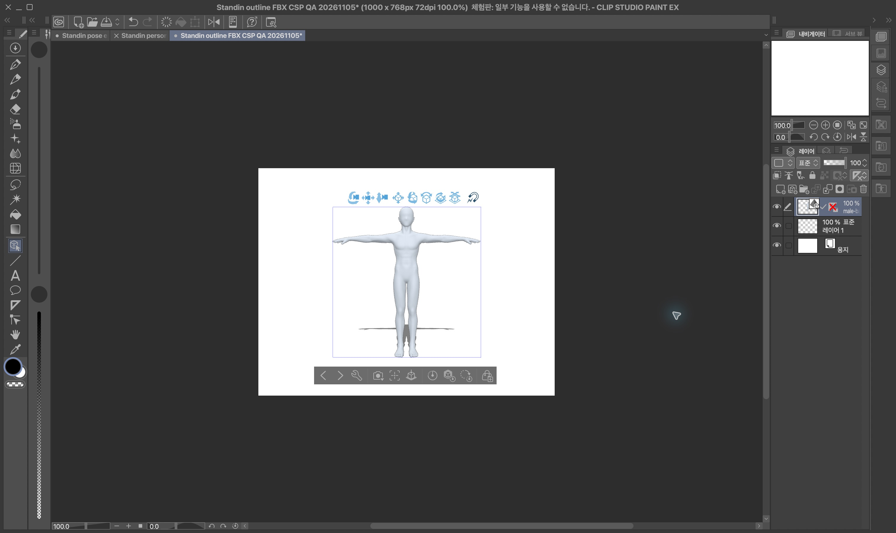
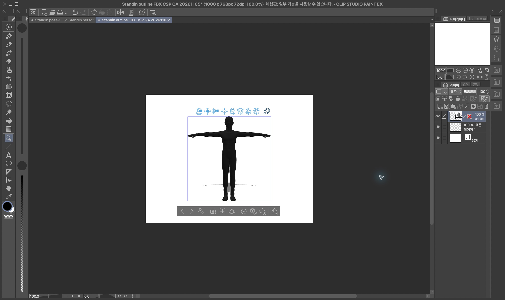
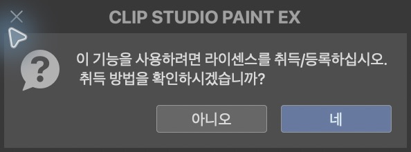
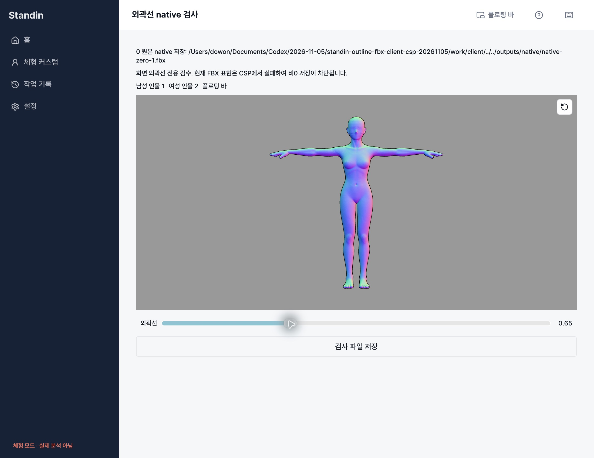
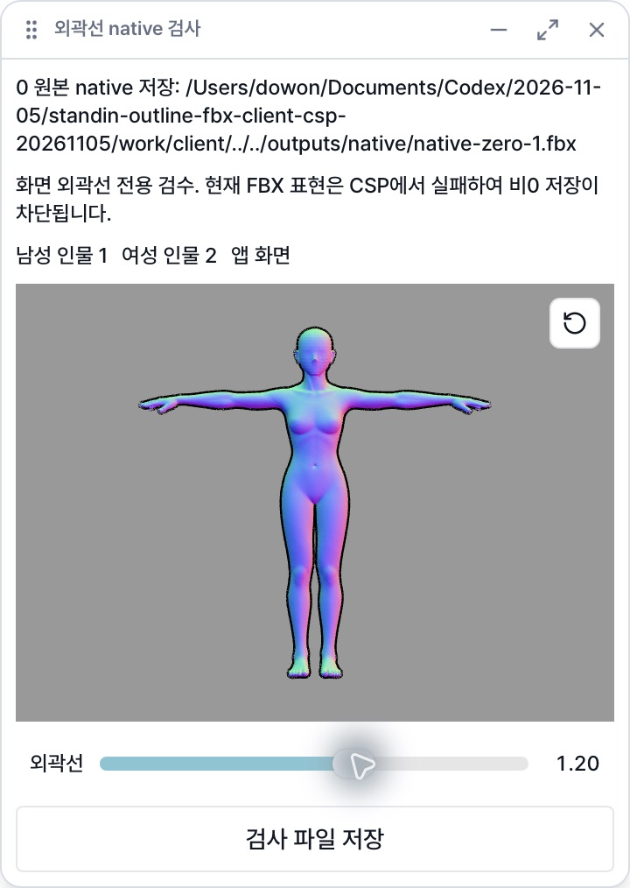
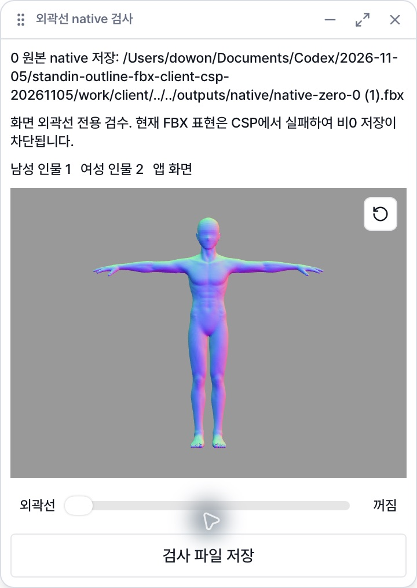
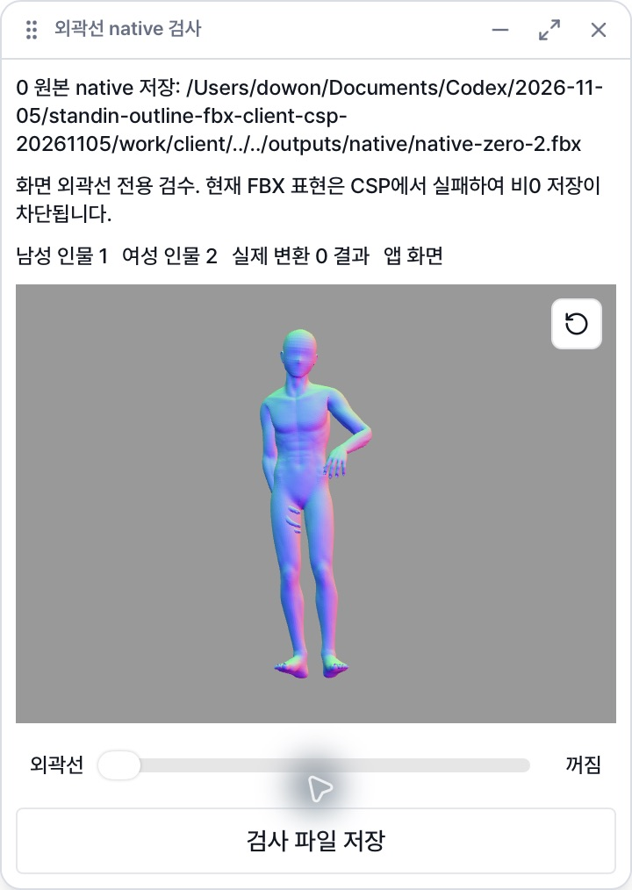
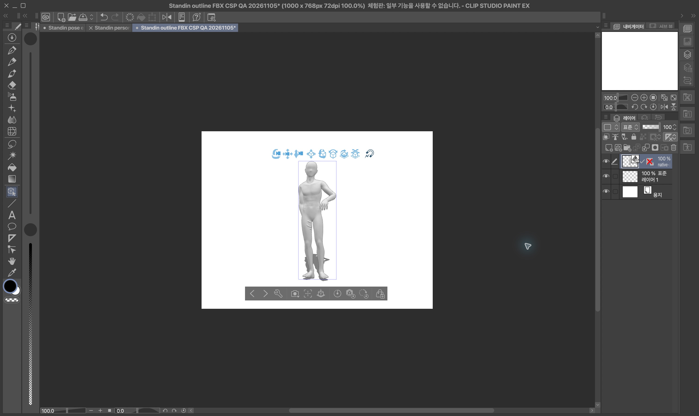

# 최종 FBX 외곽선 연결과 CSP 검수 — 2026-11-05

현재 최종 FBX 외곽선의 CSP 수용은 **실패**다. 웹뷰의 선을 FBX 성공으로 보고하지 않는다. `skinned-inverted-hull-fbx-culling-v1`은 실제 CSP 자동 가져오기에서 검은 몸 전체를 표시하므로 거부한다. 제품의 비0 지원은 꺼져 있고 클라이언트 표현 허용 목록도 비어 있다. 새 표현과 별도 수용 검수가 필요하다. PR #162는 Draft를 유지한다.

## 클라이언트 변경

인물별 0~2 논리 굵기를 작업 선택 상태에 보관한다. 포즈·체형·스킨 전환과 앱↔플로팅 바 이동에서 유지하며 작업/소유자가 바뀌면 격리한다. 화면 렌더러에는 optional 선폭 getter/prop을 추가했다. 기존 `ReviewModelPreview`, `InteractivePose`, `ExpandablePose`, `registerView` 호출은 기본 0으로 호환된다. 인물/뷰별 stencil pass는 별도 재질을 소유하고 원본 재질/geometry/cache를 바꾸지 않는다.

포인터/키보드 제스처 중에는 GPU만 갱신한다. 저장 준비는 조작이 끝난 뒤 기존 비동기 coordinator에서 debounce한다. 로컬 변경 시작 즉시 이전 준비 결과와 진행 중인 저장을 무효화하며 늦은 응답은 generation/appearance/revision/stateHash로 막는다. 선택·body/shape·손·refine의 기존 차단도 유지한다.

0은 appearance를 전송하지 않고 기존 BFF 요청/바이트 경로를 유지한다. 비0은 `interactive-state`의 `{version:"fbx-outline-v1",width}`만 사용하며 CSS px를 물리 길이로 바꾸지 않는다. owned head의 `appearanceExport:{version,available}` 명시 지원 때만 조절 UI를 노출한다. 미지원 형식/서버에 비0이 남으면 저장을 차단하고 0으로 되돌릴 수 있다. `/framed`, BVH, scene/VRM ZIP, 개인 모델 지원을 확장하지 않는다. 환경 플래그·배포 설정을 켜지 않았다.

최종 다운로드는 operation의 appearance, 최종 receipt의 appearance와 파일 SHA/길이, 원본/최종/선택 binding 및 runtime lineage를 검증한다. 현재 거부된 표현은 서버가 인증을 주장해도 허용하지 않는다. 미지원 서버에서 외곽선 없는 파일을 성공 처리하지 않는다. native 파일 쓰기는 기존 exportTauri 경로이며 마지막 상태 검증 전에는 호출하지 않는다.

## 실제 CSP 결과

CLIP STUDIO PAINT EX 5.1.1 build 202607291835, **Unregistered**. 새 `Standin outline FBX CSP QA 20261105` 1000×768 캔버스만 사용했다. 기존 열려 있는 문서를 수정하지 않았다. File → Import → 3D Data, 자동 기본값. CSP 외곽선/뒷면 옵션은 켜지 않았다.

| 실제 입력 | 초기 표시 | 결과 |
| --- | --- | --- |
| 작은 2-bone 0 대조 | 원본 흰 표면 | 표시됨 |
| 작은 CullingOff/OnCCW/OnCW, width 2 | 전체 검은 표면 | 3개 실패 |
| 승인 남녀 T-pose 원본 0 | 정상 흰/회색 표면 | 표시됨 |
| 승인 남녀 OnCCW width 2 | 검은 몸 전체 | 2개 실패 |
| 승인 남성 공유 bend-side, width 0/.5/1/2 | 0 정상, 비0 검은 몸 전체 | 비0 3개 실패 |
| 승인 여성 공유 sit90-side, width 0/.5/1/2 | 0 정상, 비0 검은 몸 전체 | 비0 3개 실패 |

추가 실제 변환 0 native 저장본까지 총 17개 실제 가져오기는 완료됐다. 초기 화면은 정면이며 파일 이름의 side를 UI 시점 검증으로 해석하지 않는다. 본창 회전 드래그 및 Raise는 CUA `-10005 noWindowsAvailable`로 막혔다. 여러 시점·CSP 관절 편집·얼굴/손가락 내부 확대 수용은 **미검증**이다. Save As는 라이선스 취득/등록 안내로 막힌다. **.clip 파일은 없으며 저장→닫기→재열기 성공을 주장하지 않는다.** 기존 라이선스 등록이 가능한 환경에서 새 표현 수용 후 재검사해야 한다. 구매/설정 초기화는 하지 않았다.

[각 입력의 경로·SHA·화면·실패 기록](qa/outline-fbx-csp-20261105/validation.json).

## 실제 Tauri와 fixture 범위

별도 identifier/keychain service `app.standin.desktop.outline-qa-20261105`, 별도 app bundle/독립 복제 target을 사용했다. 실제 Tauri WebView에서 승인 원본 FBX를 평가한 표면의 0/.65/1.2/2, 남녀 인물별 유지, AppShell/BarShell/WindowModeSync의 앱↔플로팅 바, exportTauri native 쓰기를 검사했다. diagnostic normal material로 렌더했으며 제품 재질 검수와 구별한다. native 0 저장본의 SHA는 남성 `809a131510434089888429605bf7cd2e3bc75b63109e4ac5c9734b211ee52365`, 여성 `e6947d8e2aeb1014e9505a61d2f42e6bd9d34965cc7bb3a6c2fcd2722d4f280a`로 입력과 같다. 중복 저장은 `(1)` 새 파일이며 기존 파일을 덮지 않았다. 비0 harness 저장은 파일을 쓰지 않는다.

이것은 **로컬 UI/native harness**다. 실제 BFF 전체 save flow의 비0 성공을 mock으로 대체하지 않는다. 실제 제품 `useSaveFlow`의 미지원 비0 거부와 다운로드 중 외곽선 변경 후 native 호출 0회는 별도 회귀 검사다. `tools/outline-native-qa`는 제품 라우터에 연결하지 않은 재현 도구다.

## 검증 명령과 제한

`NODE_OPTIONS=--no-experimental-webstorage npm test`, typecheck/lint/build, icons:check --windows, release:check. Node 25 기본 Web Storage는 기존 zustand 검사에서 실패하므로 기존 검수와 같은 opt-out을 쓴다. macOS 실기이며 Windows 실기는 미검증이다.

`STANDIN_BFF_WORKTREE=... npm test -- scripts/interactive-bff-wire.test.mjs`는 새 BFF 실제 Hono routes/PGlite SQL과 실제 client adapter를 연결한다. 기본 worker는 synthetic이며 Blender/native/CSP 증거가 아니다. 선택적으로 `STANDIN_REAL_PACKET_DIR`, `STANDIN_REAL_BVH_FILE`, `STANDIN_REAL_CONVERTER_URL`, `STANDIN_REAL_CONVERTER_TOKEN_FILE`을 지정하면 기존 허용 BVH와 로컬 Converter/Blender를 쓴다. 새 유료 추론은 없다. production installation auth/PostgreSQL advisory locking/S3는 이 검사 범위가 아니다. 토큰/원본/패킷은 commit하지 않는다.

컨버터 파일 무결성/변형 추종 검사는 별도 companion PR 증거이며 CSP 성공을 대신하지 않는다. 관련 PR 링크와 최종 CI는 아래에 기록한다. main/develop push, merge, 스테이징/운영 배포, 전역 활성화는 하지 않는다.

## Companion PR

- BFF: https://github.com/04JUNG/Standin-app-server/pull/161 — 선택/appearance revision·capability·캐시·다운로드 경계.
- Converter: https://github.com/04JUNG/Standin-server/pull/170 — 실제 파일 표현 실험·엄격한 원본/외곽선 검사·현재 표현 거부.
- Client: https://github.com/04JUNG/Standin-client/pull/162 — 기존 PR에 통합. #177/#174/#158은 수정·병합하지 않았다.

## 실제 client adapter + BFF + Converter 검사 결과

옵션을 켠 `interactive-bff-wire` 검사 통과: 실제 client adapter → 새 BFF Hono routes/PGlite(SQL, in-process HTTP fixture auth) → 전용 localhost:18491 Converter TCP HTTP → 실제 Blender solve/export/독립 import → 최종 receipt/SHA 검증. 기존 허용 BVH·기존 master FBX를 사용했고 추론 호출은 없다. 0 파일을 받았고 .5/1/2 준비는 `OUTLINE_DISABLED`로 거부됐다(BFF outline dependency 미구성). 거부 후 기존 0 바이트를 그대로 다시 받았고 취소 후 다운로드도 거부됐다. 전체 18.33초의 단일 로컬 표본이며 production 성능 수치가 아니다.

검증 바이트를 `live.fbx`로 기록한 뒤 별도 Tauri harness가 읽어 native-zero-2.fbx로 실제 저장했다. live receipt → 기록 파일 → native 저장본의 SHA/길이가 일치한다. 이 실제 저장본도 CSP에서 정상 표면을 표시했다. 네이티브 단계는 기록 파일을 읽는 별도 단계이며 하나의 실시간 앱/BFF 트랜잭션으로 과장하지 않는다. raw API receipt의 `nativeSaved:false`는 수정하지 않는다. .clip 저장/재열기는 라이선스 차단이 그대로다.

