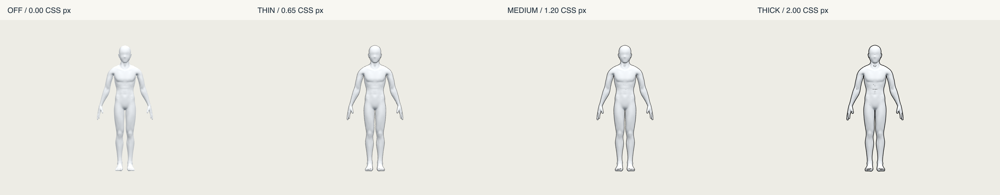
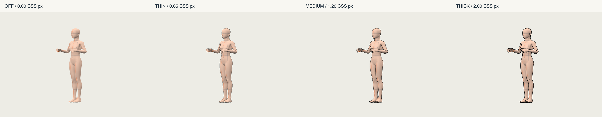
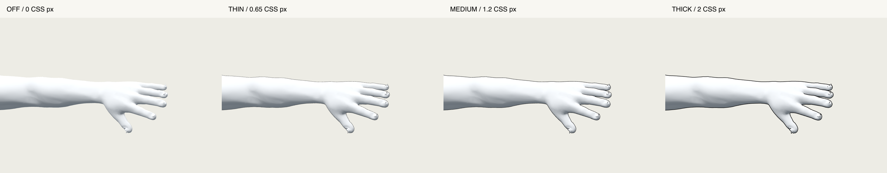
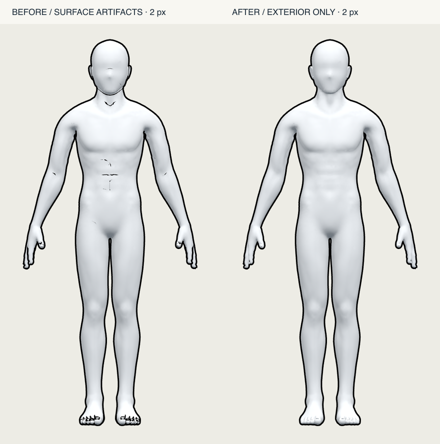

# 외곽선 두께 프리뷰 (2026-10-28)

현재 인물의 검정 인체 외곽선을 화면 CSS px 단위로 두껍게 만든다. 기본값 0은 원래 렌더 한 번만 실행하며 화면을 보존한다. 색은 #000000, alpha/opacity는 1로 고정한다. 0 / 0.65 / 1.2 / 2 px 비교를 제공한다. 최대 2 px는 아래 실제 모델 검수에 근거한 **제안값**이며 모든 모델·해상도에 대한 제품 확정값은 아니다.

## 구현과 범위

- `src/features/pose-viewer/outline/BodyOutlineRenderer.ts`: `stencil: true`인 WebGLRenderer에 연결하는 내부 보호 mask + back-face pass. 몸 안쪽의 음영/오목한 굴곡에는 선을 추가하지 않고 배경과 만나는 실루엣 밖에만 그린다. 화면 XY만 이동하고 실제 geometry·transform·rig·skin weights·morph 값을 변경하지 않는다. 원래 depth buffer로 가려진 표면을 거르고, 대상 body root에만 적용한다. 카드 선택/hover 테두리는 대상이 아니다.
- `OutlineThicknessControl.tsx`: controlled 슬라이더, 현재 수치, 초기화. input change마다 반영하며 pointer 이벤트가 부모의 회전 동작을 시작하지 않는다.
- `PersonOutlineSettings`: **뷰어/작업마다 한 인스턴스**. 인물 index별 독립 저장, 모델·스킨·포즈 변경에도 유지, 새 작업/로그아웃/뷰어 종료에서 clear. 세션/서버 영속화는 하지 않는다.
- `ReviewModelPreview`에 기본 0인 optional `outlineWidth`를 추가했다. 변경 시 기존 GPU surface만 다시 그리며 모델 요청/파싱/재생성을 하지 않는다. `mountReviewModel`의 반환 dispose 함수는 `setOutlineWidth` 핸들도 제공한다. 기존 앱 화면의 조작 정책·저장/다운로드 계약은 바꾸지 않았다.
- 독립 뷰어는 `tools/outline-preview`에 있다. 인물 1/2 설정, 남녀, 기립/굽힘/앉기/체형 표면/리그 실험, 5종 피부 시안, 4방향, 얼굴/손 확대, 회전/줌을 제공한다. 실제 앱 전체에 새 피부/설정 UI를 배치하는 작업은 이 PR 범위 밖이다.

피부 통합 시 `mesh.material`은 스킨 담당이 소유한다. `pass.setWidth(body, width); pass.render(scene, camera)`만 호출하면 된다. 피부를 바꾸어도 외곽선 모듈을 다시 만들 필요가 없다. 기존 `mountReviewModel`의 neutral `libraryPreviewMaterial` 정책은 유지했으므로, 새 스킨을 붙일 때는 피부 재질 적용 지점도 별도로 연결해야 한다. 원래 재질/콜백/scene 상태는 finally에서 복원하고, 사용하지 않는 내부 재질은 다음 render에서 dispose한다. body 교체 시 `remove(oldBody)`, 뷰어 종료 시 `dispose()`를 호출한다. 외곽선 모듈이 소유하지 않는 geometry/skin/texture/renderer는 호출자가 정리한다.

현재 계약은 normals가 있는 opaque Mesh/SkinnedMesh와 기본 framebuffer다. alpha-cutout, 투명/굴절 피부, 커스텀 vertex shader, WebGPU, 별도 postprocessing/render target은 이번 검수에 포함하지 않았다. Three r186.1의 [OutlineEffect 문서](https://threejs.org/docs/pages/OutlineEffect.html)와 설치된 소스를 검토했으나, CSS px 정규화와 명시적 dispose/예외 복원을 위해 별도 작은 pass를 사용했다. 추가 패키지는 없다.

## 실제 모델과 증거

스킨 작업의 `outputs/skin-preview/assets`에서 안정된 파일을 읽기 전용 복사했다. 소스 파일은 변경하지 않았다. 복사 manifest는 독립 결과물의 `assets/snapshot.json`에 있다.

- 남성 FBX 출처: `male-base-v0-7-2.fbx`, SHA256 `3f4ad797317595ca5a6901e3a89937cc7dd2f6d457faf390000b1b30dc4f08b5`.
- 여성의 출처/해시는 독립 프리뷰의 `female-source.json`에 보존했다. 파일명으로 최신 공식 기본형이라고 단정하지 않는다. 공식 기본형 승인 여부는 별도 확인 상태다.
- 기본 포즈 비교는 스킨 담당이 Blender full-weight 평가한 실제 정적 표면을 쓴다. `rig` 실험은 별도 rigged GLB를 쓴다. GLB의 4-component weight와 Blender 원본의 full-weight 표면이 완전히 같은 리타게팅 결과라고 주장하지 않는다.
- 피부 PNG 4종과 원래 기본 재질을 함께 실제 적용했다. 이 PNG는 복사 시점의 **시안**이며 이후 스킨 담당의 수정본과 자동 동기화하지 않는다. 이번 작업에서 텍스처/UV/원본 모델/관절 제한은 만들거나 수정하지 않았다.

아래 초기 4단계 이미지는 수정 전 렌더 기록이다. 최신 결과는 실루엣 전용 수정 비교를 따른다.

## 초기 검사 결과 (실루엣 전용 수정 전)

- Chrome headless / SwiftShader WebGL2, macOS host. 실제 Tauri WebView·Windows·CSP 실행은 검증하지 않았다.
- 0은 direct renderer 결과와 PNG 픽셀 동일. 피부/geometry/weights/morph/bone matrix의 동일성과 원래 재질 참조를 검사했다. 4단계의 완전 검정 픽셀 수는 0, 59, 1332, 3532로 증가했다. 얇은 선의 안티앨리어싱 픽셀이 덜 검게 보이는 것은 raster coverage이며 alpha 값 변경이 아니다.
- 남녀 × 정면/45도/측면/후면 × 기립/팔 굽힘/앉기 = 24개 조합. 현재 표면의 4 px 이웃(2 px 폭 + raster allowance)을 벗어난 검정 픽셀 0. 이는 큰 분리선/유령선을 검출하는 검사이며 모든 숨은선 정확도를 증명하는 것은 아니다. 얼굴/손가락/팔과 몸통 겹침은 비교 이미지로 시각 검수했다. 원래 가려진 손가락 틈을 새로 만들어 주지는 않는다.
- 실제 rigged SkinnedMesh의 팔꿈치 변화와, 별도 메모리 복제 표면의 position+normal morph 실험이 컴파일/렌더되고 변형을 추종했다. 제공 모델에 실제 shape key가 없으므로 morph 검사는 합성 fixture임을 구분한다.
- 공유 피부의 두 body root에 서로 다른 폭 적용, 드래그 mouseup 전 반영, 카메라 불변, 인물 전환/새 작업 초기화, 빠른 모델·피부 전환 확인.
- 12회 모델/피부 교체 후 GPU geometry 1, texture 2, program 2로 유지. 내부 재질 교체·disable·dispose와 렌더 예외 복원은 단위 테스트로 검사.
- DPR 1/2의 base-minus-outline 통합 휘도 면적을 DPR²로 정규화한 비율 0.99963. zoom 0.7/1/3 렌더 확인. 추가적인 물리 모니터 혼합 DPI와 Tauri 실기는 남았다.
- typecheck, lint, build, 프리뷰 별도 strict typecheck 통과. lint는 기존 `BodyCandidates.tsx` fast-refresh 경고 1건. 최신 develop `711f18eb57447d66bd008a91f923ba409fb80ecf` 위에서 전체 테스트 1,234 통과 / 1 skip. Node 26 기본 실행은 기존 Zustand localStorage 테스트 99개가 환경 충돌로 실패했으며, bundled Node 24의 `--no-experimental-webstorage`로 전체 통과했다. 테스트/설정 코드를 우회 수정하지 않았다.
- 상세 수치는 `qa/outline-thickness-20261028/*qa.json`에 있다.

## 실루엣 전용 수정 검수

몸 안쪽의 오목한 표면에 back-face 외곽선이 노출되던 문제를 해결했다. 색상을 쓰지 않는 원래 표면 mask를 stencil에 먼저 기록하고, 그 영역 밖에서만 검정 외곽선을 그린다. 따라서 음영 대비나 normal 변화로 선을 추출하지 않는다. 실제 손가락 사이 등 배경이 보이는 틈의 경계는 유지한다. 0은 여전히 기본 render 한 번이고, 나머지는 base → interior mask → exterior outline 세 번이다.

호출자는 renderer를 `new THREE.WebGLRenderer({ stencil: true, ... })`로 생성해야 한다. 이 모듈은 기본 framebuffer의 stencil을 사용/초기화하므로 다른 stencil 효과와 공유하지 않는다. 부족한 컨텍스트에서 조용히 내부 선이 있는 방식으로 폴백하지 않는다. 앱 기존 리뷰 및 독립 뷰어에 이 생성 옵션을 연결했다. 슬라이더 변경에 컨텍스트 재생성은 없다. mask/outline 재질 모두 교체·disable·dispose에서 정리한다.

수정 후 남녀·4방향·3포즈·피부 시안·DPR 1/2와 3단계 활성 선폭에서 총 62개 실제 WebGL 검사를 통과했다. 원래 색 배경과 magenta 배경에서 동일한 색을 갖는 완전 피복 인체 픽셀을 추출하고 1 physical pixel을 추가 침식해 anti-alias 경계를 제외한 뒤, 선폭 0과 활성 선폭의 RGB를 비교했다. **모든 검사에서 내부 픽셀 변화 0**, 경계에는 실제 변화가 있었다. 같은 남성 DPR2 프레임의 내부 168,067 픽셀에서, 수정 전 검은 자국은 2,265 픽셀을 바꿨고 수정 후에는 0이었다. renderer stencil 옵션을 켜기 전/후에도 선폭 0의 원래 이미지는 픽셀 동일했다.

상세는 `qa/outline-thickness-20261028/outline-silhouette-only-qa.json`. 기존 `outline-qa.json`과 `outline-export-and-dpi-qa.json`은 초기 방식의 수치 기록이며, 수정 후 GPU program 수를 뜻하지 않는다. 수정 후 내부 보호 및 mask 재질 수명·예외 복원 테스트, 전체 1,234 tests / 1 skip, typecheck/lint/build와 프리뷰 strict typecheck를 통과했다. 열려 있던 프리뷰도 2 px로 새로고침해 직접 확인했다.

## FBX / CSP 경계와 후속

이 pass는 화면 효과다. API 요청이나 export payload에 outline width를 추가하지 않았다. 독립 실험에서 같은 원본 표면을 0/2 px 렌더 뒤 GLB로 각각 export한 결과는 **동일 SHA256 / 1,295,268 bytes**였다. 즉 추가 외곽선 shell/재질이 export surface에 생기지 않는다. 이것은 GLB 경계 실험이며 **FBX export 또는 CSP import 실측이 아니다**.

CSP에는 [자체 Outline width/Opacity/Color 설정](https://help.clip-studio.com/en-us/manual_en/810_subtools/O.htm)과 [렌더링 outline/offset 설정](https://help.clip-studio.com/en-us/manual_en/810_subtools/P.htm)이 있다. [공식 3D import 문서](https://help.clip-studio.com/en-us/manual_en/660_3d/Importing_3D_Files.htm)는 FBX/GLB/glTF를 안내한다. 다음 실험은 실제 FBX를 격리된 CSP 캔버스에 가져와 CSP 자체 검정 외곽선 폭을 비교하는 것이다. 웹뷰 px와 CSP 폭이 1:1이라고 가정하지 않는다. 사용자 파일·CSP DB·Converter는 수정하지 않았다.

CSP 외부에서도 보존해야 한다면 별도 export shell 또는 대상 프로그램의 toon/outline 설정을 검토해야 한다. shell은 weight/morph 복제, culling, pose/camera/거리별 폭, 손가락 겹침을 다시 검증해야 하므로 이 PR에 넣지 않는다. 일반 UV texture만으로 시점에 따른 실루엣을 해결했다고 주장하지 않는다. 운영/main 병합·배포는 하지 않는다.
