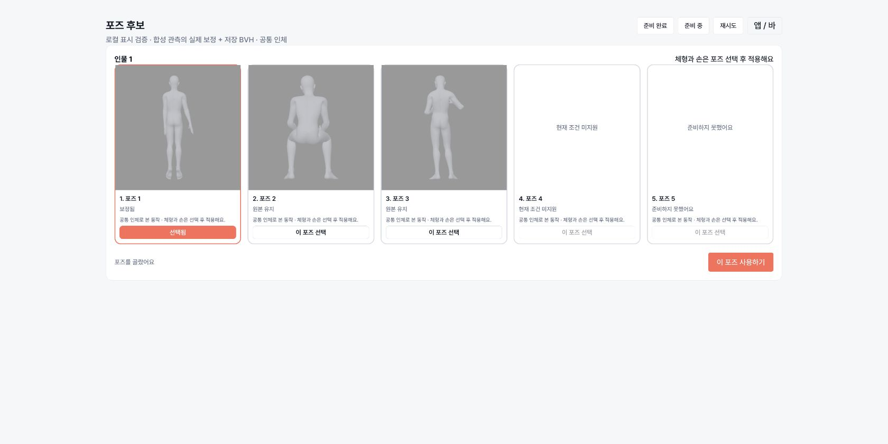
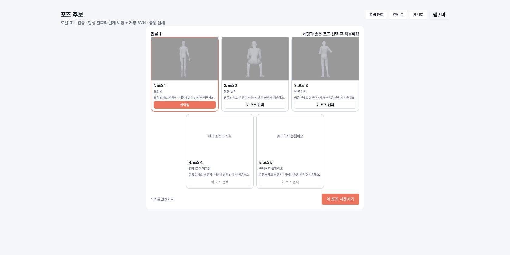
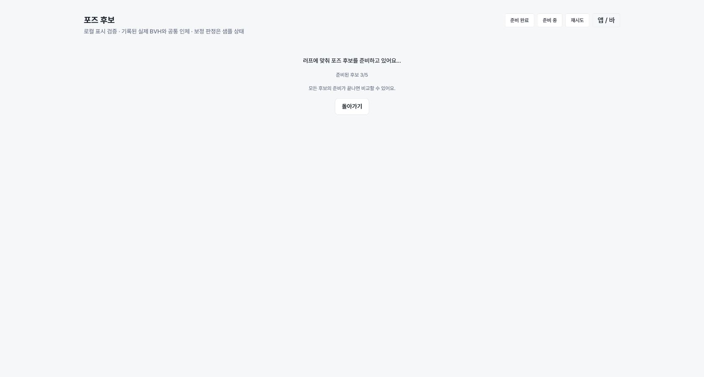
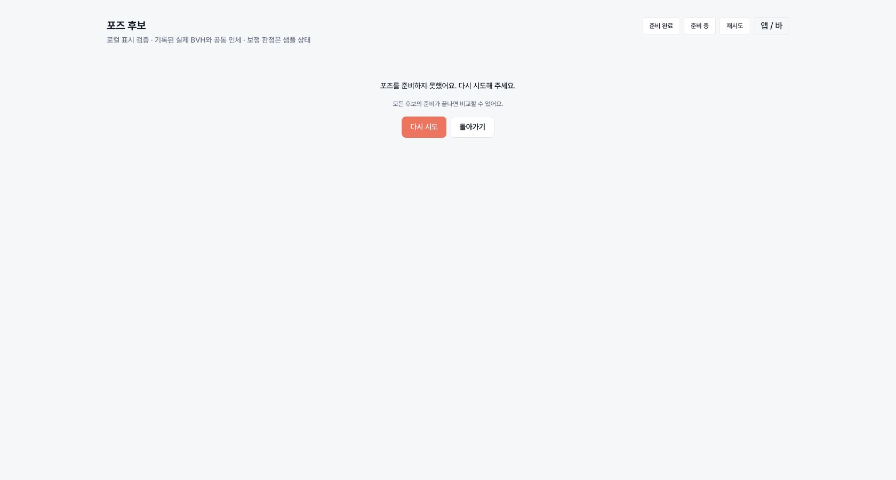

# Top5 전 동작 보정과 선택 후 체형 적용

구현 기준: 2026-11-06 사용자 정정. 검색 → 후보별 source 동작 보정 → Top5 비교 → 사용자 포즈 선택 → 체형·수치·손 적용 → 기존 target/최종 파일 검증. 운영·스테이징 배포, 기능 전역 활성화, 릴리스는 하지 않는다.

## 클라이언트 경계

`preparation/session.ts`가 설치·작업·후보 묶음별 단일 비동기 준비를 유지한다. 후보별 resultId/contextHash/source·output SHA를 보관하며 `refineByPerson`은 선택 후 호환 projection만 담당한다. 같은 후보 재선택은 기존 결과를 지우지 않는다. 앱↔바 전환은 취소가 아니고 동일 진행 요청과 결과를 쓴다. 진행 중 작업을 다른 작업으로 바꾸거나 명시적으로 취소하면 그 작업만 취소한다. 완료 결과는 제한된 세션 캐시에 보관하며 만료·설치 변경·source revision 변경은 재사용을 차단한다.

사전 source identity에 체형·shape·손·출력 범위·외양은 들어가지 않는다. 이를 변경해도 검색/VLM/source solve를 다시 요청하지 않는다. 실제 관측·카메라·solver 버전 권한은 BFF가 보관하며 클라이언트는 좌표·파일 경로·품질 판정을 제출하지 않는다.

캡처/이미지 live 결과에서만 준비 capability를 확인한다. 분석 응답에 없으면 작업별 capability GET을 한 번 사용한다. 구 BFF의 404/false는 기존 선택 후 흐름으로 돌아간다. 자연어 검색/일반 참고 정책과 정적 작업 기록은 기존 경로를 유지한다.

## 표시와 선택

모든 후보의 처리 결과가 terminal이 되기 전에는 원본 카드를 공개하지 않는다. 준비·원본 유지·미지원·일시 실패를 구분하며 실패는 성공 cache로 바꾸지 않는다. 부분 실패를 재시도할 수 있고 정상 후보 선택은 유지한다. 3명 15후보도 누락 없이 하나의 barrier로 검사한다(BFF 내부 chunk10 제한과 제품 인원수는 별개, 현재 공개 상한64후보는 초과시 명시적 오류).

준비 BVH의 크기·SHA·context를 검증한 뒤 기존 승인 공용 `humanReference` template과 `referencePose` 관절 mapping을 소비한다. 모델과 관측 카메라 회전을 적용한 display-only 인체이며 개인 체형/손/shape/Converter를 호출하지 않는다. 공용 template 다운로드는 공유하고, BVH 다운로드는 최대2개, GPU는 기존 공용 renderer를 쓴다. PNG를 굽지 않는다. 소스 rig 필수관절이나 WebGL 표시가 실패하면 원본 이미지로 보정 성공을 위장하지 않고 선택을 막는다.

현 표시 한계: 공용 인체의 비례는 실제 선택 체형과 다르고, framing은 비교용이다. BFF 검색 rotation/projection/distance를 소비하지만 공용 인체의 비례가 다르므로 러프 픽셀/crop까지 정확히 정합한 미리보기라는 보장은 없다. 카메라가 없는 진단 fixture는 canonical front다. 최종 body/손/출력 범위의 미리보기는 선택 후 기존 경로가 담당한다. 기존 외곽선/스킨 renderer 소유 파일은 변경하지 않았다.

## 선택 후 재사용과 저장

실제 사용자 선택 확정 후 `/reuse`가 source/current revision/engine 준비 ID를 재검증한다. 그 응답만 `RefineOutcome.prepared`로 투영하고 `useRefineSelection`의 legacy source 호출을 막는다. body/hand/framed/interactive의 기존 선택 후 target 검증은 유지한다. source 영수증은 skinSafe=false/finalFileVerified=false이며 최종 FBX 권한이 아니다. target 실패 시 기존 복구·검토 게이트를 우회하지 않는다.

BVH 저장은 카드가 읽은 같은 prepared descriptor와 SHA를 다시 검증한다. source 변경/만료/선택 변경/설치 변경은 저장을 막는다. FBX는 기존 BFF export URL에서 prepared source를 소비한 뒤 기존 선택 후 검증 영수증이 있는 파일만 저장한다. 장면 선택 조합 검증도 기존 게이트를 그대로 사용한다.

## 로컬 검증과 의존성

베이스: client develop `5934f0d2799d64074cb5836b9d7bab48d7246f1e`. 외곽선 #162, 스킨, 큰미리보기 PR을 가져오거나 수정하지 않았다. BFF #163 `6d45674baa1efa54d6807671710eede0711bc11c`의 candidate-preparation 계약/준비 source resolver와 엔진 #171 `9b6b76df5c63b0dc2b2bb2fd1e5eedd48a1e72c4`가 런타임 의존성이다. 클라이언트 PR은 #178이다. 엔진 v3 shadow/v4 intent를 apply/user_confirmed로 바꾸지 않았다.

- 테스트: 전체 1,297개 통과/4개 명시적 opt-in skip. 최종 카메라/재사용/만료 저장 차단 관련 50개 별도 통과. 빌드·lint 통과(기존 Fast Refresh 경고1개). 준비5/10/15후보, 동일 요청 single-flight, 늦은 응답·취소·부분 결과·hash 손상 차단, no-op 선택, source 재사용 시 legacy refine0, 기존 앱/바/target/장면 회귀.
- 실제 localhost wire: BFF의 Hono routes + PGlite SQL + durable store/worker에 클라이언트 HTTP를 연결. 3인15후보를 10+5 chunk로 처리, 선택3개의 정확한 BVH SHA/184 bytes 확인, 선택 이후 source 추가 호출0, 다른 설치404. source engine은 제어 fixture이며 실제 VLM/target/최종 FBX 증거가 아니다.
- 재현: BFF `scripts/candidate-preparation-local-wire.mjs`를 별도 실행한 뒤 `CANDIDATE_WIRE_URL=http://127.0.0.1:18765 npm test -- src/features/pose-viewer/preparation/bff.local.test.ts`. `CANDIDATE_WIRE_OUTPUT`은 JSON 결과 저장 경로다. 기본 suite에서는 명시적으로 skip한다.
- 이 호스트 Node25에서는 `NODE_OPTIONS=--no-experimental-webstorage`로 기존 Zustand localStorage 테스트를 실행했다. CI는 저장소 기본 Node22다.
- C=1/2 cold/warm source/target 정량 평가는 별도 target 담당이 동일 자원 조건으로 조율한다. 이 클라이언트 검증 시간을 solver 속도나 운영 SLA로 주장하지 않는다.
- CSP는 스킨 세션이 사용 중이므로 조작하지 않았다. Windows/Tauri 네이티브 저장·CSP import 및 새 target provider 실제 FBX 전체 연결은 이 클라이언트 검증에 포함하지 않았다.

아래 첫 카드는 엔진 담당이 기존 안전 게이트를 유지한 실제 source solver로 만든 `ready_refined` 합성 fixture다(원본 SHA e9cfa2b1…, 결과 SHA 496ee278…, 21관절/Neck 포함, 합성 관측). 두 번째·세 번째는 실제 저장된 앉기/문자보기 BVH 원본 유지 표시다. 미지원·실패는 UI fixture 상태다. 공용 인체를 사용하며 유료 분석·실사용 러프 정확도·운영 결과가 아니다. source 원본/결과와 영수증은 사용자 출력에 보관했다.

