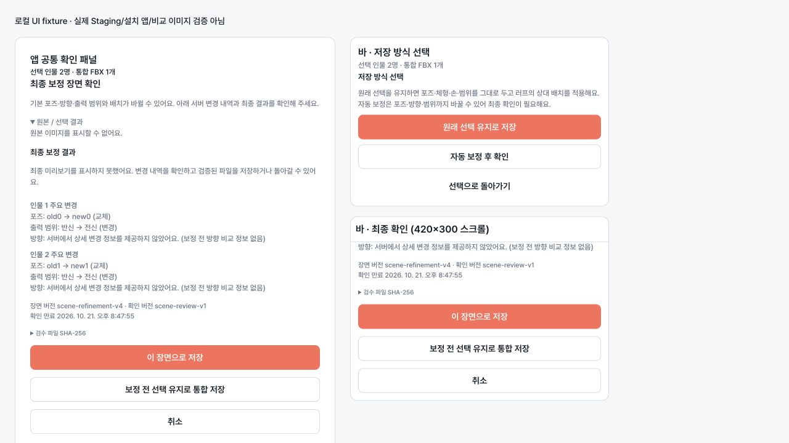

# 통합 FBX 저장 모드와 최종 장면 확인 (2026-10-21)

이 문서는 앱 `SavePage`, 플로팅 바 `BarSavePage`, 공통 `useSaveFlow`의 동작과
BFF `scene-save-v1` 계약을 설명한다. worker/서버 배포, 기본 v4 활성화는 이 변경에 포함하지 않는다.

## 사용자 흐름

1. 기존 인물별 후보·체형·손·출력 범위를 확정하고 검수 FBX를 준비한다.
2. 새 `capabilities.sceneSaveContract`가 있는 이미지 FBX 작업은
   **선택 인물 N명 · 통합 FBX 1개**와 저장 방식 선택을 표시한다.
3. **원래 선택 유지로 저장**은 기존 포즈·체형·손·범위를 사용하고 러프의 상대 배치를 적용한다.
   장면 자동 보정은 요청하지 않는다.
4. **자동 보정 후 확인**은 지원 모드에 `auto-correct-v4`가 있고 `sceneRefinement=true`일 때만
   사용할 수 있다. capability는 worker가 현재 준비됐다는 보장이 아니므로 오류 복구를 제공한다.
5. 준비가 끝나면 앱과 바에서 같은 확인 패널을 표시한다. 원본, 보정 전 선택 결과,
   최종 보정 결과, 인물별 변경 내역, 장면/확인 버전과 만료 시각을 확인할 수 있다.
6. **이 장면으로 저장**을 누르면 검수한 동일 FBX만 다운로드하고 native writer로 쓴다.
   **취소**는 선택을 유지한 취소 상태가 되고, **보정 전 선택 유지로 통합 저장**은
   pending review를 버리고 원래 선택 참조를 다시 검증해서 기본 통합 저장을 요청한다.
   실패한 자동 보정을 다른 모드로 자동 전환하지 않는다.
7. 완료 시 같은 N명/통합 FBX 1개 안내와 실제 저장 파일 목록을 표시한다.

원본은 현재 job의 서버 `inputPreviewUrl` 또는 같은 job 초안만 사용한다. 보정 전 선택 이미지는
실제 다운로드에 사용한 정확한 검수 URL과 같은 `framed-image` 캐시만 재사용한다.
해당 이미지/원본이 없으면 표시 불가를 명시하고 다른 후보 이미지로 대체하지 않는다.
최종 이미지는 검수 artifact SHA에 연결된 PNG만 표시한다. PNG가 준비 중이거나 실패해도
기존 verified-FBX 계약대로 서버 변경 내역을 확인한 후 파일을 저장할 수 있으며,
이미지를 보았다고 기록하거나 비교 이미지를 합성하지 않는다.

summary의 previousPoseId/previousOutputScope와 poseChanged/outputScopeChanged를 표시한다.
방향은 서버가 준 몸통·머리 yaw/상대 yaw/pitch와 라벨만 표시한다.
`previousDirection:null`, `directionChanged:null`이므로 이전 방향과의 변화량이나 유지 여부는
단정하지 않는다. interaction/armGoalCount가 null이면 상세가 없는 것으로 취급한다.
완료율·대기 순번·추정 IK 변경 등 서버가 주지 않은 정보를 만들지 않는다.

## API

경로: `POST /v1/analysis/jobs/:jobId/scene`, 기존 설치 인증 사용.

| 동작 | 요청 필드 |
|---|---|
| 원래 선택 유지 | `contractVersion:"scene-save-v1", saveMode:"original-selection", persons` |
| 보정 준비 | `contractVersion:"scene-save-v1", saveMode:"auto-correct-v4", persons, prepare:true, artifactOnly:true` |
| 보정 확인/저장 | 위 contract/mode/persons + `reviewVersion:"scene-review-v1", reviewKey, artifactSha256` |
| 최종 PNG | 확인/저장 요청 + `preview:true` |

persons는 소유 job의 확정 후보 ID, 검수 URL(체형/손 revision 포함), 실제 받은 FBX의 SHA다.
한 번의 준비→확인→저장에서는 같은 참조를 사용한다. 준비 응답의 계약/검수 버전,
ISO expiresAt, fileCount=1, 인물 수와 중복 없는 인물별 summary를 검증한다.
다운로드는 `X-Standin-Scene-Contract`, `X-Standin-Scene-Save-Mode`, Scene-Version,
Person-Count, Artifact-SHA256와 실제 바이트 SHA, FBX magic을 모두 확인한 뒤 저장한다.
보정 파일 SHA는 검수 SHA와도 동일해야 한다.

새 계약이 없는 구 BFF 작업에는 `{persons}`로 기본 통합 저장을 요청하며,
`sceneRefinement=true` 하나만 보고 v4 prepare를 요청하지 않는다.
새 BFF는 v4 flag가 켜져 있어도 구 앱 `{persons}`를 original-selection으로 유지한다.
BVH·문장 검색·생성 포즈 개별 저장 경로는 유지한다.

## 상태와 취소 경계

| 의미 | 저장소 상태 | 화면 |
|---|---|---|
| 저장 방식 선택 | idle + choosingSceneMode | 원래 선택 / 자동 보정 선택 |
| prepare | preparing | 파일 또는 자동 보정 장면 준비 중, 준비 취소 |
| awaiting-confirm | awaiting-confirm | 최종 장면, 저장 / 원래 선택 / 취소 |
| save | saving | 통합 FBX 파일 저장 중 |
| completed | saved | 통합 파일 1개 저장 완료 |
| cancelled | cancelled | 실패 알림 없이 재시작 / 선택 돌아가기 |
| failed | error | 코드별 오류와 복구 행동 |

취소/실제 화면 이탈은 AbortController로 HTTP 대기와 미리보기 요청을 중단하고 late response를
무시한다. 인물별 준비 다운로드에도 signal을 전달한다. 서버/worker 작업의 중단을 보장하지
않으며 취소 API는 없다. 오류 응답의 `details.serverOperationMayContinue=true`이면
시간 초과·네트워크 단절 후에도 작업이 계속될 수 있고 재준비가 새 작업을 만들 수 있음을 별도로 표시한다. 서버 검수 자료는 자연 만료된다. 사용자 취소와 화면 이탈은
`export_failed`나 `CANCELLED` 실패 지표를 보내지 않는다. native writer를 호출한 뒤에는
쓰기 중단을 제공하지 않으며 실제 저장 결과를 따른다. 준비·확인·쓰기 중 앱 업데이트는 막는다.

선택/체형/손/출력 범위/소유자가 변경되면 준비와 확인을 무효화한다. 다운로드 뒤에도
같은 선택인지 다시 확인해 오래된 파일을 쓰지 않는다. 만료 타이머와 확인 시각 검사는
새 준비를 요구하고 서버의 만료 판단도 따른다. 재시도는 항상 새 prepare와 사용자 확인을 거친다.

## 오류 복구

| 코드 | 행동 |
|---|---|
| SCENE_REVIEW_REQUIRED, SCENE_REVIEW_EXPIRED | 장면 다시 준비·확인 |
| SCENE_TIMEOUT | 서버 작업 지속 가능 안내 후 장면 다시 준비·확인 |
| SCENE_INTEGRITY | 파일 저장 차단, 장면 다시 준비·확인 |
| SCENE_SOURCE_CHANGED, 인물별 stale/revision 오류 | 선택·최종 미리보기 다시 확인 |
| SCENE_UNSUPPORTED_BODY | 다른 후보/체형 선택; 지원 시 명시적 원래 선택 유지 |
| SCENE_CONTRACT_UNSUPPORTED | 작업 capability 무효화, 작업을 다시 열어 확인 |
| SCENE_BUSY, SCENE_UNAVAILABLE, SCENE_FAILED | 잠시 후 재시도, 지원 시 명시적 원래 선택 유지 |
| SCENE_OBSERVATION_MISSING | 후보 변경 또는 새 분석 |

씬 오류를 폴더 오류로 안내하지 않으며 폴더 변경/포맷 변경 단축키로 복구를 우회하지 않는다.
취소·일시적인 장면 오류는 기존 인물별 검수 영수증을 지우지 않아서 원래 선택으로 돌아갈 수 있다.
BFF는 S3의 scene 전용 검수 저장소로 다중 인스턴스를 지원한다. 다른 인스턴스/재시작에서
검수 키가 사라지면 클라이언트는 SCENE_REVIEW_REQUIRED로 새 준비·확인을 요청한다.

## 검증 범위와 남은 통합 검증

자동 회귀는 로컬 fixture다. 실제 React 앱/바 페이지 + 공통 hook의 모드 선택→확인→저장,
취소, prepare 중 이탈과 late success, 선택/범위/체형/손 변경, 만료/재확인, 코드별 복구,
원래 선택 복원, StrictMode, API 계약/summary/헤더/바이트 SHA 대조를 검사한다.
시스템 Node 26.5의 실험적 Web Storage가 jsdom localStorage와 충돌하므로 로컬 test에는
`NODE_OPTIONS=--no-experimental-webstorage`를 사용한다. CI는 기존 Node 22를 유지한다.

**미검증:** Windows/macOS 최신 Staging 설치 앱의 실제 3컷, worker 자산/readiness,
native 파일 쓰기와 CSP import, 실제 복제 BFF 간 준비/확인/저장. fixture 통과는 E2E가 아니다.
준비된 worker와 BFF/앱 버전을 연결한 뒤 앱/바 각각 확인·취소·원래 선택 복원,
보정 전후 주요 변경과 검수/저장 SHA 일치, 1개 파일/인원 수를 검증해야 한다.
worker 422는 현재 body 불가·plan 만료·증거 거절을 구별하지 못하므로 BFF가 원인을
추정해서 SCENE_UNSUPPORTED_BODY로 만들지 않는다. 해당 구분은 worker 담당 협의가 남아 있다.
v4 기본 꺼짐 유지. 이 작업에서 머지·배포하지 않는다.

### 로컬 화면 확인

공통 컴포넌트를 로컬 fixture로 렌더링해 앱 520px 패널과 바 420×300 스크롤 영역을 확인했다.
아래 바는 하단으로 스크롤한 상태이며 확인·원래 선택·취소 버튼에 도달할 수 있다.
비교 이미지는 없는 상태로 명시했으며 실제 장면/설치 앱 캡처가 아니다.

