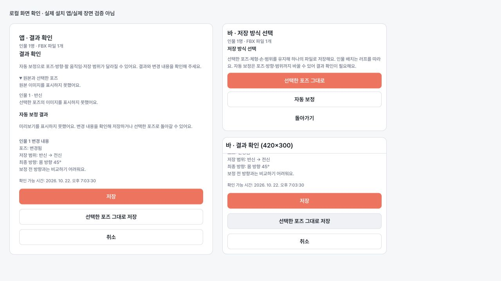

# 통합 FBX 저장 모드와 최종 장면 확인 (2026-10-22)

이 문서는 앱 `SavePage`, 플로팅 바 `BarSavePage`, 공통 `useSaveFlow`의 동작과
BFF `scene-save-v1` 계약을 설명한다. worker/서버 배포, 기본 v4 활성화는 이 변경에 포함하지 않는다.

## 사용자 흐름

1. 기존 인물별 후보·체형·손·출력 범위를 확정하고 검수 FBX를 준비한다.
2. 새 `capabilities.sceneSaveContract`가 있는 이미지 FBX 작업은
   **인물 N명 · FBX 파일 1개**와 저장 방식 선택을 표시한다.
3. **선택한 포즈 그대로**은 기존 포즈·체형·손·범위를 사용하고 러프의 상대 배치를 적용한다.
   장면 자동 보정은 요청하지 않는다.
4. **자동 보정**은 지원 모드에 `auto-correct-v4`가 있고 `sceneRefinement=true`일 때만
   사용할 수 있다. capability는 worker가 현재 준비됐다는 보장이 아니므로 오류 복구를 제공한다.
5. 준비가 끝나면 앱과 바에서 같은 확인 패널을 표시한다. 원본, 보정 전 선택 결과,
   최종 보정 결과, 인물별 변경 내역, 확인 가능한 시간을 확인할 수 있다.
6. **저장**을 누르면 검수한 동일 FBX만 다운로드하고 native writer로 쓴다.
   **취소**는 선택을 유지한 취소 상태가 되고, **선택한 포즈 그대로 저장**은
   pending review를 버리고 원래 선택 참조를 다시 검증해서 기본 통합 저장을 요청한다.
   실패한 자동 보정을 다른 모드로 자동 전환하지 않는다.
7. 완료 시 같은 인원/FBX 파일 1개 안내와 실제 저장 파일 목록을 표시한다.

원본은 현재 job의 서버 `inputPreviewUrl` 또는 같은 job 초안만 사용한다. 보정 전 선택 이미지는
실제 다운로드에 사용한 정확한 검수 URL과 같은 `framed-image` 캐시만 재사용한다.
해당 이미지/원본이 없으면 표시 불가를 명시하고 다른 후보 이미지로 대체하지 않는다.
최종 이미지는 검수 artifact SHA에 연결된 PNG만 표시한다. PNG가 준비 중이거나 실패해도
기존 verified-FBX 계약대로 서버 변경 내역을 확인한 후 파일을 저장할 수 있으며,
이미지를 보았다고 기록하거나 비교 이미지를 합성하지 않는다.

summary의 poseChanged/outputScopeChanged와 previousOutputScope/outputScope에 근거해 실제 포즈 변경 여부와 저장 범위 전후를 표시한다.
방향은 서버가 준 몸통·머리 yaw/상대 yaw/pitch 수치를 쉬운 문구로 표시한다. 식별자와 raw label은 화면에 표시하지 않는다.
`previousDirection:null`, `directionChanged:null`이므로 이전 방향과의 변화량이나 유지 여부는
단정하지 않는다. armGoalCount는 조정 요청의 수이며 측정된 관절 변경 수가 아니므로 “N곳 보정”으로 표시하지 않는다. interaction도 실제 동작 전후 비교를 보장하지 않아 별도 변경 사실로 표시하지 않는다.
완료율·대기 순번·추정 IK 변경 등 서버가 주지 않은 정보를 만들지 않는다.

## API

경로: `POST /v1/analysis/jobs/:jobId/scene`, 기존 설치 인증 사용.

| 동작 | 요청 필드 |
|---|---|
| 원래 선택 유지 | `contractVersion:"scene-save-v1", saveMode:"original-selection", persons` |
| 보정 준비 | `contractVersion:"scene-save-v1", saveMode:"auto-correct-v4", persons, prepare:true, artifactOnly:true` |
| 보정 확인/저장 | 위 contract/mode/persons + `reviewVersion:"scene-review-v1", reviewKey, artifactSha256` |
| 최종 PNG | 확인/저장 요청 + `preview:true` |

persons는 소유 job의 확정 후보 ID, 검수 URL(체형/손 revision 포함), 실제 받은 FBX의 SHA다.
한 번의 준비→확인→저장에서는 같은 참조를 사용한다. 준비 응답의 계약/검수 버전,
ISO expiresAt, fileCount=1, 인물 수와 중복 없는 인물별 summary를 검증한다.
다운로드는 `X-Standin-Scene-Contract`, `X-Standin-Scene-Save-Mode`, Scene-Version,
Person-Count, Artifact-SHA256와 실제 바이트 SHA, FBX magic을 모두 확인한 뒤 저장한다.
보정 파일 SHA는 검수 SHA와도 동일해야 한다.

새 계약이 없는 구 BFF 작업에는 `{persons}`로 기본 통합 저장을 요청하며,
`sceneRefinement=true` 하나만 보고 v4 prepare를 요청하지 않는다.
새 BFF는 v4 flag가 켜져 있어도 구 앱 `{persons}`를 original-selection으로 유지한다.
BVH·문장 검색·생성 포즈 개별 저장 경로는 유지한다.

## 상태와 취소 경계

| 의미 | 저장소 상태 | 화면 |
|---|---|---|
| 저장 방식 선택 | idle + choosingSceneMode | 원래 선택 / 자동 보정 선택 |
| prepare | preparing | 파일 또는 자동 보정 장면 준비 중, 준비 취소 |
| awaiting-confirm | awaiting-confirm | 최종 장면, 저장 / 원래 선택 / 취소 |
| save | saving | FBX 파일 저장 중 |
| completed | saved | FBX 파일 1개 저장 완료 |
| cancelled | cancelled | 실패 알림 없이 재시작 / 선택 돌아가기 |
| failed | error | 코드별 오류와 복구 행동 |

취소/실제 화면 이탈은 AbortController로 HTTP 대기와 미리보기 요청을 중단하고 late response를
무시한다. 인물별 준비 다운로드에도 signal을 전달한다. 서버/worker 작업의 중단을 보장하지
않으며 취소 API는 없다. 오류 응답의 `details.serverOperationMayContinue=true`이면
시간 초과·네트워크 단절 후에도 작업이 계속될 수 있고 재준비가 새 작업을 만들 수 있음을 별도로 표시한다. 서버 검수 자료는 자연 만료된다. 사용자 취소와 화면 이탈은
`export_failed`나 `CANCELLED` 실패 지표를 보내지 않는다. native writer를 호출한 뒤에는
쓰기 중단을 제공하지 않으며 실제 저장 결과를 따른다. 준비·확인·쓰기 중 앱 업데이트는 막는다.

선택/체형/손/출력 범위/소유자가 변경되면 준비와 확인을 무효화한다. 다운로드 뒤에도
같은 선택인지 다시 확인해 오래된 파일을 쓰지 않는다. 만료 타이머와 확인 시각 검사는
새 준비를 요구하고 서버의 만료 판단도 따른다. 재시도는 항상 새 prepare와 사용자 확인을 거친다.

## 오류 복구

| 코드 | 행동 |
|---|---|
| SCENE_REVIEW_REQUIRED, SCENE_REVIEW_EXPIRED | 장면 다시 준비·확인 |
| SCENE_TIMEOUT | 서버 작업 지속 가능 안내 후 장면 다시 준비·확인 |
| SCENE_INTEGRITY | 파일 저장 차단, 장면 다시 준비·확인 |
| SCENE_SOURCE_CHANGED, 인물별 stale/revision 오류 | 선택·최종 미리보기 다시 확인 |
| SCENE_UNSUPPORTED_BODY | 다른 후보/체형 선택; 지원 시 명시적 원래 선택 유지 |
| SCENE_CONTRACT_UNSUPPORTED | 작업 capability 무효화, 작업을 다시 열어 확인 |
| SCENE_BUSY, SCENE_UNAVAILABLE, SCENE_FAILED | 잠시 후 재시도, 지원 시 명시적 원래 선택 유지 |
| SCENE_OBSERVATION_MISSING | 후보 변경 또는 새 분석 |

씬 오류를 폴더 오류로 안내하지 않으며 폴더 변경/포맷 변경 단축키로 복구를 우회하지 않는다.
취소·일시적인 장면 오류는 기존 인물별 검수 영수증을 지우지 않아서 원래 선택으로 돌아갈 수 있다.
BFF는 S3의 scene 전용 검수 저장소로 다중 인스턴스를 지원한다. 다른 인스턴스/재시작에서
검수 키가 사라지면 클라이언트는 SCENE_REVIEW_REQUIRED로 새 준비·확인을 요청한다.

## 검증 범위와 남은 통합 검증

자동 회귀는 로컬 fixture다. 실제 React 앱/바 페이지 + 공통 hook의 모드 선택→확인→저장,
취소, prepare 중 이탈과 late success, 선택/범위/체형/손 변경, 만료/재확인, 코드별 복구,
원래 선택 복원, StrictMode, API 계약/summary/헤더/바이트 SHA 대조를 검사한다.
시스템 Node 26.5의 실험적 Web Storage가 jsdom localStorage와 충돌하므로 로컬 test에는
`NODE_OPTIONS=--no-experimental-webstorage`를 사용한다. CI는 기존 Node 22를 유지한다.

**미검증:** Windows/macOS 최신 Staging 설치 앱의 실제 3컷, worker 자산/readiness,
native 파일 쓰기와 CSP import, 실제 복제 BFF 간 준비/확인/저장. fixture 통과는 E2E가 아니다.
준비된 worker와 BFF/앱 버전을 연결한 뒤 앱/바 각각 확인·취소·원래 선택 복원,
보정 전후 주요 변경과 검수/저장 SHA 일치, 1개 파일/인원 수를 검증해야 한다.
worker 422는 현재 body 불가·plan 만료·증거 거절을 구별하지 못하므로 BFF가 원인을
추정해서 SCENE_UNSUPPORTED_BODY로 만들지 않는다. 해당 구분은 worker 담당 협의가 남아 있다.
v4 기본 꺼짐 유지. 이 작업에서 머지·배포하지 않는다.

### 로컬 화면 확인

공통 컴포넌트를 로컬 fixture로 렌더링해 앱 520px 패널과 바 420×300 스크롤 영역을 확인했다.
아래 바는 하단으로 스크롤한 상태이며 확인·원래 선택·취소 버튼에 도달할 수 있다.
비교 이미지는 없는 상태로 명시했으며 실제 장면/설치 앱 캡처가 아니다.

## 후속 연동 점검 (2026-10-22)

기존 #148의 mode negotiation·SHA pinning·취소 비실패 집계는 유지한다. UI에는 v4,
reviewKey, SHA, artifact/revision/contract/capability/worker/IK/plan이나 원시 포즈 ID를
노출하지 않는다. 내부 검증·진단 코드와 버전은 그대로 유지하며 일반 화면은 행동과 결과만 안내한다.

최종 PNG 요청 실패 중 SCENE_REVIEW_REQUIRED/EXPIRED/SOURCE_CHANGED/CONTRACT_UNSUPPORTED,
SCENE_INTEGRITY와 PREVIEW_NOT_READY(503)·체형·손·범위 재확인 오류는 기존 결과를 폐기하고 코드별 복구로 이동한다.
단순 렌더·네트워크 오류만 previewFailed로 취급하며 이미 검증된 파일은 저장할 수 있다.
이 구분은 BFF의 느린 PNG 렌더 후 원본/손 재검증과 함께 적용한다.

같은 화면에서 다른 job으로 이동하면 저장 방식과 자동 시작 여부를 새 job 기준으로 판단한다.
이전 결과·이미지를 버리고 취소된 요청이 끝난 후 현재 job만 시작한다. 오래된 화면 동작이
새 job을 조용히 저장하지 않도록 대기 후에도 job을 확인한다. 기존 인물별 재확인 무효화는
화면의 로컬 job ID가 아닌 실제 서버 job ID에 적용한다.

실제 Staging 실행 환경은 별도 runtime-readiness 조사에서 자동 보정 endpoint/자산·최신 설치 앱·
소유 작업 3컷이 확인되지 않았다. 로컬 표준 경로의 Staging 앱은 0.1.1-beta.8이며 현재 소스의
설치 검증으로 사용할 수 없다. 실 worker 호출·최신 설치 앱 native 저장/CSP import는 여전히 미검증이다.
이번 변경은 운영 기능을 켜거나 앱/BFF/worker를 배포하지 않는다.

### BFF 실제 응답 재생 회귀

`api/fixtures/scene-bff-wire.json`은 BFF의 createFramingRoutes/createSceneRoutes 및 실제
scene preparation/transport 경로를 함께 호출해 캡처한 로컬 자료다. provenance의
bffBaseCommit/implementationSha256/generatedAt로 생성 근거를 확인할 수 있다. 준비와 저장은
서로 다른 Hono 인스턴스에서 공유 직렬화 영수증을 읽는다. repository·worker·Converter·FBX와
인증·공유 저장소는 synthetic fixture이며 실제 worker/S3 응답을 뜻하지 않는다.

`sceneBffWire.test.tsx`는 이 자료를 fetch 경계에서 재생하고, 기존 확정 선택 캐시와 셸/카탈로그/
native writer 경계를 격리한 뒤 실제 클라이언트 HTTP 처리·인물별 파일 검증·scene API·공통 hook·
앱/바 페이지를 실행한다. 요청 refs/버전/모드의 일치, 기본/보정 통합 파일 1개, 검수한 SHA와
실제 저장 bytes의 일치, 원래 선택 복원, 취소 비실패, 다른 bytes 차단, BFF의 실제 body409 및
runtime PREVIEW_NOT_READY503 재확인을 검사한다. PNG 렌더 후 무효화 응답이 generic 이미지
실패로 바뀌지 않으며 로컬 job ID와 서버 job ID가 달라도 기존 검수 자료를 폐기한다.
캡처 시각으로 Date만 고정해 영수증이 CI 실행 날짜에 따라 만료되지 않게 한다.

실제 네트워크·인증·worker·설치 앱·native 파일 쓰기 E2E와 구분한다. 전용 준비 환경이 생기면
원문 요구의 실제 3컷 검증을 별도로 해야 한다.

오류 화면의 “선택한 포즈 그대로 저장”은 지원 모드와 `allowedActions`를 함께 확인한다.
원본/체형/손의 재확인이 필요한 오류에서는 해당 행동을 우회해 저장하도록 권하지 않는다.
`allowedActions`가 없는 구 응답은 코드별 재확인/다른 선택을 우선하고, 일시적 오류만 기본 저장 복원을 제공한다.

최종 로컬 검증: 1,135개 테스트 통과, 기존 조건부 1개 건너뜀(139개 파일 통과).
타입 검사·프런트 빌드·lint(기존 경고 1개)·릴리스 문서·Windows 아이콘 검사를 통과했다.
사용한 wire JSON SHA256은 `c25712ccd60b15f875823b41fcb5e95c6b070e01bfa001285c0a65fb972749ed`,
실행된 BFF 구현 SHA256은 `d79b286c0ddc9a5f9a0b8773d4d949e265c9aca1c671c659775bbcdbcdee2020`이다.
전체 suite는 `NODE_OPTIONS=--no-experimental-webstorage npm test`로 실행했다.

## 감지 인원·CSP 구도 상태 후속 보완 (2026-10-28)

감지/저장 인원, 부분 저장 확인, 선택 산출물 기준 eligibility, FBX에 결합한 메타데이터 및
작업별 파일명·시간 초과 복구는 [CSP_LAYOUT_SAVE_UI.md](CSP_LAYOUT_SAVE_UI.md)를 따른다.
