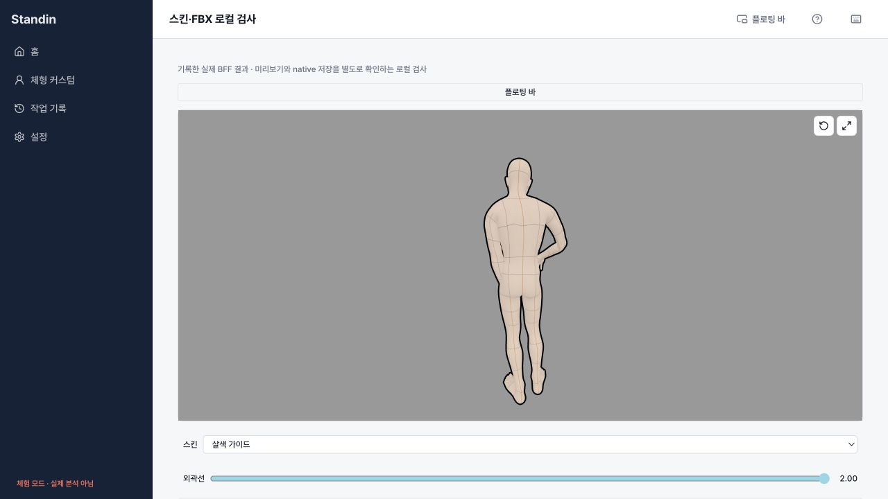
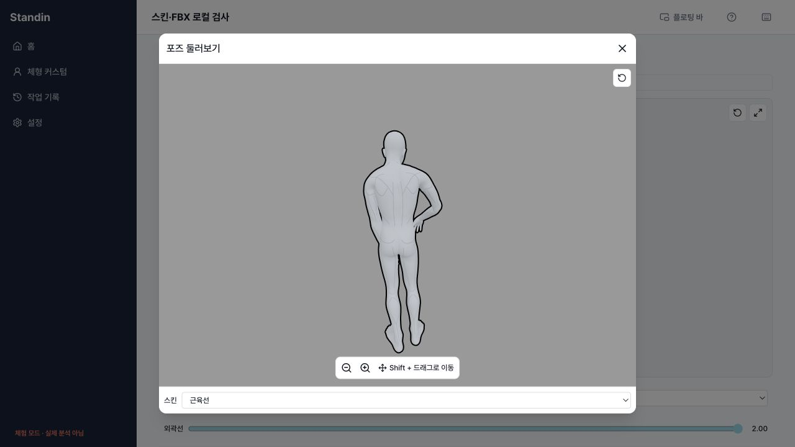
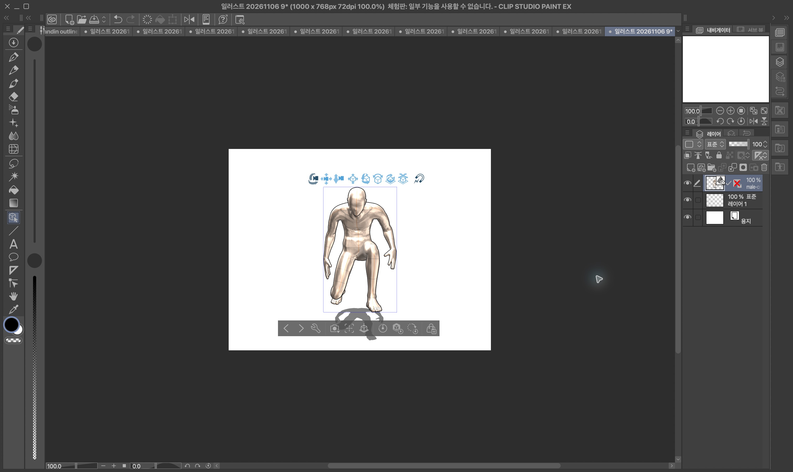
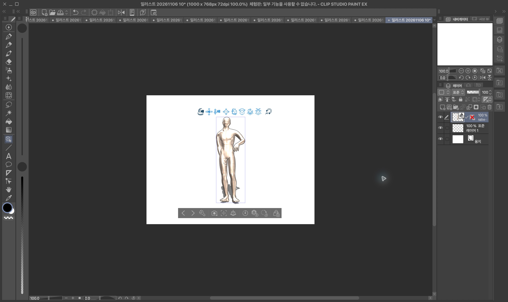

# Skin selection → verified final FBX

The review screen now keeps one skin choice per person: 기본, 회색 가이드, 살색, 살색 가이드, 근육선. Changing it preserves the candidate, body/shape, hand choices, output scope, outline and camera observation. The normal viewport and enlarged dialog use the same verified display surface; the dialog includes the same selector.

The separate optional request is `skin:{version:"fbx-skin-v1",id}`. Default normalizes to omission. Existing strict outline JSON remains unchanged. The controller binds skin into generation/recovery/prepare and rejects old capabilities; consent and native-save snapshots also include skin. Legacy/BVH/scene paths cannot silently discard a nondefault choice.

## Supported evidence boundary

Only the current approved #168 male (`male-default83-v0-7-6-p1`,24988 vertices) and female (`female-default80-v0-3-9-p1`,24999 vertices), each52bones, full individual FBX are accepted. The four nondefault skins support skin-only(width0) or combined outline width2. Intermediate combined widths and crops are unavailable until their own acceptance is published. Existing default-skin outline behavior is unchanged. Public server capability must also approve the current target; client pins do not enable a feature flag.

Asset manifest: `1fb0fa382d4fa7d27233b6139cba9c5f1ec575c6b8f86b7deac2a3dc4d447386`, version `current-neutral-uv-20261106-v1`. The new display mapping uses exact neutral triangle/corner UVs, immutable model/UV/topology/texture hashes and prebuilt2048 PNG derivatives. Final FBX proof separately pins its4096 embedded PNG. Old female topology and nearest-position UV guessing are rejected. Canonical model points/normals/bones/weights are never modified by display code.

Preview assets are restricted to their operation-owned URLs, state/revision and pinned hashes/lengths. Compressed reads, gzip inflation and image dimensions are bounded. On skin swap, abort releases obsolete work and display geometry/material/texture/bitmap resources; normal/large clones reuse the active surface. Equivalent polls/status changes do not reload it. The existing studio lighting remains a preview convention, not a CSP pixel match.

Final processing is verified base→skin→outline. The strict receipt checks exact supported asset/model/compatibility, choice digest, verifier material manifest, unchanged-body limits and proof chain. Native download compares the currently selected skin and outline to the operation, checks streamed final bytes and SHA, and rejects late/stale results. Default skin omission retains the existing server identity/path.

## Output scope and recovery (2026-11-13)

Nondefault skins work only for full output. For every other resolved scope (`half`, `bust`, `shoulder_head`, `head`) the Converter crops the mesh, so it never matches the pinned full-mesh UV, and the BFF refuses it as `SKIN_UNSUPPORTED`. Production example: rough_178 is upper body only. Its cropped male mesh has 97,337 vertices; the full mesh has 139,474.

- **Candidate page.** `CandidateAppearanceControls` gets the person's resolved scope (`previewScope(person)`, the same rule as the BFF's `resolvePersonOutputScope`). For a cropped scope, only 기본 stays enabled. Disabled choices carry the reason as a tooltip, and a note says "전신 포즈에서만 스킨을 쓸 수 있어요." We disable rather than flag because `SkinControl` already disables unavailable combinations, and a choice that can never be saved should not be pickable. 기본 always returns to the plain default skin when gray line layers are unavailable.
- **Head reason.** The BFF head now adds a sibling `skinUnavailable:{code,outputScope?}` next to the unchanged strict `skinExport`. The controller keeps it in its snapshot. Each case becomes a different failure:
  - A cropped `outputScope` becomes `SKIN_UNSUPPORTED` (422) with `details.outputScope`. It is permanent, so there is no auto-retry.
  - `SKIN_UNSUPPORTED` or `SKIN_UV_INCOMPATIBLE` stays permanent (422).
  - A named outage such as `SKIN_UNAVAILABLE` stays 503 and uses the existing auto-recovery.
  - An older server sends no reason, so the result is the unchanged `SKIN_DISABLED`.
  - An available capability that does not list the chosen ID becomes `SKIN_UNSUPPORTED`.
- **Retry.** Any refused skin capability makes the next run read the head again. Before this change, 다시 시도 replayed the cached refusal, so it could never recover.
- **Review page.** If a skin failure still arrives, `useFramedReview` uses the person's own scope when the server only says `SKIN_DISABLED`, which covers older BFFs. The alert names the scope: "전신 포즈에서만 스킨을 쓸 수 있어요. 이 포즈는 반신 범위예요. 기본 스킨으로 바꾸면 저장할 수 있어요." It also offers **기본 스킨으로 바꾸기**, which resets only the failing people's skin. Their pose, body, hands and outline stay as they were. For permanent failures, 다시 시도 is hidden. For outages, both actions are shown. Nothing silently falls back: the switch is an explicit user choice.

## Actual observations

- Final typed-writer neutral FBXs:16 actual automatic CSP imports (male/female×4nondefault skins×skin-only/outline2). All isolated source directories contained only their FBX after import; no locator or manually supplied PNG was needed.
- Representative approved crouch: male+female flesh-guide/outline2 imported and compared with their source. Bent arms/legs and skin/black silhouette remained visible. Other six posed style files have independent converter verification, not six additional visual-import claims.
- Actual client HTTP adapter against disposable TCP Hono/installation middleware/PGlite and the production resolver, real Converter/Blender and skin/outline endpoints: five final downloads passed strict preview/receipt/SHA checks (flesh-guide width0/2, gray-guide/flesh/muscle width2). Local source/auth/SQL/private storage drivers are controlled; this is not production PostgreSQL/S3 evidence.
- Separate recorded-result stage: the production Tauri save adapter wrote the actual verified combined file. Disk SHA `16796fc8487da771111915deafa0a1c3069482cf9601375f81f72379f3c1073e`,5105708bytes, matches the client HTTP result. The same saved file was then actually imported into CSP with pose/flesh guides/black silhouette visible. This is recorded actual HTTP result→native→CSP, not one live product UI/BFF transaction.
- UI photos show all five choices in production components, including selector changes inside the enlarged dialog while camera observation remains. A temporary loading state stays a loading message rather than a false failure.

CSP's existing default lighting creates strong white specular highlights and can make lines faint locally. A separate explicit-matte Phong/Lambert diagnostic visibly improved this in one front comparison; those two diagnostic files are not product-certified and do not change current accepted bytes/pins/runtime. No `.clip` or CSP-internal posing support is claimed or required.

## Validation and isolation

The new worktree started on client outline PR162. After that PR was squash-merged, the skin-only commit was rebased onto develop915b9ea (the source tree is identical to the accepted outline head); the old outline worktree was untouched. Server skin PR173 and BFF skin PR162 (different repository) are explicit upstream dependencies. No merge, deployment, global activation or paid inference occurred.

`npm run typecheck`, build, lint(no errors; one existing BodyCandidates fast-refresh warning), and the final full regression suite (1346 passed,5 opt-in skips) passed after the UI loading/resource-reuse cleanup. Opt-in `scripts/skin-bff-wire.test.mjs` passed62.24s and68.06s for the two actual file groups. `validation.json` preserves their hashes and the separate native stage. The opt-in UI/native harness is in `tools/skin-native-qa`; private model/UV/PNG/FBX/token inputs and build products are excluded from Git.
