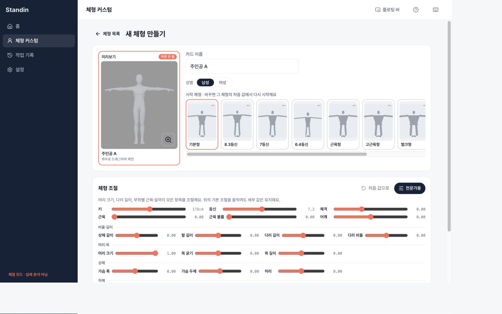
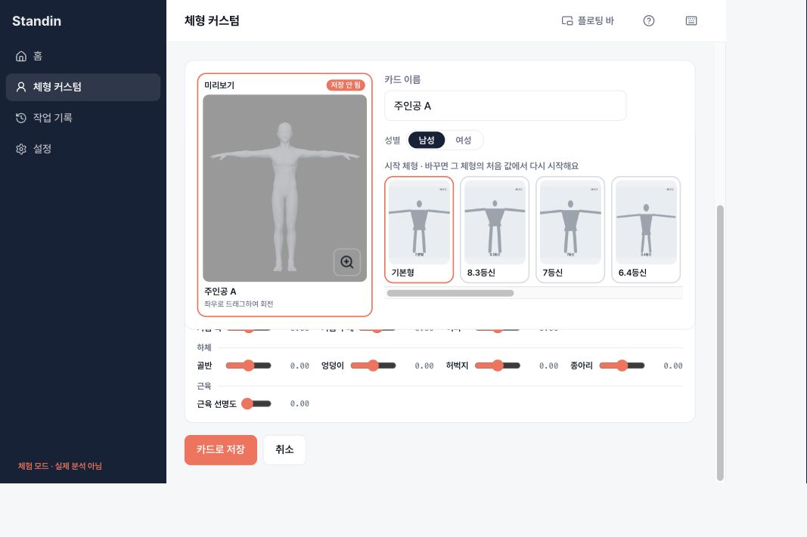
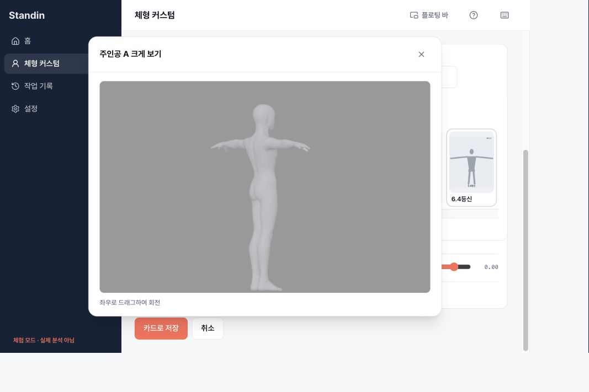

# 체형 만들기 회전·확대·고정 미리보기 검증 (2026-10-20)

상단의 미리보기와 시작 체형, 아래 전체 너비의 조절 영역이라는 기존 배치와 기본 미리보기 크기(232px 카드 / 248px 그림 높이)를 유지한다. 체형 만들기·카드 편집만 `interactive` 및 페이지 CSS에 opt-in한다. AppShell, 전역 스크롤, 후보·포즈·손·저장 확인 화면은 수정하지 않았다.

## 브라우저 확인

Chrome, Vite 로컬 mock. 별도 임시 진입점에서 `BodyCustomPage` / `BodyPreferencesPage`와 메모리 QueryClient·mock 설치 ID를 사용했다. 실제 설치 등록, 동의, 인증 저장소, 설치 앱은 변경하지 않았다. 런타임 파일은 기존 로컬 release의 남성 0.7.1 / 여성 0.3.3 자산을 복사해 사용했다. 따라서 메시 회전은 실제 Three.js/WebGL 렌더링이지만 서버 저장 결과 검증은 아니다. 시작 체형 카드의 단순 그림은 mock 이미지다.

- CSS viewport 1280×800: 기존 상하 배치·기본 미리보기 크기 유지.
- 960×640: 전문가 모드에서 끝까지 스크롤, 인물 유지 및 저장/취소 버튼 접근 확인.
- 720×500: 낮은 창의 그림/시작 카드 높이를 줄여 단일 페이지 스크롤에서 마지막 조절과 저장 접근 확인. 좁은 창의 조절은 두 열로 표시한다.
- 인물 좌우 마우스 드래그 → 앞/뒤/측면 렌더 확인. 테스트에서 카드 너비만큼 드래그하면 2π 회전 검증.
- 키 178→179 변경 → 확대 아이콘 → 현재 체형의 확대/회전 → 닫기 및 ESC → 아이콘 포커스 복귀 확인.
- mock 카드 생성·저장·목록 복귀·카드 편집 재진입에서 키 179 유지 확인.
- 로딩/자산 교체/WebGL 실패·복구 및 비 opt-in 미리보기의 수동 상태는 컴포넌트 테스트로 확인.

브라우저 확대율 때문에 캡처 픽셀 크기는 CSS viewport와 다르다. `innerWidth/innerHeight`로 위 크기를 확인했다.

## 자동 검증 및 한계

- `npm run typecheck`, `npm run lint`, `npm run build` 통과. 기존 BodyCandidates fast-refresh 경고와 번들 크기 경고는 남아 있다.
- `NODE_OPTIONS=--no-experimental-webstorage npm test`: 980개 통과, 전체 메시 대조 1개는 기존 조건부 건너뜀. Node 26 기본 Web Storage와 기존 jsdom 테스트의 충돌을 피하는 실행 옵션이다. 프로젝트 소스/테스트 환경 설정은 바꾸지 않았다.
- 추가 테스트: 전체 360도, 수치 변경 시 각도 유지, 확대 값/각도 공유, ESC/포커스, 컨텍스트 손실/새 자산 복구, 렌더러 자원 해제, 회전 중 shape 재계산 없음.
- 설치 macOS/Windows Tauri 실행, 실제 API/실제 카드 저장, native WebView/GPU 차이는 미검증. 설치 앱을 교체하거나 인증·동의를 초기화하지 않았다.
- develop 및 기존 #121/#122와의 통합 결과는 PR 본문에 기록한다.
