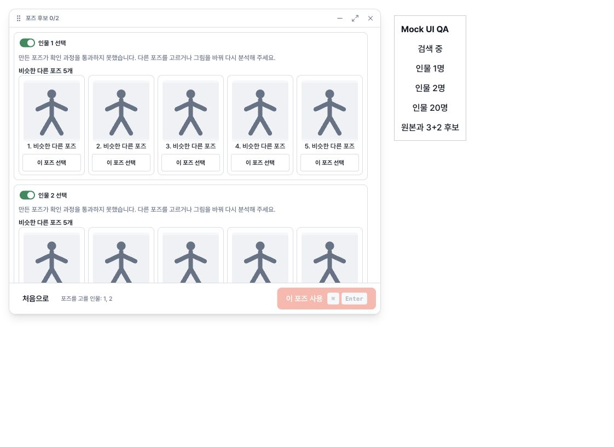
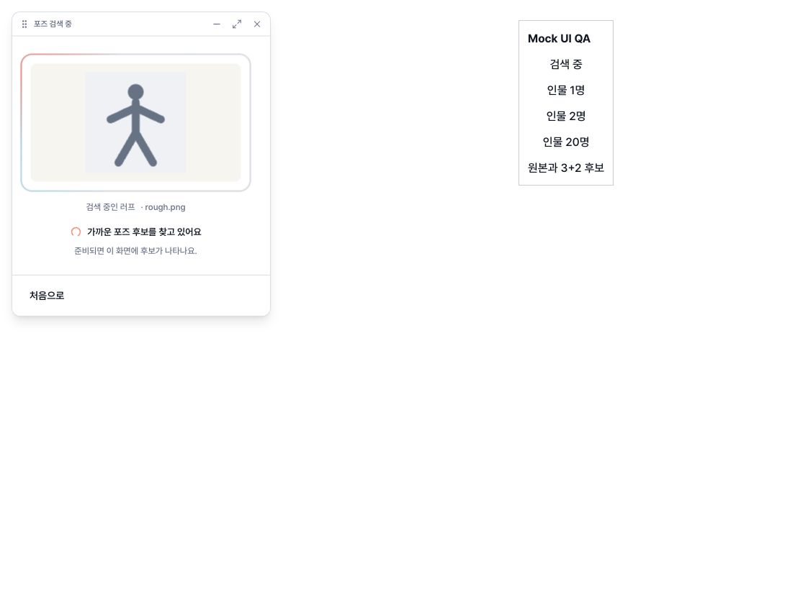

# Compact floating candidates QA — 2026-10-20

The actual BarCandidatesPage, BarShell and WindowModeSync were rendered in a local browser fixture with synthetic pose results and stick-figure thumbnails. The native window service was replaced only in the fixture with a root-element resize recorder. These screenshots verify layout, not real pose search or OS window behavior. The fixture is not shipped.

## Observed layout

- Search pending: 360 × 424 logical pixels, with the original image contained and the home button below it.
- One presentation person: 680 × 379; the content fits without the previous blank tail.
- Two presentation people: 680 × 560; bordered sections share one scrolling body and a fixed confirmation footer.
- Twenty people: still 680 × 560; the last person's first candidate can be selected after scrolling.
- Original + 3+2 candidates: 720 × 560, preserving the original left panel and candidate arrangement. The wider size preserves pose readability.
- Images continue to use contain sizing. Candidate content above the 560-pixel window cap scrolls.

## Automated checks

- Full Vitest suite: 995 passed, 1 skipped, using bundled Node 24.19.0.
- The two-person body-panel test opens each person's body controls independently, closes the first while the second stays open, and confirms both pose selections are preserved.
- Multi-person selection tests cover exclusion/reinclusion and confirming the actual selected IDs for both people.
- WindowModeSync tests cover content shrink/grow, the height cap, pending/result width changes, and preservation of user-moved window anchors.
- TypeScript + Vite production build passed.
- ESLint: no errors; existing BodyCandidates.tsx fast-refresh warning remains.
- System Node 26.5.0 initially failed 33 unrelated storage tests because its experimental global localStorage shadowed jsdom. The bundled runtime passed the entire suite without code changes to those tests.

## Scope and remaining platform check

No API contract, logo asset, app-mode layout or native Rust code changes. Real API analysis, Windows runtime and native macOS resizing were not exercised for this change. Before release, check pending → results → body panel → pose on Windows and macOS, especially near a monitor edge; browser measurements cannot establish native window behavior.
