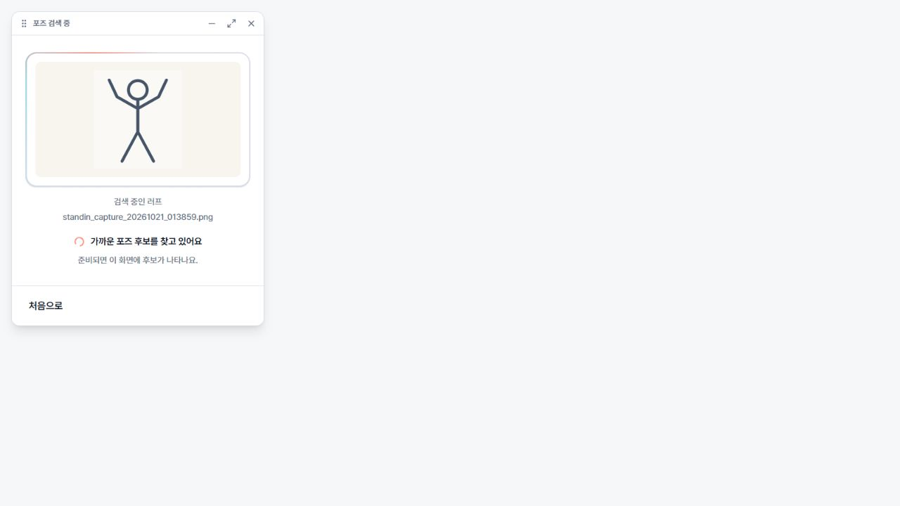
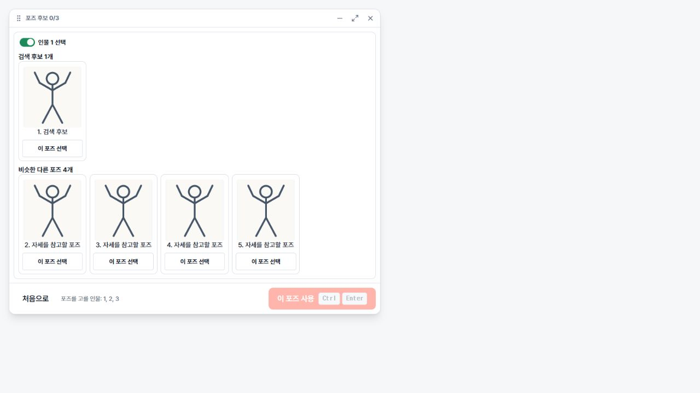
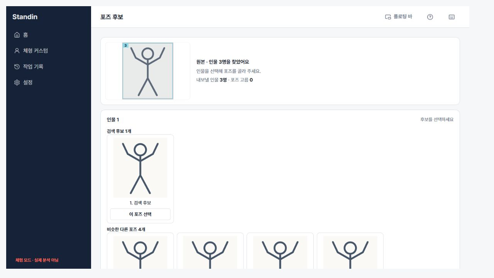

# Floating alignment and hidden scrollbars — 2026-10-21

The actual `BarCandidatesPage`, `BarShell`, `PoseSearchPending`, `PoseViewerPage`,
and `AppShell` were rendered in the Windows Codex browser with synthetic analysis
results and stick-figure images. The temporary fixture is not shipped. No real
analysis, native window controls, export, or installed application was exercised.

## Verified behavior

- Pending search at 360px: the preview center matches the shell center (0px offset).
- Pending search at 320px with a long Korean filename: no horizontal overflow;
  the filename truncates and its full name remains available in the title.
- Floating candidates at 680 × 560: the content scrolls inside a 468px viewport
  with approximately 1391px of content. The scrollbar has `scrollbar-width: none`,
  its WebKit pseudo-element has `display: none`, and no scrollbar gutter remains.
- Wheel scrolling reaches the third person (`scrollTop` approximately 922px).
  Selecting that person's first candidate updates the title to `포즈 후보 1/3`.
  The confirmation footer remains fixed.
- Page Up from a candidate moves the floating content back up
  (`scrollTop` approximately 594px).
- Full app at 1200 × 680: the main scroll area has no visible scrollbar or gutter.
  Wheel scrolling moves from 0 to approximately 453px and exposes the lower content.

## Checks

- `npm run lint`: passed; existing `BodyCandidates.tsx` fast-refresh warning only.
- `npm run build`: passed, including TypeScript.
- `npm test -- --maxWorkers=4 --minWorkers=1`: 129 files passed, 1 skipped;
  1006 tests passed, 1 skipped.
- `git diff --check`: passed.

Native Windows WebView2 and macOS runtime checks remain for release QA.

## Screenshots

