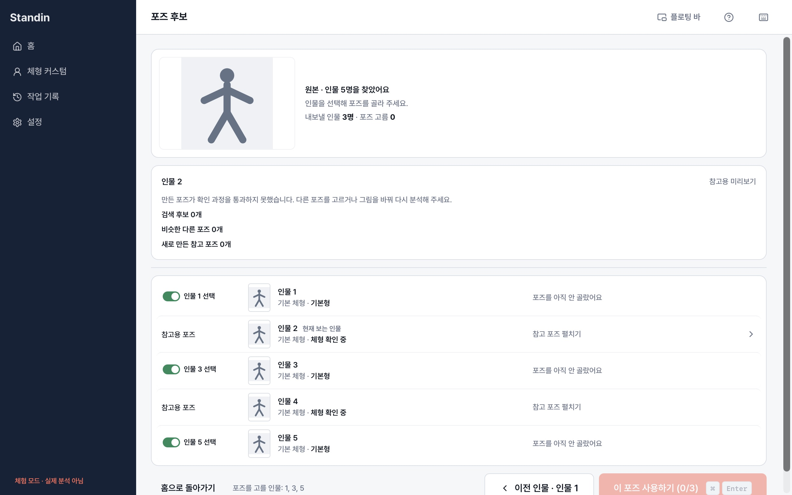

# Fullscreen people index QA — 2026-10-21

## Resulting flow

The image-search page shows the complete ordered people index below the active candidate/body panel. Selecting a person keeps that person in the index and highlights the current entry. Opening body controls does not hide other people. The index remains in normal document flow: scroll the page to reach it; there is no fixed bottom panel or nested index scroll.

The inclusion switches appear only in this lower index, with labels such as “인물 1 선택”. The active candidate card has no duplicate inclusion switch or inclusion button. Reference-only and hard-failure people keep their entries and existing non-exportable status. Each person keeps their selected pose and body selection. On fullscreen person switches, the currently displayed pose/body view carries to the next person; a reference-only person retains that intent even though it cannot display body controls. Returning to an eligible person therefore resumes the same view.

Only the image-search full app page is changed here. Semantic text results and the approved floating-bar layout/colors retain their prior behavior. AppShell has no change.

## Scroll continuity

When the lower people index is visible, person switches preserve its viewport position rather than keeping a raw scrollTop that becomes incorrect when candidate content changes height. This covers moving between reference-only and candidate-bearing people. Late preview/body layout changes continue the correction until the user scrolls or interacts again. When the index is off-screen, switching from the rough overview preserves the upper viewport instead of jumping down to the index. Correction is scoped to the current job and never adds fixed panels or reserved blank content.

## Evidence

- Full Vitest suite: 995 passed, 1 skipped, bundled Node 24.19.0.
- Four scroll-continuity regression tests cover long → short → long content, late preview resize, stopping on user scroll, job changes, and off-screen index navigation. The page test also carries body view through a reference-only person and carries pose view back across people.
- TypeScript and Vite production build passed.
- ESLint has no errors; the existing BodyCandidates fast-refresh warning remains.
- The regression test switches between three people, including a reference-only person; verifies that all index entries stay in order; opens body controls; toggles inclusion without changing the active person; checks that switches only occur in the index; and returns to the first selected pose without losing it.
- Separate native macOS Standin People QA uses synthetic five-person results, with people 2 and 4 reference-only. The screenshot shows person 2 active and all five entries below the candidate section in the page scroll.
- No real API analysis, export or installed app replacement occurred. The QA fixture and its isolated app/keyring identifier are not shipped.

## Remaining release check

Windows runtime and live-server results were not exercised. Confirm the page scroll and keyboard navigation on Windows before release. No native Rust code or API contract changed.
