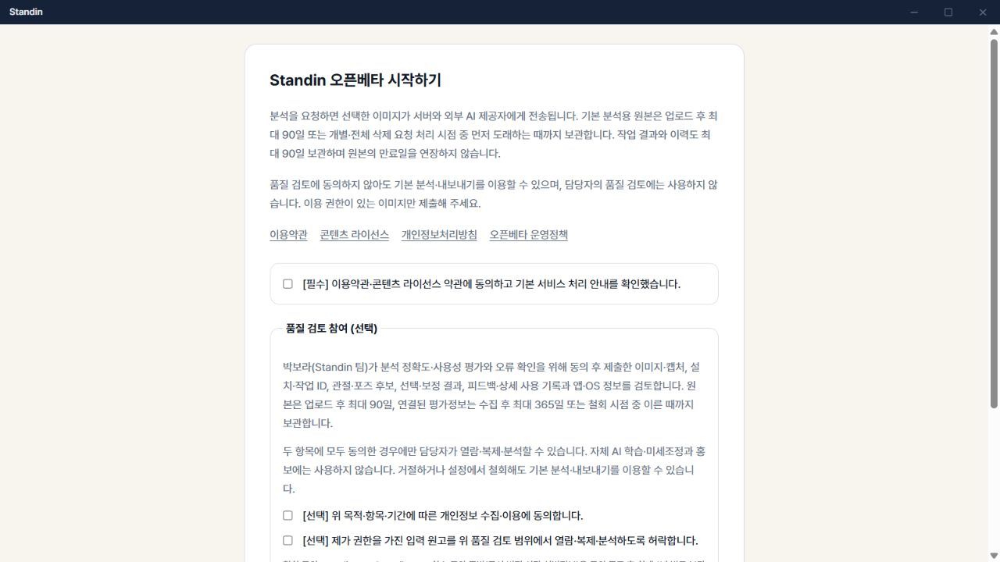
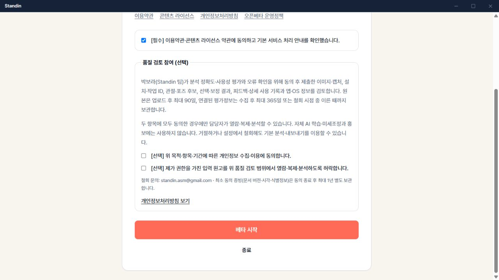
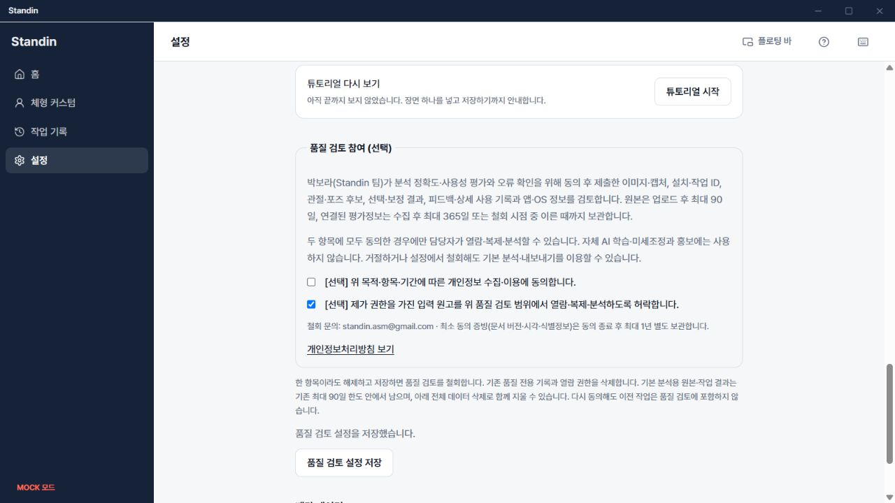

# 선택 품질 검토 화면 확인

2026-10-19. 브라우저 개발 모드(Mock API), 1280×720에서 확인했다.
네이티브 Tauri 배포본이나 운영 계정의 실제 동의를 변경한 검증은 아니다.

- 첫 실행의 필수 확인 및 두 선택 체크박스 모두 기본 미체크다.
- 필수 확인만 체크하면 두 선택 항목이 비어 있어도 `베타 시작`이 활성화된다.
  창 높이를 넘는 내용은 스크롤하여 시작 버튼까지 접근할 수 있다.
- 설정에서 두 허용을 저장한 뒤 한 항목을 해제해 저장할 수 있다.
  기본 설치 인증은 유지되고 `전체 데이터 삭제`는 별도로 표시한다.
- 테스트는 기존 설치 조회 실패, 철회 실패/재시도, 늦게 도착한 조회 응답,
  미동의 이벤트 차단과 과거 오프라인 큐 삭제도 확인한다.

BFF의 모든 API/워커 인스턴스 배포 후 앱을 배포한다. 기본 약관 버전과 선택 동의 버전은
분리되어 있고, 기존 앱 설치를 재등록하거나 과거 업로드를 자동 동의로 전환하지 않는다.

## 스테이징 서버 연동 확인

2026-10-19, BFF `749367c0`의 API 교체와 워커 정의 갱신 후 합성 테스트 설치로 확인했다.
미동의 상태의 기본 이력 조회, 검토자 접근 거부, 명시적 동의 후 검토/이벤트 허용,
한 항목 철회 후 접근·이벤트 차단과 기본 인증 유지, 재동의 후 이전 동의 ID 거부가 통과했다.
테스트 설치와 데이터는 전체 삭제 API로 정리했으며 실제 사용자 이미지/자료는 사용하지 않았다.

이 검증에서 PC 시계가 서버보다 약 350ms 느려 동의 직후 이벤트가 제외되는 경우를 재현했다.
앱은 새 이벤트 시각의 하한을 서버 동의 시각으로 두도록 보완하고 회귀 테스트를 추가했다.
서버의 동의 이전 이벤트 차단과 기존 큐 폐기 규칙은 유지한다.
