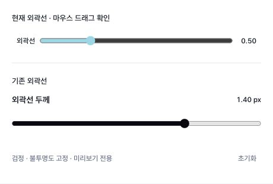

# Native outline slider dragging

`OutlineControl` now leaves range-thumb dragging to the browser, as the existing
`OutlineThicknessControl` does. It stops the pointer event propagating into a parent
viewer without explicitly taking pointer capture away from the native thumb. Its
18px input height matches the adjacent body sliders and keeps the compact row size.

Gesture editing, cancellation, key handling and final appearance state are unchanged.
Existing supported widths remain:0–2 in 0.05 steps for ordinary surfaces,0/2 for line
skins. This is an interaction fix, not an expansion of the certified export matrix.

Validation:
- macOS in-app browser, real pointer drag:0 → 1.50 → 0.50 on the modified control;
  reference native slider dragged0 → 1.40. No keyboard/value injection was used.
- 34 related tests passed; typecheck/build and changed-file ESLint passed.
- Tests cover native thumb ownership, parent gesture isolation, in-progress width,
  pointer cancellation/unmount cleanup and line-skin width constraints.
- Windows/native installer not tested. No merge or deployment performed.

