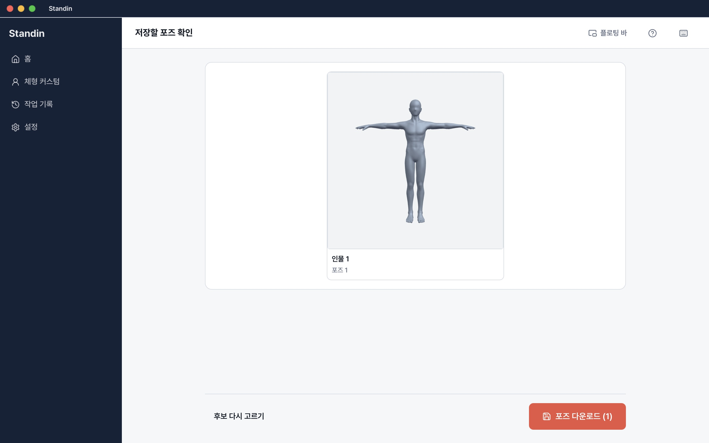
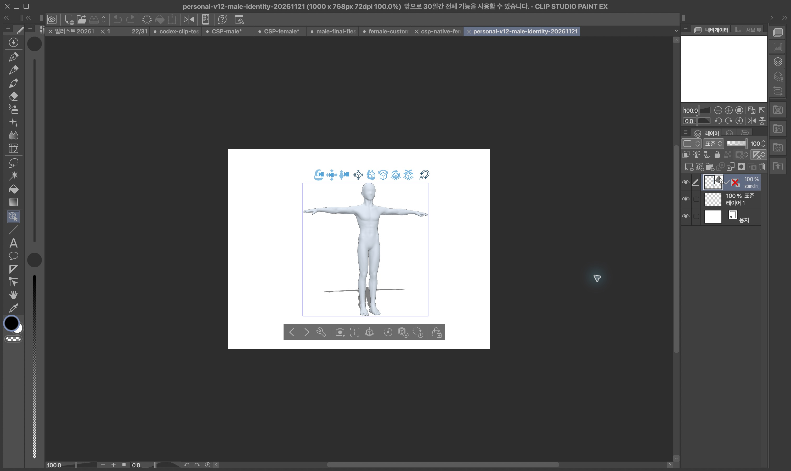
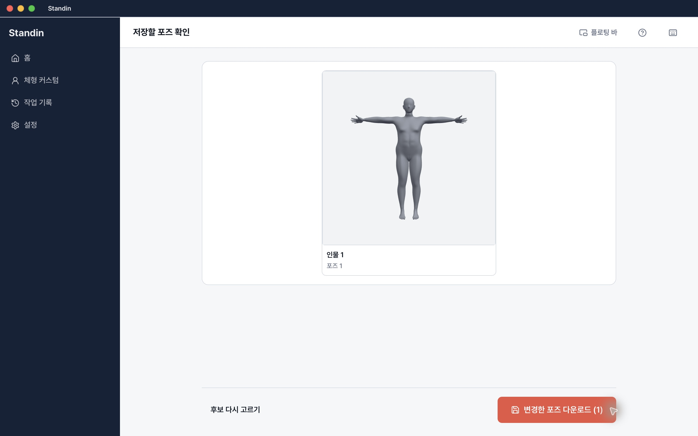
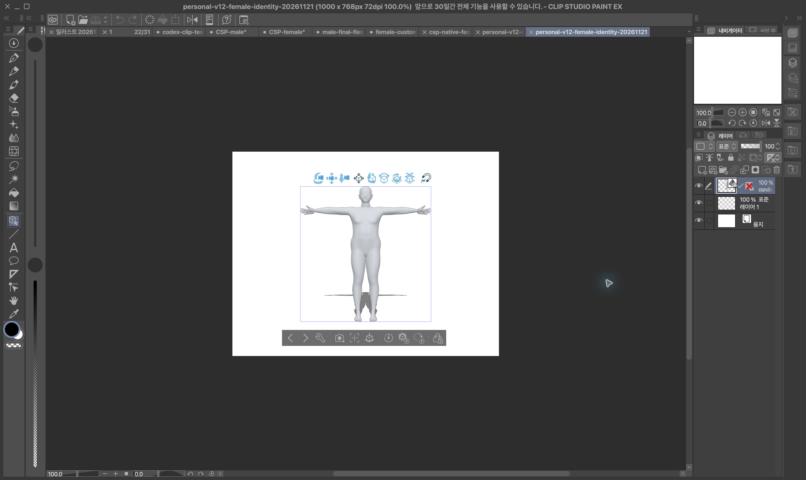
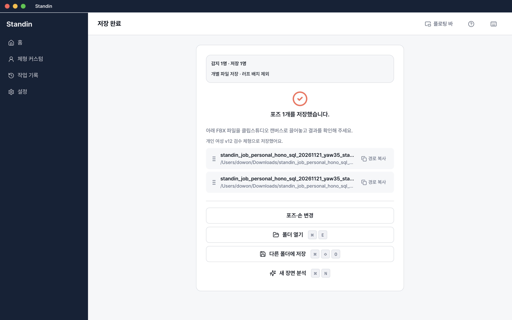
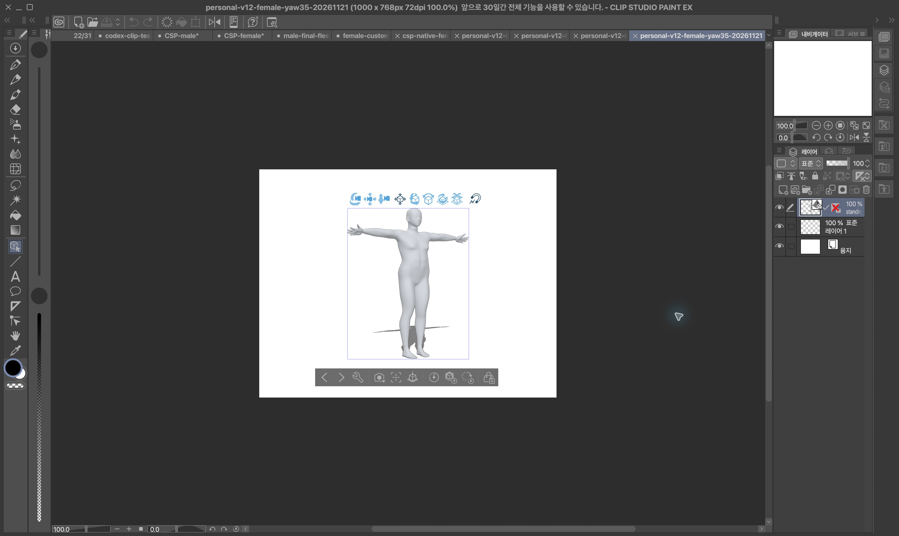
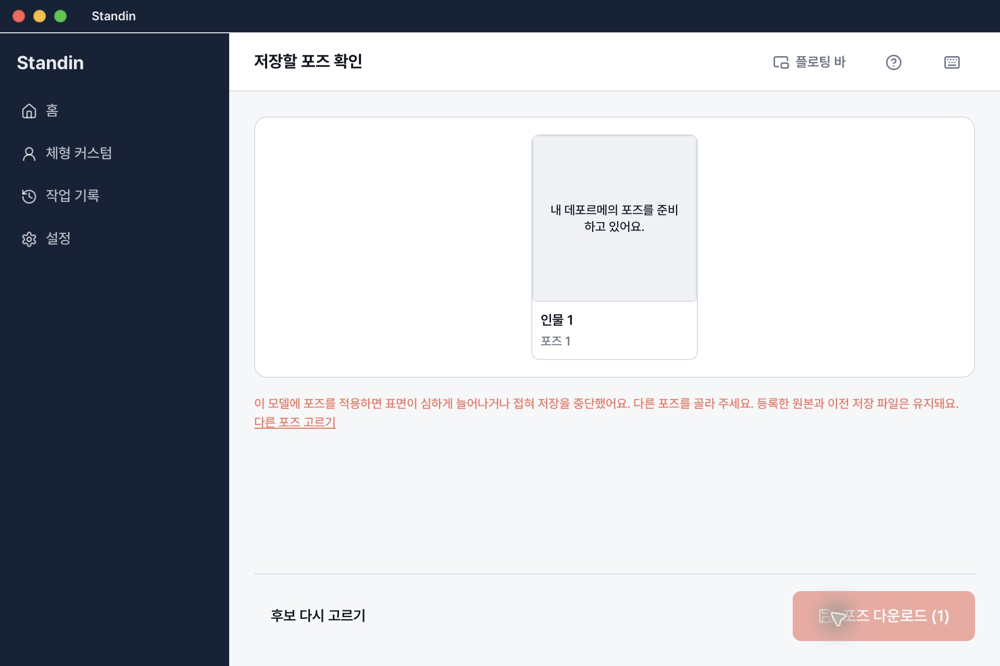
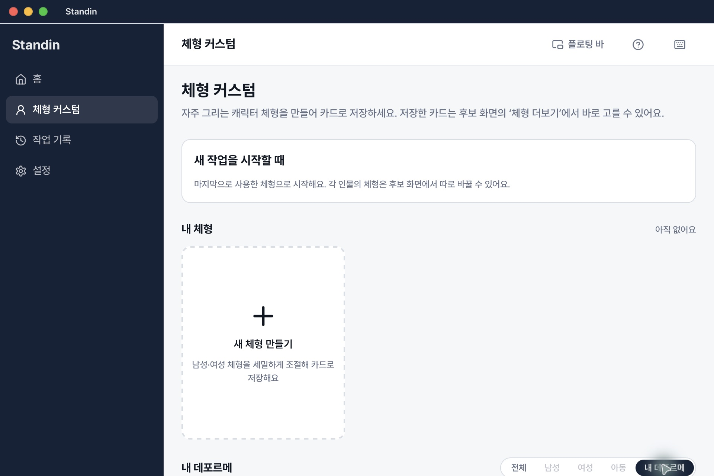

# 개인 모델 v12 실제 앱·CSP 검수 — 2026-11-21

**Draft·기본 비활성·releaseReady:false. 심한 변형 해결은 미완료다.** develop `8b1708d4` 충돌을 해결하고 기존 main `c0aed5dc`의 최종 확인 방향 수정을 인수했다. 개인 등록 모습의 큰 미리보기와 기본형의 최신 미리보기·저장·스킨·외곽선 경로를 보존한다.

## 실제 수행과 한계

- macOS 26.6.2 arm64, 독립된 QA 앱/앱데이터/QA Keychain, loopback API. 운영·스테이징·업데이터 피드와 연결하지 않았다. 실제 계약 동의 없이 로컬 Hono가 만든 가상 설치만 사용했다.
- 남성 CS3C·여성 FBX를 실제 picker로 등록하고 개인 모델을 선택했다. 각 모델 × identity/yaw35 카메라의 중립 대조를 최종 확인하고 실제 Downloads에 FBX4개를 저장했다. 네 artifact/snapshot은 서로 다르며 원본·포즈·카메라 binding/최종 reloaded 검사를 통과했다. 같은 이름의 두 번째 저장은 `_v2`로 이전 파일을 보존했다.
- 네 실제 저장본을 CSP 새 문서에 가져와 `.clip` 저장·닫기·재열기4건을 확인했다. 남성 identity의 오브젝트 이동/Y 회전도 재열기 후 유지됐다. 기존 사용자/다른 기본형 검수 문서는 수정하지 않았다.
- 중립 입력은 기록 BVH의 전 채널0 대조다. 심한 앉은/CMU 포즈 해결로 세지 않는다. 여성 앉은 입력은 UI에서 품질 사유와 비활성 다운로드를 확인했고 새 파일이 없다.
- 네 저장본은 20:46 앱 빌드다. 정확한 runtime manifest는 아래와 같으며, 이후 복구 버튼 수정 소스를 포함한 최종 재빌드에서는 사용자 QA Keychain 재승인 후 카드2개 보존·이름 변경 취소·삭제 취소·실제 picker 취소·앱↔바 전환을 확인했다. 품질 거부에 ‘다른 포즈 고르기’가 표시되고 후보로 돌아가 개인 체형 선택을 유지한다. 최종 재빌드의 여성 identity 재다운로드는 앞서 CSP에서 재열었던 입력과 SHA까지 일치한다. 이전 빌드 출력에 나중 source SHA를 붙이지 않는다.
- 오프라인 BFF에 승인된 기본형 poster가 없어서 후보2 클릭은 이미지 재시도로 끝났다. 카메라별 실제 소유 작업으로 분리해 첫 확정 후보를 사용했다. 일반 온라인 후보 이미지 흐름을 통과했다고 주장하지 않는다.

Runtime `personal-converter/12`, contract7, manifest `4929a7ab3200a96533a674361669ab278da108c46663d9b9b9f26d8257b1c852`, exact6,616개, `darwin-arm64`. 이전 v11 manifest는 보존·재감사했다. 새 품질 차단은 retarget 변경이 아니라 export veto다. 원본 리그/웨이트/재질/노멀/손을 유지하며 기준을 완화하지 않는다.

## 화면 증거

| 실제 개인 모델 앱 | CSP 재열기 |
|---|---|
|  |  |
|  |  |
|  |  |





## 실제 BFF 경계

`tools/personal-native-qa/bff.mjs`는 별도 BFF develop `4255e88`의 실제 Hono 라우터·설치 토큰 해시 인증·현재 CORS·PostgreSQL 스키마와 SQL(PGlite pg adapter)·확정 선택·refined artifact 저장/조회·S3 SDK를 사용한다. 외부 추론과 AWS만 기록 BVH/loopback 파일 object-store로 대체한다. 새 제품 endpoint나 BFF PR은 없다. missing/invalid auth, foreign owner, stale confirmed selection, changed source SHA, wrong person/pose는 거절되고 base/refined 바이트 일치를 검증했다. refined 대조는 공백 바이트를 추가한 경로 구분용이며 새 조형 보정이 아니다. 운영 inference/SQL/S3 E2E 수용과 구분한다.

개인 원본/로컬 ID·경로·decoder가 요청에 들어오면 검수 서버가 거절한다. 요청 증거에는 method/path/status/BVH SHA/시간만 기록하고 토큰·body는 기록하지 않는다. quality consent가 없어 export analytics 행은0이다.

## 검증 결과와 남은 출시 조건

[해시·단계별 수치·실측 시간·실패를 포함한 JSON](evidence.json), [서버 분석/기각 실험](https://github.com/04JUNG/Standin-server/blob/codex/personal-body-local-converter/docs/personal-body/CLOSEOUT_20261121.md).

client 전체1744 pass/7 skip 후 품질 복구2건을 추가했고 관련78건을 통과했다. GitHub 구현 head `07e4b480`의 전체 CI는 **1746 pass/7 skip**이며 frontend·macOS/Windows Rust·PR check를 통과했다(기존 정책으로 Dev/Staging build skip). 후속 증거 문서 head는 PR CI에서 별도 확인한다. typecheck/web build, lint0error(기존2warning), packaging5건, Rust21 pass/6ignored, 실제 native5건을 통과했다. native는 v11→v12 재등록에서 카드 ID/이름/생성일 유지·version 증가·fingerprint 교체·이전 snapshot 거부·새 cache 재사용·저장본 보존·취소·FBX·decoder 유무를 검사한다. 자동 검증과 실제 picker/CSP 수용은 따로 기록한다.

여성 CMU 최대198.628788배의 심한 변형은 해결되지 않았다. 새 부모 전달14후보는 모두 기각했다. 아동 최종 실기에는120초 제한 안의 TIMEOUT이 남고, Windows/Intel 실제 runtime·정식 내장 서명·notarization·decoder 재배포/완전한 notices·live BFF 수용도 남는다. 새 앱/패키지를 출시로 올리거나 main/develop에 직접 push/merge/deploy하지 않는다.

## 오프라인 검수 서버 재현

별도 BFF checkout에서 `npm ci && npm run build`를 수행하고 로컬 검수 의존성 `@electric-sql/pglite`를 준비한다. 아래 변수는 모두 명시적으로 지정해야 한다. 이 도구는 loopback18461(Hono),18462(object-store),18463(recorded upstream)만 연다.

```sh
BFF_QA_ROOT=/absolute/isolated/bff \
QA_WORK=/absolute/private/qa-state \
QA_BVH=/absolute/neutral.bvh \
QA_BVH_SHA256=24852fcb5222a9a8c4511db527b479bc85f1122238260e0b75adede225d42a8d \
QA_SEVERE_BVH=/absolute/recorded-seated.bvh \
QA_SEVERE_BVH_SHA256=756b393a31732e270a6fa65454fb4162e6f442a7f0e31ef8c7f0da204dc74ad6 \
node tools/personal-native-qa/bff.mjs
```

`credentials-private.json`은 해당 비운영 설치 전용이며 Git/보고서에 포함하지 않는다. 같은 QA 앱을 재빌드하면 macOS가 키체인 접근을 다시 확인할 수 있다. 현재 운영 설치·계정·토큰을 이 검수 서버로 복사하지 않는다.
