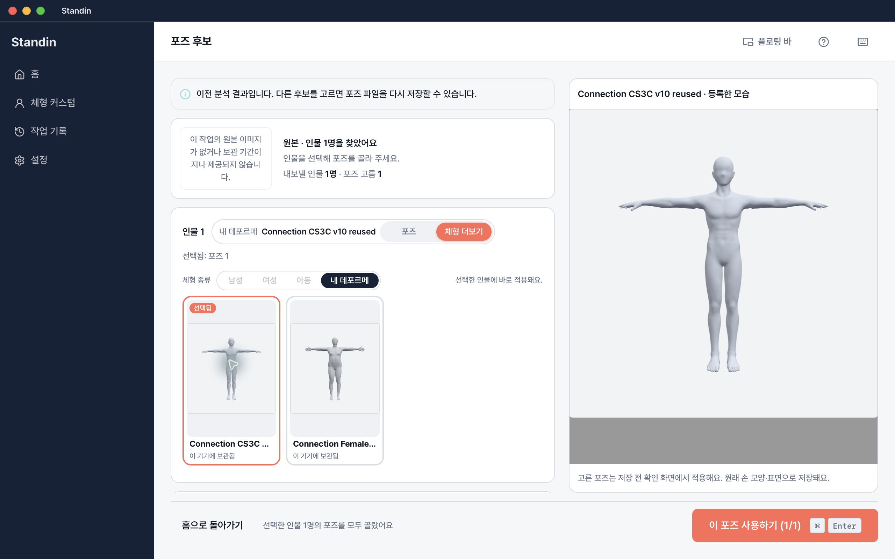
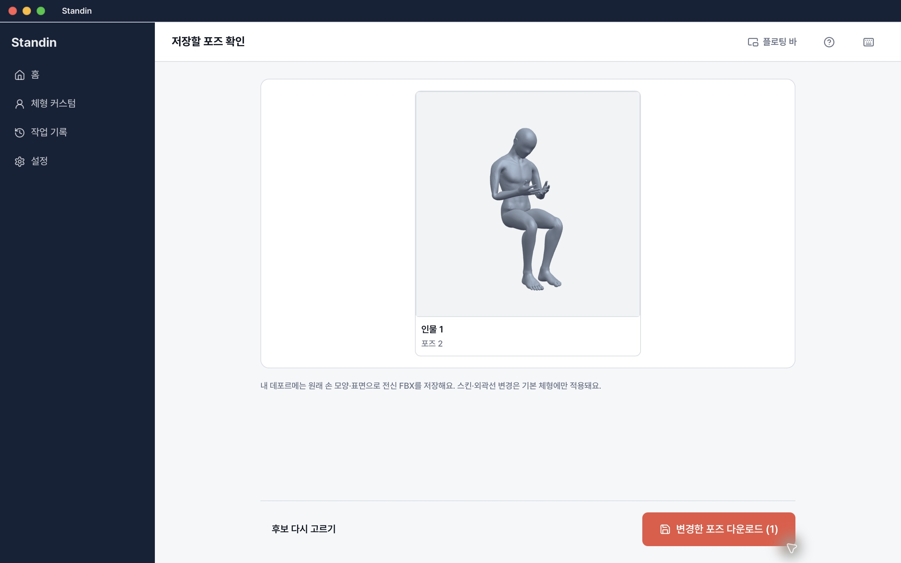
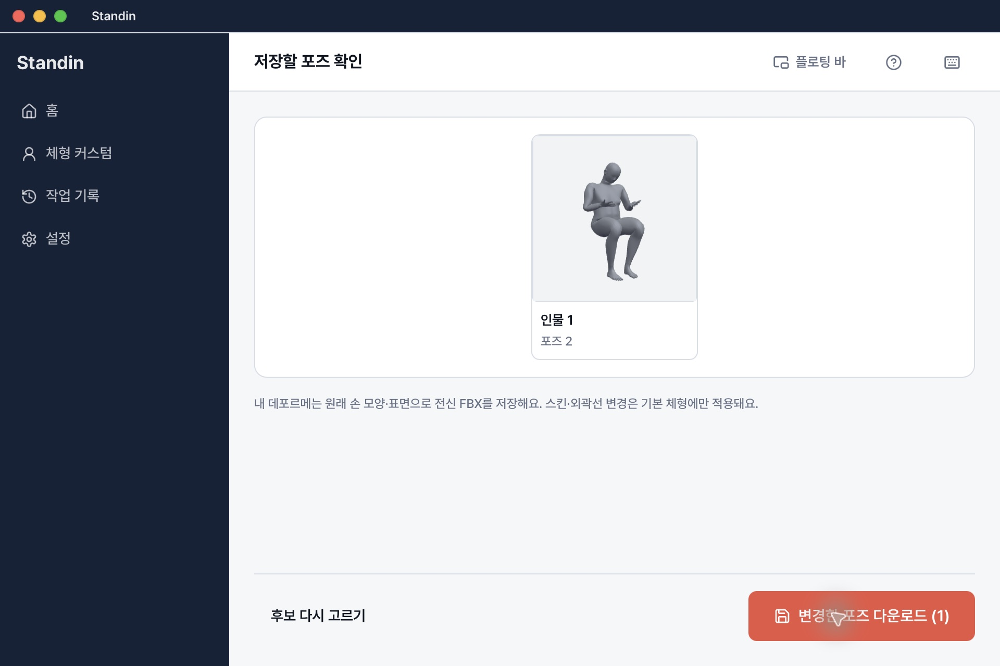
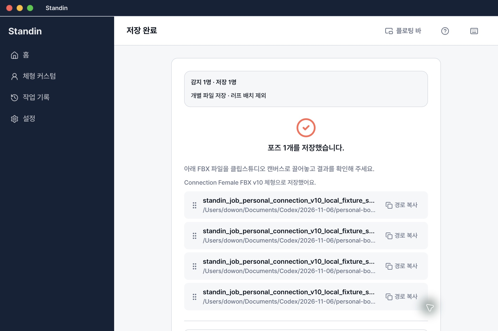
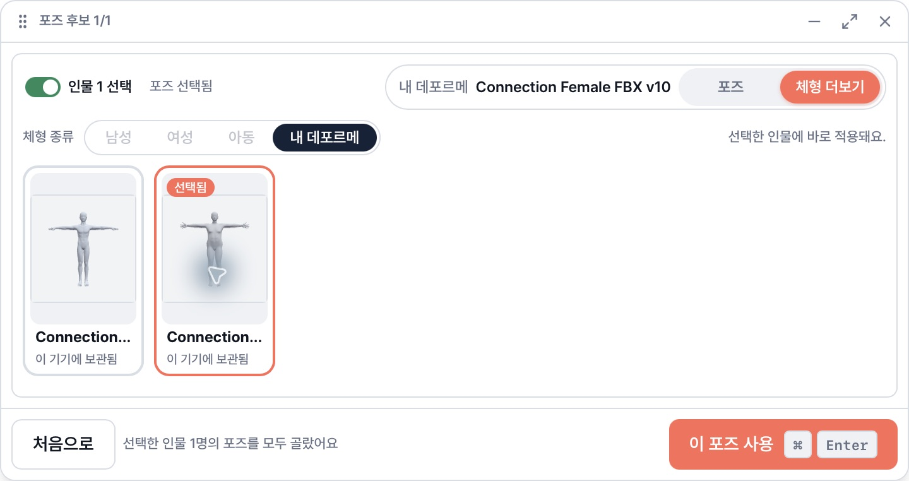
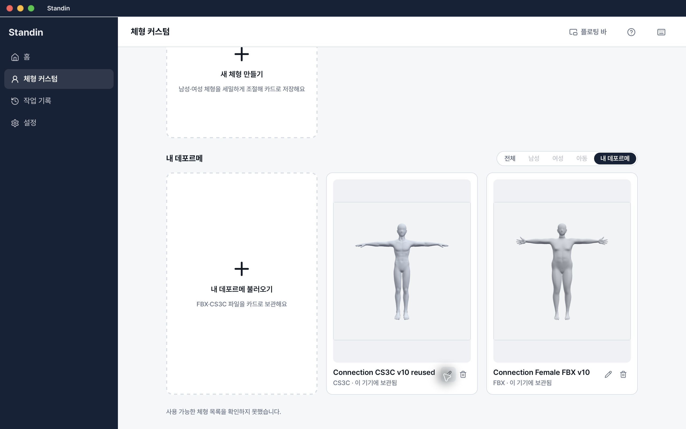
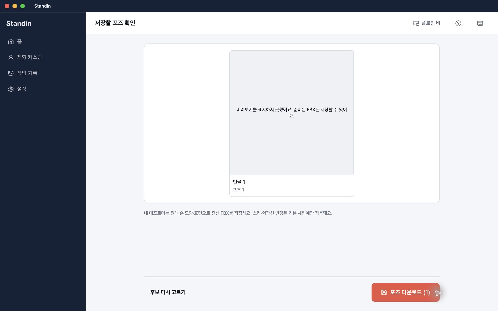

# 개인 FBX·CS3C 연결 / 최신 develop 통합 — 2026-11-06

**최신 develop 충돌을 해결했고, 실제 앱에서 기록 final BVH → 개인 모델 → 최종 FBX 저장 4건을 확인했다.** 비용 없는 localhost 소유권 fixture를 사용했다. Production/live BFF 인증·분석, 변형 품질, CSP 및 다른 OS의 수용과 구분한다. Draft / default-off / `releaseReady:false` 유지이며 병합·배포·유료 호출은 없다.

## 통합한 동작

PR159 `a473b525…`에서 새 독립 bare/worktree를 만들고 develop `65a43657194f87f244075d6ba24fa76d9b71b703`을 정상 merge했다. 커밋 `ae3224a3ab3d254658de5e6403d7007c41e25ecd`. 기존 공통 3D·기본형/role/order·점진 검색·돋보기·외곽선·스킨·큰 미리보기 변경은 보존했다. 개인 모델의 native final-BVH 경로와 기본 모델의 interactive controller를 인물별로 분리했고, optional controller 배열의 인덱스도 유지했다.

큰 선택 미리보기는 개인 카드에서 서버 기본 체형을 보여주지 않는다. 실제 등록 모습을 **“등록한 모습”**으로 표시하며 포즈 적용은 저장 전 확인 화면이라고 안내한다. 개인 모델은 원래 손 모양·표면으로 저장하고, 기본 체형에 선택했던 스킨·외곽선 값은 그 기본 체형으로 돌아올 때를 위해 보존한다. 개인 모델에 해당 기능을 새로 지원한다고 표시하지 않는다. 등록 플러스 카드·inline 이름 변경·확인 삭제·앱/바 카드 선택 패턴은 유지했다.

[플랫폼 인수](../personal-body-platform-20261106/README.md)의 패키징 보강 `ad149c4`를 검토해 `3d31f2e`로 cherry-pick했다. exact-file/hash·symlink·누락·잘못된 native architecture를 거부한다. v10 runtime 바이트는 바꾸지 않았다. 새 자동 보정 runtime은 채택되지 않았다.

## 실제 앱 / 저장 절차

별도 ID `app.standin.desktop.personal-connection-qa-20261106`, 앱0.2.3, 실제 macOS26.6.2 arm64. 일반 build wrapper와 runtime manifest `eaac3841c8b9e693ff88c959eabaceaf1ecc298e547eede748e83ad4a0de1d70`을 사용했다. Mock 두 플래그는 false, interactive opt-in은 이 QA 앱에서만 true, API는 localhost:8000, updater endpoints는 별도 overlay에서 비웠다. 기존 설치 앱은 변경하지 않았다.

앱 binary SHA `7af1288f9f2b6fbcf3d22042070405079712d503ddcc4b56bda096f316f63d6a`. 빌드한 로컬 commit `7f3ff3565a424512b2f9eaed1baeb924a170cb0b`의 전체 Git tree는 게시자의 `3d31f2e`와 같다. 정확한 tree/config/runtime SHA는 [evidence.json](evidence.json)에 있다. UI 변환 후에도 6,591개 runtime 파일의 정확한 집합·해시 검사를 통과했다.

Keychain namespace도 별도로 격리했다. 빌드 환경 `STANDIN_KEYRING_SERVICE=app.standin.desktop.personal-connection-qa-20261106`을 플랫폼 담당이 확인했고, publisher도 rustc `standin_desktop_lib.d`64행의 `env-dep` 및 위 앱 binary SHA를 직접 재확인했다. 번들 식별자만으로 격리를 추정하지 않았다. Credential/Keychain 값은 조회하지 않았으며 이 metadata 보완을 위한 새 빌드나 앱/runtime 변경은 없다.

공용 UI 락을 독점한 동안 일반 제품 화면만 사용했다. 최소 fixture는 신규 추론·원본 업로드·외부 연결을 허용하지 않고 기존 허용 기록 BVH SHA `756b393a31732e270a6fa65454fb4162e6f442a7f0e31ef8c7f0da204dc74ad6`만 소유한 선택 tuple에 반환한다. 설치 자격정보/소유권은 로컬 메모리 fixture다. Hono·SQL·S3·production 인증 구현 검사는 아니다. [재현 도구](../../../tools/personal-native-qa/README.md).

1. 실제 picker로 이전부터 허용된 남성 CS3C와 여성 FBX를 등록했다. Native 명령·모델·파일 저장을 mock하지 않았다.
2. 작업 기록의 fixture 후보를 열고 개인 카드 선택 → 저장 전 확인의 실제 native apply → 새 QA 폴더로 자동 저장했다. 저장 직전에 동일 final BVH SHA를 다시 검사했다.
3. 같은 기록 BVH의 후보 행렬을 identity/source와 yaw35로 바꿔 각각 저장했다. 후보 변경 중 저장 버튼이 비활성화됐고 기존 파일은 덮어쓰지 않고 `_v2`~`_v4`로 보존됐다.
4. 앱의 남성 선택 → 플로팅 바에서 여성 선택 → 앱 복귀 후 여성 유지, 앱 종료/재열기 후 등록 카드 재사용·inline rename, 확인 삭제의 취소를 확인했다. 실제 삭제 뒤 사용자 출력 보존은 별도 플랫폼 native 검사에서 통과했다.
5. 큰 선택 미리보기 계약을 광고한 fixture에서도 실제 개인 등록 모습·설명과 서버 스킨/외곽선 컨트롤 제거를 확인했다. 기본 Top5 static assets는 이 최소 fixture가 제공하지 않으므로 그 3D 실패를 제품 자산 검사로 해석하지 않는다.

| 실제 앱 저장본 | 원본 | 선택 행렬 | SHA256 |
|---|---|---|---|
| `standin_pose.fbx` (기본 suffix) | 남성 CS3C | identity | `fd827d5fa720ff08b2aa328f3c15202eb689243f12c88511b3051ec4342e03f8` |
| `standin_pose_v2.fbx` | 남성 CS3C | yaw35 | `d5b7453f3bbf4fa83aadccd53f32ee6fe10c0b42ba36e7e4bbf57d57849297d8` |
| `standin_pose_v3.fbx` | 여성 FBX | yaw35 | `6d694a901a7eeca38a0fd3364fc9f1c28e1769bc647d0e19150647ca9598336b` |
| `standin_pose_v4.fbx` | 여성 FBX | identity | `80c1e94e5e4b1df5640c333a15f0001e5b4fdb73becc8980a533dac2f6a59462` |

전체 파일명·길이·원본/BVH/선택 행렬은 JSON, 절대 경로는 공용 로컬 `app-handoff.json`에만 있다. 원본 모델/decoder/runtime/FBX/payload/자격정보는 Git에 넣지 않는다. 남녀 원본 입력 SHA도 저장 후 그대로임을 재검사했다.

독립 Blender 재임포트에서 source→yaw35의 요청 강체 회전과 Hips pivot을 검사했다. 남성24,988점 최대오차 `1.0081e-6m`, 여성90,143점 `7.9578e-7m`로 `2e-5m` 기준을 통과했다. 이는 **fixture가 지정한 선택 행렬을 앱이 올바르게 전달했다는 검사**다. 실제 production 검색에서 얻은 관측 카메라, 표면 보정 성공이나 CSP 합격으로 확대하지 않는다. Source는 이번 앱의 명시적 identity이며 이전 native baseline의 null-camera와 구분한다.

## 검증 범위와 남은 문제

| 항목 | 판정 |
|---|---|
| Frontend / typecheck / lint / web build | 1,418 pass, 외부 fixture opt-in6 skip / pass / 오류0·기존경고1 / pass |
| 새 localhost HTTP wire | 실제 adapter pass: 소유자403·선택409·source SHA 불일치·PUT 후 이전 선택 거부 |
| 패키징 gate | 합성4 pass; 실제 다른 OS 실행 증거 아님 |
| 실제 macOS 앱 저장 | 위 4파일 pass; JS/native adapter 대체 없음 |
| 카메라 전달 | controlled I/yaw35 pass; 실제 live 관측 카메라는 unverified |
| 미리보기 신뢰성 | 남성 source 화면 재방문1회 실패 관찰; 원인·일관 재현 unverified |
| 실제 macOS native/재배치 | [플랫폼 결과](../personal-body-platform-20261106/README.md) pass |
| Windows / Intel native runtime | unverified |
| Production/live BFF 연속·신규 분석 | unverified; 유료 호출 안 함 |
| 변형 품질 / 새 runtime | not qualified / 미채택, 기존 v10 유지 |
| CSP 최신 앱4개 | 남성 source/yaw35 모두 crash, 여성 source/yaw35 모두 표시. 실제 Save As license-required, .clip/reopen 차단. [별도 실제 CSP 결과](../personal-body-csp-20261106/README.md) |

최신 앱 저장본4개를 같은 SHA로 CSP5.1.1에 실제 가져왔다. 남성 source/yaw35는 모두 즉시 종료하고 여성 두 파일은 앉은 인체·회색 음영·방향 차이를 표시했다. 최신 여성 source의 실제 Save As도 라이선스 요구로 차단됐다. null camera/identity/yaw35 남성 실패를 근거로 카메라 원인을 단정하지 않는다. 최소 리그 진단 성공을 원래 리그의 해결책으로 대체하지 않는다.

미리보기 실패는 첫 남성 source 표시 성공 후 설정 화면을 다녀온 재방문에서1회 관찰됐다. 검증된 FBX 준비와 미리보기 성공을 구분하는 기존 동작에 따라 저장은 가능했고 해당 디스크 파일을 별도로 해시했다. 이후 남성 yaw35와 여성 두 방향은 실제 표시됐다. **모든 재방문에 정상 표시된다고 주장하지 않는다.**

사용자 검수는 개인 선택 시 등록 모습 설명이 명확한지, 저장 전 적용 포즈/표면이 의도와 맞는지, 앱↔바에서 같은 카드인지, 최종 CSP 표시가 가능한지에 집중한다. 손 라이브러리·임의 리그·텍스처·CSP 내부 관절 재편집 지원은 추가하지 않았다. CSP 라이선스·외부 장비·geometry 실패가 남아 Draft를 유지한다.
