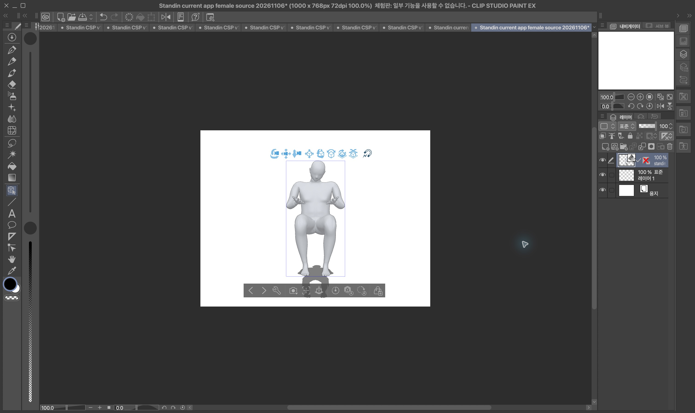
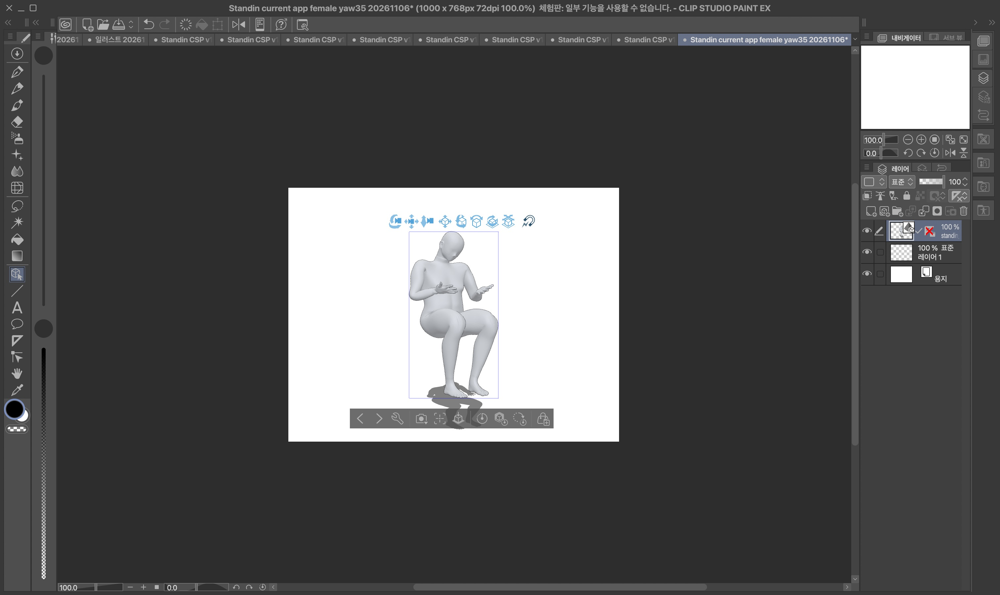
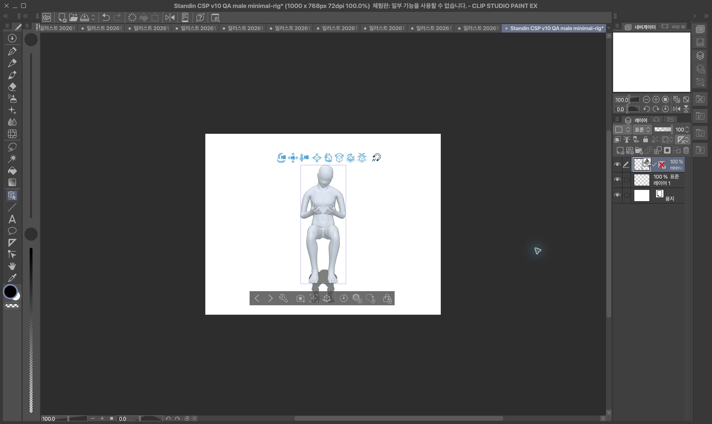
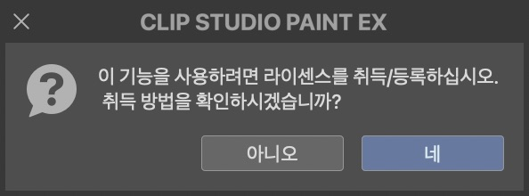
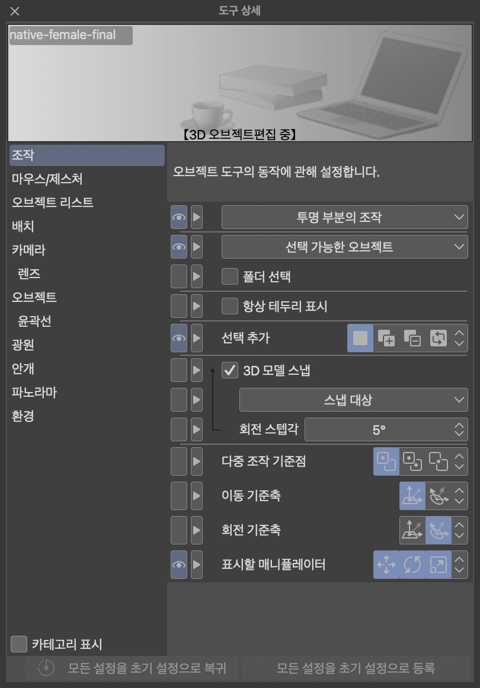

# 개인 FBX / CSP 실제 호환 검사 — 2026-11-06

**v10 기준 12파일 중 표시 성공 8, 가져오기 크래시 4. 전체 호환·조형 품질은 미합격이다.** 이전 파일 선택 차단은 해결했다. `.clip` 저장은 실제 라이선스 요구 안내로 차단됐고 저장본 재열기는 미검증이다. Draft / default-off / `releaseReady:false`를 유지한다. 배포·병합·원격 push는 하지 않았다.

## 최신 통합 앱의 실제 저장본 — 추가 4파일

**최신 normal-app UI 저장본은 남성 source/yaw35 모두 crash, 여성 source/yaw35 모두 실제 표시 성공**이다. 이전 기준 12파일과 합쳐 실제 import 시도는 16파일(표시 10 / crash 6)이나, 각 단계의 출처·포즈·SHA를 별도 기록했다.

- 소스 `7f3ff3565a424512b2f9eaed1baeb924a170cb0b`, 연결 통합 `ae3224a3ab3d254658de5e6403d7007c41e25ecd`, 앱 binary `7af1288f9f2b6fbcf3d22042070405079712d503ddcc4b56bda096f316f63d6a`, 기존 v10 manifest pin 동일. 생산 코드와 publisher head의 일치는 연결 담당 인수 증거이며 CSP 담당은 실제 binary와 manifest를 재해시했다.
- 두 Mock flag는 false다. 허용된 recorded BVH를 **loopback HTTP ownership fixture**로 받고 실제 파일 선택·등록·native apply·제품 review·UI 저장한 파일이다. 운영/실제 live BFF 인증·검색·Hono/SQL E2E는 아니다.
- 원본 방향은 `rotation=I`가 명시된 후보, yaw35는 fixture가 지정한 관측 행렬을 선택한 후보다. production 검색 관측 카메라 검증으로 확대하지 않는다.
- 4개 최종 FBX의 SHA/바이트 수, 입력 모델/BVH SHA와 선택 행렬을 import 직전·직후 재확인했다. [최신 앱 증거](current-app-evidence.json), [전체 재현표](reproduction-table.md).
- 새 남성 crash 두 개(`150108`, `150152`) 모두 main thread excessive recursion / EXC_BAD_ACCESS / SIGSEGV다. null-camera baseline뿐 아니라 명시적 identity와 yaw35 선택도 실패했다. 카메라 인과는 미확정이다.
- 최신 여성 두 문서는 회색 표면·앉은 포즈와 방향 차이를 표시했다. 골반/관절의 기존 조형 결함은 **not_qualified**다. latest female-source에서 Save As를 다시 실행해 동일 라이선스 요구 안내를 확인했다. `.clip` 미생성 / 재열기 미검증, 라이선스 변경 없음.

## 기준 v10 환경과 입력

- 실제 OS: macOS **26.6.2 (25G83), arm64**. CSP **5.1.1**, native ARM-64, translated:false. CSP 실행 파일 SHA: `40ff5d9a8519e9d9a09187f6a36f40f42a99745f6d2c4b981478fa0632d122c6`.
- QA 작업트리: PR159 `a473b525b76b7ea3917b56c81346ea9cf7742f1e` 기반 `codex/personal-body-csp-qa-20261106`. 새 fetch develop `65a43657194f87f244075d6ba24fa76d9b71b703`; 병합은 연결 담당 소유다.
- 이전 native 출력의 앱 소스 `c9021067ee1a34eef7d784455fa88dad0a773775`, 앱 binary SHA `27bc92544c235331b5b6d622d2b18c245f911d88e41dafe08fef33c53d251f21`를 재검사했다. **이전 native test 저장본이며 최신 통합 앱 UI나 live BFF 연속 저장 증거가 아니다.**
- 컨버터 소스 `1332d598be58aec68540137e887fea4dc5fb9991`, `personal-converter/10`, runtime manifest `eaac3841c8b9e693ff88c959eabaceaf1ecc298e547eede748e83ad4a0de1d70`. 원본 모델/BVH SHA는 이전 owner manifest에서 인수했고, 이번 CSP 담당은 실제 가져온 12 FBX·앱 binary·runtime manifest SHA를 재검사했다. 입력 모델·BVH·최종 FBX·대조 기준 SHA는 [evidence.json](evidence.json)에 구분했다. 기존 보정 실험은 이 runtime에 포함되지 않는다.
- 남성 CS3C 입력 SHA `a2b61fd5673abfec339fa7a2019f8f6894f8a207a0a524c334275846158bad0c`, 여성 FBX `fb47d89d1507c377b0af136b9dc6357ef35787c59ac79467ee180b2e1640017f`.
- native 최종 저장본 둘과 남성 앉은 대조군은 recorded BVH `756b393a31732e270a6fa65454fb4162e6f442a7f0e31ef8c7f0da204dc74ad6`, 여성 CMU 대조군은 `8a755eb24f8385d1f00ea985e1266e7bdc30ed55e4ab6c464e3dd903fca73780`. **서로 다른 포즈를 동일 조건 비교로 섞지 않는다.**

## 실제 절차와 결과

공용 `desktop-ui.lock`을 독점 생성한 동안 CSP만 조작했다. 기존 문서나 모델 파일은 수정하지 않고 `Standin CSP v10 …` 새 캔버스를 파일마다 만들었다.

1. 파일 → 가져오기 → 3D 데이터. `Cmd+Shift+G`로 GoTo를 열고 **AX `PathTextField`에 `setValue(absolutePath)` 후 Return**. 일반 paste/type 입력을 반복하지 않았다.
2. 파일 선택창의 정확한 파일명 미리보기와 enabled Open을 확인한 뒤 Open을 실행했다. 이번에는 import 실행 전 UI 차단과 실제 importer crash를 구분할 수 있다.
3. 표시 성공은 실제 CSP 3D 레이어·모델을 사진으로 확인했다. 실패는 Open 직후 CSP 종료와 각 새 macOS crash log로 확인했다.
4. 남성 최소 리그 표시 후 `Cmd+Shift+S`(다른 이름으로 저장)를 실제 실행했다. “이 기능을 사용하려면 라이선스를 취득/등록하십시오” 안내가 나타났다. **아니오**로 유지했으며 로그인·라이선스·결제를 변경하지 않았다. `.clip`은 생성되지 않아 재열기는 미검증이다.

| 입력 계열 | 원본 방향 | yaw35 진단 | 최소 리그 | 단일 재질 | 최소 리그+단일 재질 |
|---|---|---|---|---|---|
| 남성 앉은 대조군 (기준 FBX `2075ae9d…`) | crash | crash | 표시 | crash | 표시 |
| 여성 CMU 대조군 (기준 FBX `617bce03…`) | 표시 | 표시 | 표시 | 표시 | 표시 |

남성 native-final(`b3032354…`, null camera)은 crash, 여성 native-final(`248f01a2…`, null camera)은 표시됐다. 전체 SHA와 crash 파일별 대응은 [재현표](reproduction-table.md)와 JSON에 있다. yaw35는 실제 선택 카메라 앱 출력이 아닌 별도 rigid-rotation 진단이다.

네 crash 모두 main thread excessive recursion / `EXC_BAD_ACCESS` / `SIGSEGV`, stack size exceeded다. 원래 리그의 null-camera도 실패하므로 **카메라 원인은 확정되지 않았다.** 남성 단일 재질만 바꾼 파일도 실패하고 원래 재질+최소 리그는 표시돼, 이 남성 대조에서 리그 관련 차이를 더 조사할 근거가 있다. 최소 리그는 원래 가중치를 한 root로 대체한 진단 파일이므로 제품 해결책이나 원래 리그 보존 합격으로 쓸 수 없다. 여성 원래 리그는 표시되므로 모든 리그·모델로 일반화할 수 없다.

raw crash log는 공용 로컬 인수 자료에만 보관한다. Git에는 예외·시간·앱/OS·주요 image offset과 원본 로그 SHA만 남긴다.

## 표시·조작·약정 범위

여성 native-final은 앉은 포즈의 메시와 회색 음영, 여성 CMU는 원본/yaw35 방향 차이를 실제 표시했다. 남성 최소 리그도 앉은 인체가 보였다. 원래 재질과 QA 단일 재질에서 음영·광택 차이가 보이지만 수치적 normal 보존·모든 면의 품질 합격 증거가 아니다. 남녀 변형 결함은 여전히 **not_qualified**이며, Blender 검사를 CSP 수용으로 대체하지 않았다.

여성 native-final의 Window → 도구 상세에서 실제 **“3D 오브젝트 편집 중”**을 확인했다. [개인 파일 전략](https://github.com/04JUNG/Standin-server/blob/develop/docs/NEXT_SPRINT/PERSONAL_BODY_LOCAL_REGISTRATION_STRATEGY_2026-10-28.md)은 외형 유지·포즈 적용 FBX·지원 CSP에서 의도한 모습으로 재열기를 요구하며 CS3C 재저장/전용 프리셋 완전 재현을 제외한다. 최신 develop의 [저장 명세](../../12_EXPORT_AND_SAVE_SPEC.md)도 FBX는 별도 3D 오브젝트이며 CSP 관절 UI 재수정과 BVH 데생 인형 조작을 구분한다. 기본 체형 외곽선의 범위 정정을 개인 모델 품질 실패를 숨기는 이유로 쓰지 않는다.

[CSP 공식 importer 문서](https://help.clip-studio.com/en-us/manual_en/660_3d/Importing_3D_Files.htm)는 FBX 파일의 3D 레이어 가져오기와 캐릭터/BVH 포즈 적용을 구분한다. [CELSYS의 캐릭터 설정 문서](https://tips.clip-studio.com/en-us/articles/1166)는 FBX를 Modeler에서 캐릭터로 설정·매핑하는 별도 흐름을 설명한다. 이번 QA에서 그 변환 기능을 새로 추가하지 않았다.

따라서 **CSP 내부 관절 재편집은 현재 FBX 계약의 실패 항목으로 세지 않으며 지원한다고도 표시하지 않는다.** 전체 오브젝트 이동·회전·카메라는 실제 조작 성공을 확인해야 한다. 메뉴/키보드와 파일창은 작동했으나 CUA의 CSP canvas 및 도구 상세 좌표 조작은 `noWindowsAvailable`로 실패했다. 관절 미지원과 이 UI 제어 미검증을 분리한다. 설정 우회나 다른 사용자 창 강제 종료는 하지 않았다.

## 대표 실제 화면

여성 native-final의 실제 가져오기 표시 (조형 합격·저장 성공 증거 아님):

남성 최소 리그 진단만 표시 성공 (원래 리그 해결 아님):

실제 Save As에서 확인한 저장 차단:

## 재검사와 인수

`python3 verify_evidence.py --artifact-root <local prior artifact directory>`는 12개 입력과 runtime manifest 해시만 재검사한다. CSP 성공 판정은 위 native 관찰이며 이 스크립트 통과로 갱신되지 않는다.

연결 담당의 최신 통합 normal-app 최종 저장본 4개를 불변 SHA·앱·runtime과 함께 받아 위 별도 stage 검사를 완료했다. 동일 검증 도구에 `--evidence current-app-evidence.json --artifact-root <immutable app output directory> --runtime-manifest <pinned app runtime-manifest.json>`을 주면 후속 4개도 감사한다. 보정 런타임은 채택·고정된 새 manifest가 나올 때 다시 검사한다. 현재 baseline 결과를 최신 앱/live BFF/Windows/Intel/새 보정 품질로 확대하지 않는다.

남은 외부/담당 조건: 조형 품질 합격과 남성 CSP import crash 해결은 컨버터 담당의 새 불변 후보가 필요하다. 그 파일과 manifest가 채택될 때 영향을 다시 검사한다. `.clip` 저장/재열기는 사용자가 준비한 저장 가능한 CSP 실행 환경이 필요하며, 라이선스 변경을 QA가 대신 수행하지 않는다. CSP 오브젝트 이동·회전/카메라의 실제 UI 조작은 접근 가능한 native canvas 제어가 필요하다. 모두 해결되지 않은 상태로 남긴다. 이번 QA 문서·도구 외 frontend/native/geometry 제품 코드를 변경하지 않았다.
