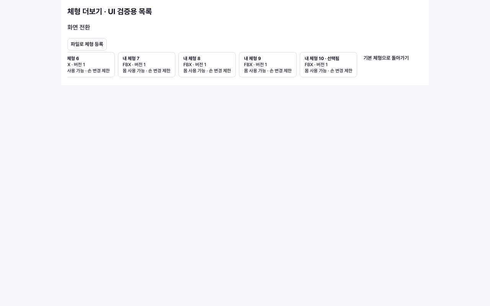
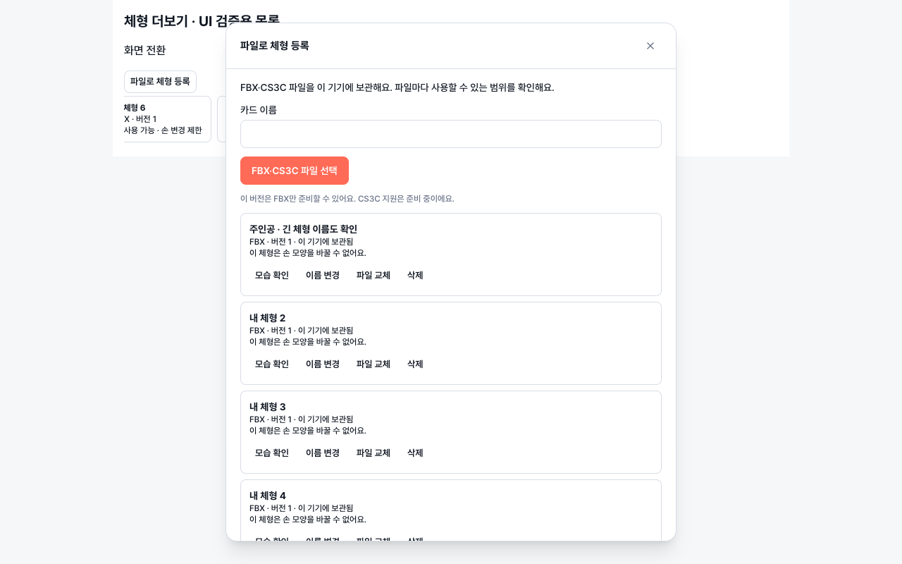

# 개인 체형 로컬 등록 — 클라이언트 Draft

기준: `origin/develop`의 `a5226ec1059322509cfcd779d9bf9a300db8dfbf`.
브랜치: `codex/personal-body-local-client-20261028`.
전략: 서버 작업 디렉터리의 `docs/NEXT_SPRINT/PERSONAL_BODY_LOCAL_REGISTRATION_STRATEGY_2026-10-28.md`.

이 PR은 출시 완료가 아니다. 운영·스테이징 배포, 기본 브랜치 push/merge, 릴리스 태그 생성은 하지 않았다.

## 구현

- 체형 커스텀 및 앱/플로팅 바 공통 ‘체형 더보기’에서 파일 등록·이름 변경·삭제·파일 교체.
- 기기 전용 원본 사본/캐시/카드. 원본 선택 경로를 재사용하지 않는다. 모델·경로·이름·파일 바이트를 서버에 보내지 않는다.
- source SHA256와 importer/normalization/mapping/converter 버전 및 코드 fingerprint로 중복/캐시를 구분한다. 교체는 새 worker 모델을 검증하고 기존 카드 ID/이름을 유지한 채 버전을 올린다. 실패하면 기존 카드가 남는다.
- NDJSON `standin.local-converter/1` 실제 프로세스 어댑터: capability, import/inspect, apply/export, cancel. worker 실행파일은 번들 리소스에서 고정 탐색한다. 개발 전용 환경변수는 release 빌드에서 무시한다.
- 등록 작업 상태는 화면 간 공유하며 다른 화면에서도 취소할 수 있다. 포즈 적용 작업은 순차 처리하고 오래된 관찰자의 응답은 저장하지 않는다. 취소/실패 임시 파일과 참조되지 않는 모델을 정리한다.
- 기존 BFF의 설치 소유 후보 검증·확정 다운로드를 그대로 사용해 최종 BVH를 확보한다. 로컬 모델 ID를 BFF character ID로 보내거나 preview-only 포즈를 사용하지 않는다.
- 모델/포즈/손/출력 범위를 묶은 스냅샷을 준비한다. 저장 직전 BFF 최종 BVH를 다시 받아 해시를 비교하고, 현재 선택·기기·체형·손 변경을 감시한다. 실제 FBX 바이트와 worker SHA256를 대조한다.
- 파일 준비와 미리보기 표시는 독립적이다. 등록 GLB와 최종 FBX를 표시하며 FBX 바이너리 파싱은 Web Worker에서 수행한다. 표시 실패가 검증된 FBX 저장을 막지 않는다.
- 기존 기본 체형/커스텀 조절/손/FBX 저장 경로를 유지한다. 개인 모델을 선택하면 기본 체형 전용 조절을 표시하지 않는다. 이미 저장한 파일은 바꾸지 않고 기존 고유 파일명 writer로 새 파일을 쓴다.
- 개인 모델이 포함된 저장은 인물별 FBX로 제한한다. 모델을 서버 scene API에 전송하는 대체 경로를 만들지 않았다.

## 현재 지원 범위와 남은 작업

| 항목 | 상태 |
|---|---|
| FBX | 알려진 인간형, 검증된 T 자세, 단색 재질 및 스킨 변형/왕복 검사를 통과한 모델에 한정 |
| CS3C | 선택·실패 안내를 실제 파일로 검증했지만 decoder 미포함으로 **등록 성공은 미지원** |
| 손 변경 | 현재 Converter는 좌우 모두 미지원. 몸 포즈를 허용하고 원래 손 모양을 유지한다고 표시 |
| 출력 범위 | 개인 체형은 전신 FBX만 지원. 부분 범위를 조용히 전신으로 바꾸지 않고 차단 |
| 크기/방향 | 기본 자세 미리보기 제공. 모델 키 수치 보정·방향 편집 및 물리 단위 확정은 미구현 |
| 런타임 | macOS arm64 패키지/로컬 무서명 앱 번들 검증. Windows/x64, 서명·공증·라이선스/소스 제공·배포 파이프라인은 미검증 |
| 전체 사용 흐름 | 실제 worker와 UI는 각각 검증. 설치 소유 BFF→네이티브 파일 선택→실제 CSP import 전체 E2E는 미완료 |
| 모델 다양성 | 합성 FBX와 공유된 24,988정점 인체 FBX 사용. 제작자별 FBX·CS3C 각 3종, 의상·외부 텍스처·실제 CSP 호환 검수는 남음 |
| 관통 방지/자동 골격 생성 | 제공하거나 약속하지 않음 |

CS3C가 지원되지 않거나 런타임 배포 검증이 남은 상태를 제품 완료로 간주하지 않는다. 실험 ZIP의 디코더와 제3자 실행파일을 제품 자산으로 커밋하지 않았다.

## 개발/패키징

일반 웹 개발은 실제 로컬 변환을 가장하지 않고 데스크톱 앱 필요 안내를 표시한다.
개인 체형 포함 앱을 만드는 **빌드 담당자**는 Converter가 만든 대상 OS 패키지를 입력으로 사용한다. 최종 사용자에게 Python/Blender/Modeler 설치를 요구하지 않는다.

```sh
STANDIN_LOCAL_CONVERTER_PACKAGE=/absolute/vetted/package npm run tauri:personal-body -- --debug --bundles app --no-sign
```

복사는 원본 시간정보를 보존한다. Python의 사전 생성 캐시가 복사 과정의 mtime 변경으로 재생성되어 재시작 때 무결성 검사를 깨뜨리는 문제를 실제 앱 리소스 경로에서 재현해 수정했다. 패키지 원본과 복사된 앱 번들에서 각각 재시작을 검증해야 한다.

런타임/샘플/캐시/빌드 산출물은 Git 제외 대상이다. 빌드 결과를 업데이트 피드나 릴리스에 올리지 않는다. 재패키징 시 생성한 `src-tauri/resources/local-converter`를 비우고 새 패키지를 사용한다.

```sh
npm ci --ignore-scripts
npm run typecheck
npm run build
# Node 26 테스트 실행 환경에서는 Node의 experimental Web Storage를 끈다.
NODE_OPTIONS=--no-experimental-webstorage npm test
cargo test --manifest-path src-tauri/Cargo.toml commands::personal_body
# 실제 테스트는 아래 환경변수와 --ignored를 명시해야 한다. 자산은 커밋하지 않는다.
STANDIN_TEST_LAUNCHER=/absolute/app-resources/local-converter/standin-local-converter \
STANDIN_TEST_FBX=/absolute/permitted.fbx \
STANDIN_TEST_BVH=/absolute/selected-pose.bvh \
STANDIN_TEST_CS3C=/absolute/sample.cs3c \
cargo test --manifest-path src-tauri/Cargo.toml real_packaged_worker -- --ignored --nocapture --test-threads=1
```

## 검증 기록

- 전체 웹 테스트: 150개 파일, 1,208개 테스트 통과(당시 1개 skip). 이후 등록 중 화면 이동/취소 테스트 및 최종 저장 변경을 별도 집중 회귀로 검사했다.
- 개인 체형 및 기본 체형 회귀: 후보 목록/기본 조절/최종 검토/부분 저장/손/장면 저장의 관련 테스트 통과. 최종 집중 회귀 77개 통과.
- Rust: 카드 재읽기/내부 worker ID 비노출/잘못된 카드·이름 거부/임시 파일 정리 단위 테스트.
- 실제 packaged macOS worker: 합성 FBX→등록→프로세스 재시작→조회→포즈 적용→FBX 해시 검증→모델 삭제 이후 저장 파일 유지 통과.
- 무서명 macOS 앱 번들 빌드 및 번들 `Contents/Resources/local-converter`에서 직접 실행한 통합 테스트 3개 통과(29.62초). 원본 패키지와 복사/번들 패키지의 반복 실행을 모두 확인했다.
- 실제 내보낸 2MB FBX를 Chrome에서 Web Worker로 파싱하고 관절 변환·카메라 경계가 반영된 포즈 표시를 육안 검수했다.
- 실제 인체 FBX+CMU BVH: 위 과정 및 실행 중 취소·임시 파일 정리 통과. 실제 CS3C는 `CS3C_DECODER_UNAVAILABLE`이며 성공 모델이 만들어지지 않음을 확인했다.
- Chromium UI 검증용 목록: 화면 전환 후 같은 선택 유지, 가로 스크롤 826px 유지, 중복 파일 안내, 삭제 취소 및 브라우저 오류 없음. 아래 이미지는 **UI fixture**이며 실제 파일 변환을 가장하는 증거가 아니다.



