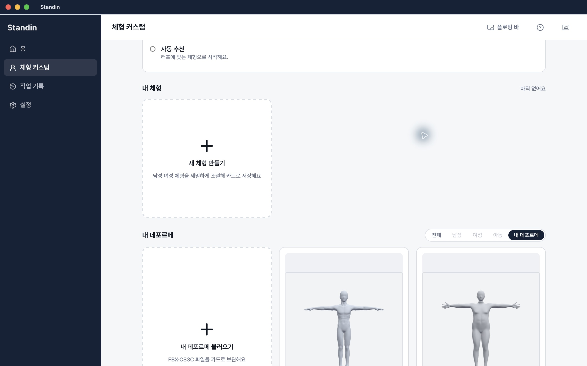
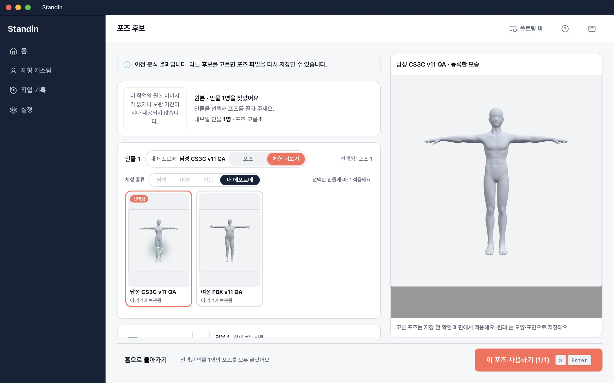
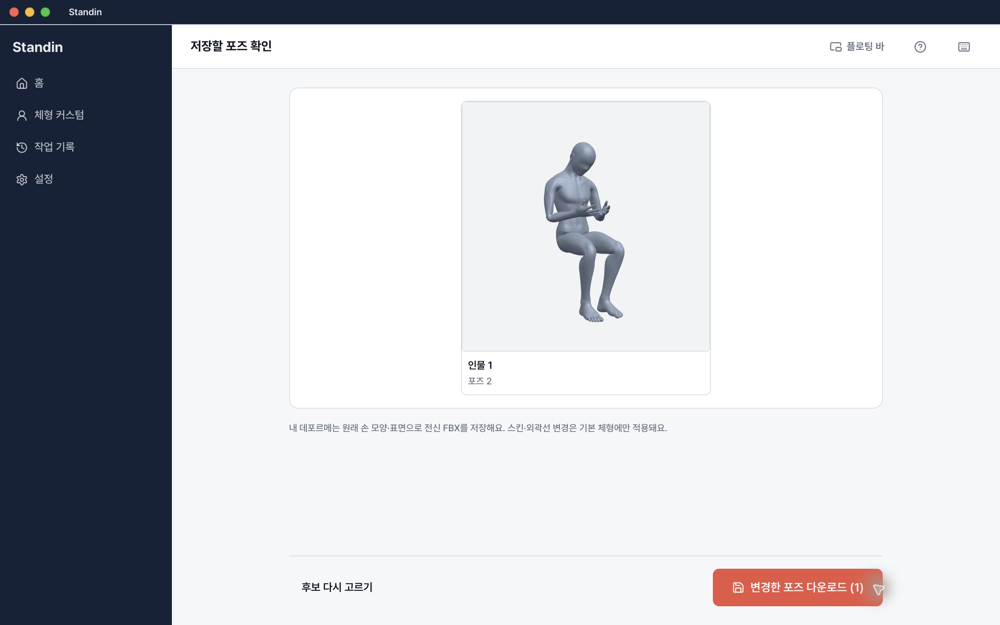
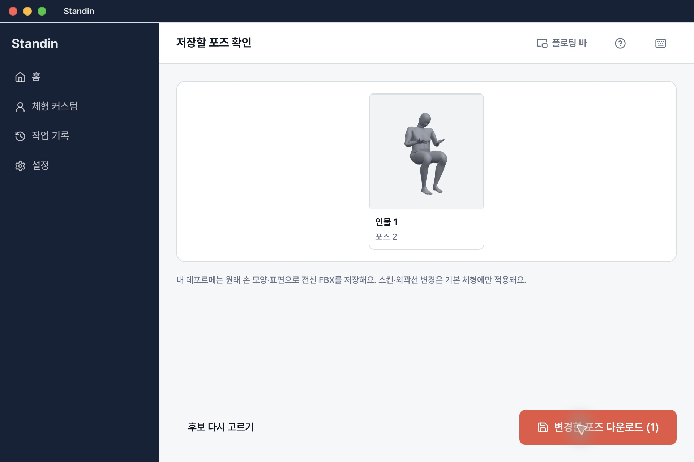
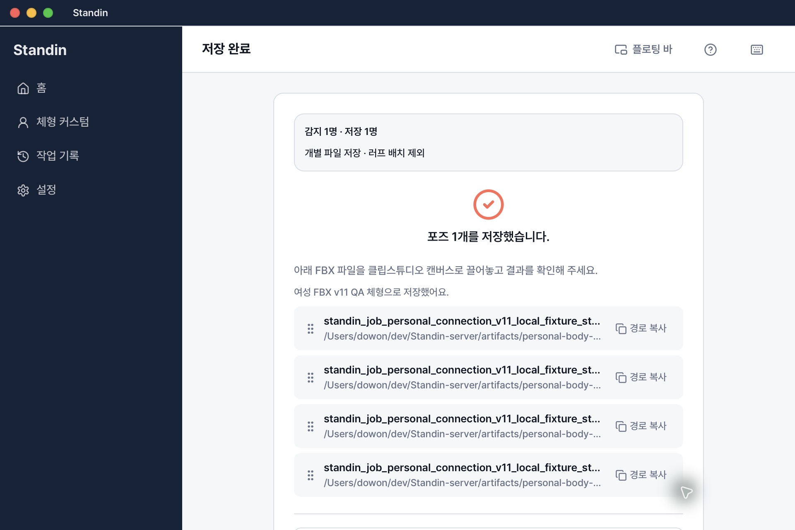

# 개인 모델 v11 앱 연결 검증 — 2026-11-06

**별도 macOS arm64 앱에서 남성 CS3C·여성 FBX 등록 → 기록 final BVH 적용 → identity/yaw35 FBX 저장 4건을 확인했다.** CSP 호환 이름 처리용 v11이며 변형 품질은 여전히 미합격이다. 정확한 앱 저장본 4개도 CSP5.1.1에서 모두 가져오기·표시에 통과했다. Draft / default-off / `releaseReady:false`, 병합·배포·유료 호출 없음.

## 계약과 앱

플랫폼 소스 `35e0136cf9cd230b18f0772116bd955f4228bf68`을 `bed1d85`로 인수했다. 빌드와 native hello 모두 revision5/converter10, revision6/converter11만 허용한다. importer4·normalize5·rig2·camera1·storage1·material1을 그대로 요구하고, 등록 manifest 버전도 검증한 hello와 일치해야 한다. [실제 v10→v11 재등록/캐시·native4건 증거](../personal-body-v11-native-20261106/README.md).

서버 CSP 수정 원본은 `7616e491fc500cbfec04fc9fe4defce93fa5776e`, PR142 인수 소스는 `d89f21608137579757626f4a5833464f2f6bd757`이다. 최종 apply FBX의 `root_group_` LimbNode 표시 이름 하나를 충돌 없는 같은 길이 이름으로 바꾼다. 등록·복구 보관본은 원래 이름을 유지한다. 9개 영향 가중치는 유지하며, 8개·1개 제한이 크래시를 막기에 충분하지 않았으므로 클라이언트에 영향 개수 제한을 넣지 않았다. 형상 보정 알고리즘이나 안전 임계값은 바꾸지 않았다.

별도 QA ID·compile Keychain namespace는 `app.standin.desktop.personal-connection-v11-qa-20261106`, updater endpoints는 비어 있다. Mock 두 플래그 false, localhost:8000, interactive opt-in true. Binary SHA `265d37b474084916da59ecf6638228aed3b0f7f924b0473f29ec0351fe85b5f7`, 전체 앱 tree SHA `3fe201675c9f551066ef4a9f7cbfcc45506de3dae5e2645cdb502e38b049ef3d`. rustc env-dep의 Keychain 컴파일 값을 직접 재확인했으며 자격정보 값은 읽지 않았다. 빌드 소스와 게시자 브랜치의 src/src-tauri/scripts/package manifests diff는 비어 있다. fixture·QA 문서 차이는 앱 소스 일치와 구분한다.

Manifest pin `2540a161e19fa34ad1d9c38bcc79751d471b938f6de5b0757923e303def5789b`, converter11/revision6/fingerprint `5fdc61c7775279392171e8002aece0e87744fe6187855746fe7411b4004458d1`. UI 변환·독립 재임포트 후에도 runtime6,606개와 전체 앱6,610개 정확 파일/해시가 일치했다.

## 실제 제품 UI와 저장

기존 v10과 다른 앱·Keychain·작업 ID·자격정보·출력 폴더를 사용했다. 공용 UI 락을 독점했고 기존 앱·저장본을 덮어쓰지 않았다. 실제 picker로 허용된 남성 원본 CS3C와 여성 원본 FBX를 등록했다. 큰 선택 화면에는 실제 등록 모습과 ‘등록한 모습’ 설명이 있으며 개인 카드에 기본형 스킨·외곽선 컨트롤을 표시하지 않는다.

소유권을 가진 localhost fixture 작업에서 후보 선택 → native apply → 적용 미리보기 → 실제 디스크 저장을 4회 진행했다. 준비 중 저장은 비활성화됐다. 앱 남성 선택 → 바에서 여성 선택 → 앱 복귀 시 여성 유지도 확인했다. 앱 종료/재열기 후 두 카드가 남았고 inline 이름 변경·삭제 확인의 취소도 통과했다. 실제 삭제 후 출력 보존·취소 중 부분 등록 방지는 별도 플랫폼 actual native 검사에서 통과했다.

파일 prefix는 `standin_job_personal_connection_v11_local_fixture_standin_pose`다.

| suffix | 모델 | 행렬 | SHA256 |
|---|---|---|---|
| `.fbx` | 남성 CS3C | identity | `04961228c2acd4532adc4066b0962bd402f2d51f1380dfd226f447d7a67500ea` |
| `_v2.fbx` | 남성 CS3C | yaw35 | `6ffe3b3b79e61725f0145919ff6328c15266af98b40ef8f5fa69d4d76e99864c` |
| `_v3.fbx` | 여성 FBX | yaw35 | `e9a7500df3fed7f1e27b1e92918599cefc67424dc08d89354b6a29a1c9b9021d` |
| `_v4.fbx` | 여성 FBX | identity | `016211a2800c6e1da70213e991ff30680de3fcade5cffe9408bf67b8d607d9f6` |

모든 snapshot은 실제 converter11/fingerprint와 기록 BVH SHA `756b393a31732e270a6fa65454fb4162e6f442a7f0e31ef8c7f0da204dc74ad6`, 입력 원본 SHA 및 명시적 후보 행렬에 일치했다. 실제 출력의 alias를 메모리에서 역치환한 SHA가 native 검증의 변경 전 SHA와 일치했다. 길이와 나머지 바이트는 유지하며 `weightsTruncated:false`다. 원본 두 파일도 저장 뒤 같은 SHA임을 검사했다.

독립 Blender 재임포트에서 male24,988점의 yaw35 회전 최대오차 `1.0081e-6m`, female90,143점 `7.9578e-7m`로 `2e-5m` 기준을 통과했다. 직접 호출에는 `PYTHONDONTWRITEBYTECODE=1`과 별도 설정 경로를 사용했다. 이는 제어된 행렬 전달 검사이며 production 검색의 실제 fitted camera나 표면 품질 합격은 아니다.

## 검증과 한계

프런트엔드1,418 pass/외부 fixture opt-in6 skip, Rust20 pass/실제 runtime opt-in6 ignored, 패키징5 pass, typecheck·web build·icons·release pass, lint 오류0/기존 경고1. 별도 실제 HTTP adapter는 소유권403·선택409·stale SHA·선택 변경 후 이전 tuple 거부를 통과했다. fixture는 Hono/SQL/S3/live 인증·신규 추론 구현이 아니다. 원본 모델 업로드나 새 유료 호출은 없었다.

기존 v10 기록과 앱은 보존했다. 원래 공유 v10 패키지는 현재 538개 pyc 변경·3개 추가로 exact pin에 실패하며 복구하거나 정상 패키지로 재표시하지 않았다. 보존 v10 앱 runtime은 6,591개 정확 해시에 통과했다. 원인 소유는 미확정이다. 이전 직접 재임포트에 bytecode 억제 플래그가 명시되지 않았던 사실도 숨기지 않는다. [기존 v10 앱·CSP 실패 기록](../personal-body-connection-20261106/README.md)은 역사적 기준이다.

새 앱의 네 첫 적용 미리보기는 표시됐다. 이전 v10 남성 재방문1회 미리보기 실패의 원인·일관 재현은 미확정이며 모든 재방문 성공을 주장하지 않는다. 변형 품질 NOT QUALIFIED, 정확한 새 앱 출력 CSP4개 import/display PASS이며 새 crash는0건이다. 실제 오브젝트 drag는 CUA noWindowsAvailable로 미검증, Save As는 라이선스 요구로 차단되어 .clip/재열기 미검증이다. [CSP 별도 증거](../personal-body-v11-csp-20261106/README.md). Windows/Intel 실제 실행·릴리스 서명/decoder 재배포·production/live BFF는 별도 미완료다. 원본/decoder/runtime/FBX/자격정보를 Git에 넣지 않는다. [정확한 공개 메타데이터](evidence.json).

