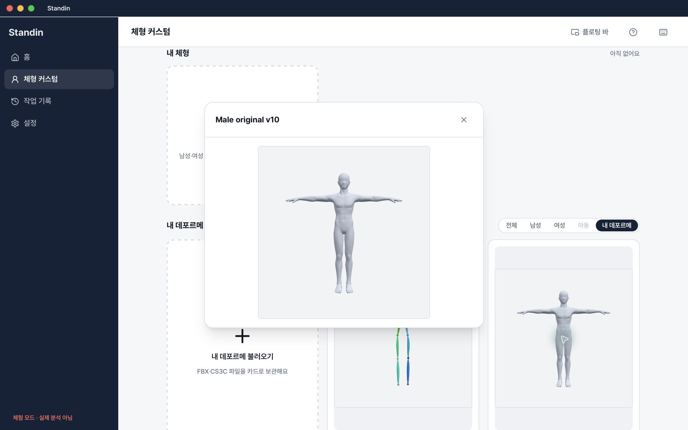
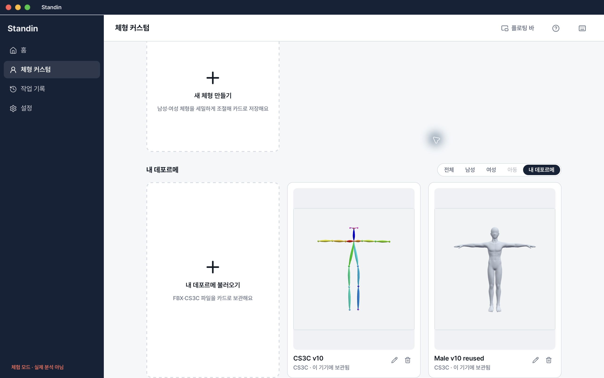
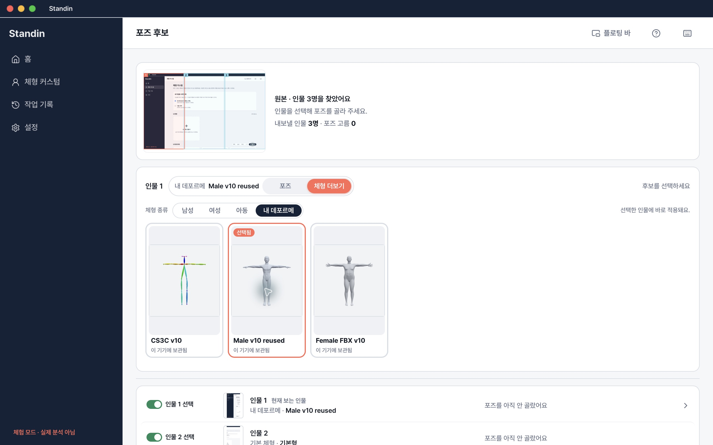
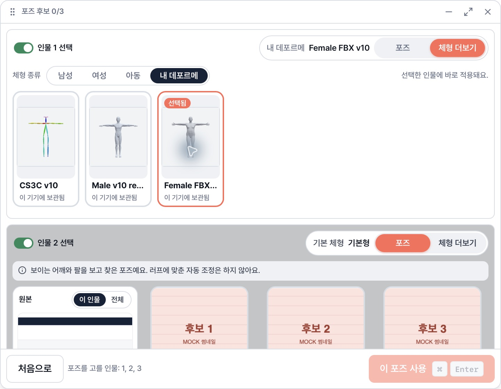
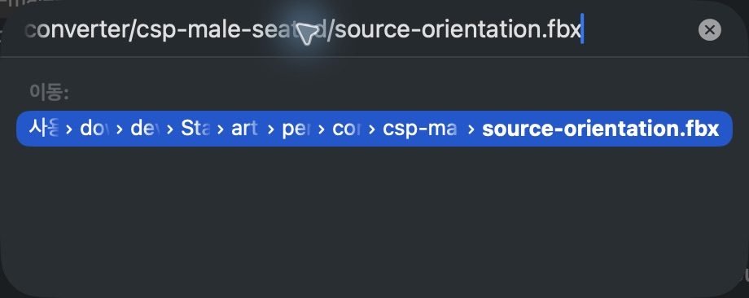

# 개인 데포르메 develop 통합 / v10 클라이언트 검증 — 2026-11-05

기존 Draft [#159](https://github.com/04JUNG/Standin-client/pull/159)에 develop `5934f0d2799d64074cb5836b9d7bab48d7246f1e`를 정상 merge했다. 소스 기준은 `c9021067ee1a34eef7d784455fa88dad0a773775`다. 원래 checkout의 미커밋 변경과 다른 세션 worktree는 수정하지 않았다. 독립 bare 저장소/worktree는 공용 `personal-deforme-followup-20261105/client-status.md`에 기록한다.

## 통합 결과

- 개인 모델의 등록 플러스 카드·inline 이름 변경·확인 삭제·앱/바 카드 선택 UX를 유지했다.
- 새 기본형 role/order, 3D 미리보기 #173, 점진 검색 #176, 기본 체형 #175와 개별 자동 저장 #172를 보존했다.
- 개인 모델은 native final-BVH 경로를 사용한다. 새 interactive 작업 controller는 해당 인물에 생성하지 않는다. 혼합 인물 배열의 인덱스를 유지하며 기본 체형은 기존 interactive 경로를 계속 사용한다.
- 개인 결과가 새 서버 3D readiness 검사로 잘못 차단되거나, 기본 체형이 준비되기 전에 저장 가능해지지 않도록 양쪽 readiness를 합쳤다. 저장 직전 interactive 재검사도 개인 native 결과와 구분한다.
- 개인 ID/원본/경로를 BFF operation이나 replay에 전송하지 않는다. 카메라/모델/포즈 변경 stale 차단과 손 변경 미지원은 유지한다. 새 UI 설계 변경 없음.

## 런타임과 실제 검증

컨버터 [#142](https://github.com/04JUNG/Standin-server/pull/142) `1332d598be58aec68540137e887fea4dc5fb9991`, `personal-converter/10`, importer `/4`, fingerprint `3fe31c1322bb2d5c618920bda19dee5d96ea58b15caa1e5a9d8cdf842c73b254`를 사용했다. manifest pin은 `eaac3841c8b9e693ff88c959eabaceaf1ecc298e547eede748e83ad4a0de1d70`이다. [정확한 입력/출력 해시와 판정](evidence.json).

일반 build wrapper로 별도 ID `app.standin.desktop.personal-followup-20261105`의 macOS arm64 debug 앱을 만들었다. source/resource/완성 앱의 runtime 6,591파일을 각각 검사해 변경0/추가0, pin 일치, `releaseReady:false`를 확인했다. 앱 binary SHA는 evidence에 기록한다. 기본 installer 기능은 계속 비활성이다. 서명·릴리스·배포를 하지 않았다.

- 프런트엔드 1,335 통과 / 3 skip. 타입·웹 빌드·lint(기존 경고1/오류0)·runtime packaging gate·clippy `-D warnings` 통과.
- 실제 허용된 남성 인체 CS3C와 여성 `female-chubby-tpose.fbx`로 native personal 검사9 통과. 등록/재시작/포즈 적용/FBX 저장/삭제 뒤 저장본 보존/취소/host 재사용을 검사했다. 기록된 staging 선택 BVH 1종을 오프라인 사용했다. 추가 출력 보존 검사2 통과. 단순 뼈 모양 대조군9 통과는 이 실제 인체 결과와 별도다.
- 실제 앱 native picker에서 두 형식을 등록했다. 남성의 큰 미리보기·inline rename·앱 종료/재시작 후 카드 재사용, 삭제 확인/취소를 확인했다.
- 실제 로컬 등록 카드를 **Mock 분석 결과**의 전체화면에서 선택하고, 플로팅 바에서 여성 FBX로 변경한 후 앱 복귀 시 선택 유지까지 확인했다. live BFF 성공이나 UI 최종 저장 E2E로 보고하지 않는다.

## CSP — 미완료, 통과 아님

CSP를 열었을 때 플랜 안내가 나타났고 그리기 체험 모드로 진입했다. 앱 제목은 일부 기능 제한을 표시한다. 기존 `Standin pose extraction QA 20261102[복원]*` 문서는 수정하지 않고 **별도 새 캔버스 `Standin personal v10 CSP QA 20261105`**를 만들었다.

File → Import → 3D data까지 도달했으나, 파일 선택창의 GoTo 경로를 확정하는 입력이 반복해서 `/`로 돌아왔다. 키보드/AX/좌표 입력과 세션 재연결을 시도했고, macOS 파일 선택 XPC 서비스 직접 연결도 timeout으로 실패했다. 선택 경로는 컨버터 `csp-male-seated/source-orientation.fbx`였지만 **가져오기 실행이 확인되지 않았다.** 이 상태는 CSP UI 제어 차단이며, 라이선스가 파일 저장을 실제로 거부했는지는 확인하지 못했다.

인형 확인·관절 조작·`.clip` 저장·닫기/재열기는 모두 **미검증**이다. 이번 실행에서 최종 FBX import 직후 crash가 재현됐다고 보고하지 않는다. 이전 excessive recursion / EXC_BAD_ACCESS / SIGSEGV 원인은 여전히 미해결이며 카메라가 원인이라는 결론도 없다. 원본 방향·yaw35·최소 리그·단일 재질 대조군10개는 컨버터 공용 manifest에 해시와 함께 준비되어 있으나 CSP 수용은 별도다. Blender 재임포트로 대체하지 않았다.

## 남은 실패와 필요한 후속 검증

컨버터 변형 품질은 **NOT QUALIFIED**다. 여성 CMU 골반 edge ~198.629배, 여성 앉은 포즈 ~26.640배가 남아 있고 남성 CMU 일부 stretch 지표 악화와 아동 의상/팔꿈치 주름도 보고됐다. 원래 노멀/반사광 보존과 파일 저장 성공은 건강한 근육 굴곡·표면 품질의 합격을 뜻하지 않는다.

live 설치 소유 BFF의 기존 검증 작업 → final BVH → 개인 모델 적용 → 앱 최종 저장 연속 검증, 실제 선택 카메라 출력, CSP import/관절/저장/재열기, Windows·Intel Mac·서명·decoder 재배포는 미완료다. 현재 pin만 명시한 테스트 앱에서 검수하며 기본 비활성·Draft·`releaseReady:false`를 유지한다. main/develop push, PR merge, 운영 접속/설정 변경, 배포, 새 유료 호출은 없다.
