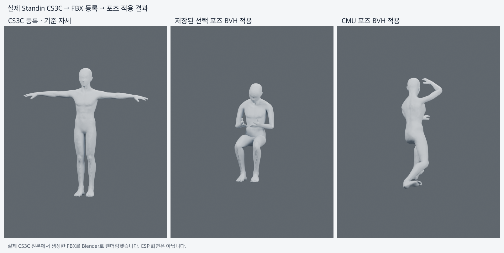

# 실제 CS3C 반사광 보존 연결 — 2026-11-04

Client package gate와 retained native host가 계약 revision **5**, `personal-solid-specular/1`을 요구한다. UI와 기록/동의 기본값은 바꾸지 않는다. companion converter가 원본 반사광을 FBX에 보존하며 실제 Standin 남성 0.7.6 CS3C 네 파일에서 등록4/pose 출력8을 통과했다.

이 이미지는 실제 CS3C 기반 FBX의 Blender 렌더이며 CSP 화면/실제 UI E2E 증거가 아니다. 이전 FBX 대조군 성공과 구분한다. 네 파일은 같은 인체의 native 저장 변형본이다.

- 원본 specular RGB `(0.12,0.1325,0.1475)`를 FBX의 `SpecularColor×SpecularFactor`로 독립 확인했다. 등록4 + 출력8의 reflection RGB 오차 **0**, shininess 최대 오차 `2.29e-7`.
- 53개 원본 노드/24,988개 정점, 원본 FK gate와 FBX의 뼈·skin weight 보존 및 실제 pose 변화 검사를 통과했다.
- native personal 검사10, frontend1,302/1 skip, typecheck/lint(기존 warning1/error0)/clippy/build/package gate 통과. 이전 material contract host 거절 테스트 포함.
- 일반 build entry의 macOS arm64 debug 앱에 새 pinned runtime을 포함했다. 새 native-picker UI 연속 E2E는 수행하지 않았다. [증거/정확한 runtime pin](evidence.json).

원본 기대 재질값을 manifest에 보존해 pose 출력까지 비교한다. 지원은 불투명·비발광·무텍스처 solid 중 `SpecularRGB=DiffuseRGB×k`, `0≤k≤0.5`인 범위다. 표현 불가능한 색/강도는 조용히 평균내거나 clamp하지 않는다. 기존 캐시는 새 importer/normalization/converter 버전으로 한 번 재등록해야 한다.

상세 구현·repro CLI: companion Standin-server `docs/personal-body/SPECULAR_20261104.md`. 원본/복구 archive/실행용 FBX 정책과 런타임 재사용·취소·오류 복구는 유지한다. `.clip` 출력, live BFF/CSP acceptance, 다른 OS와 signing/redistribution qualification은 별도이며 활성화/출시 승인으로 해석하지 않는다. merge·배포 없음.
