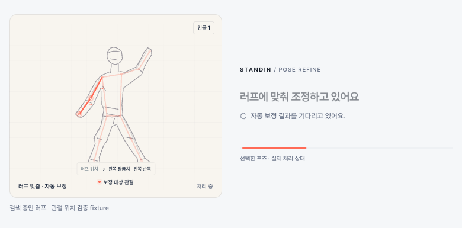
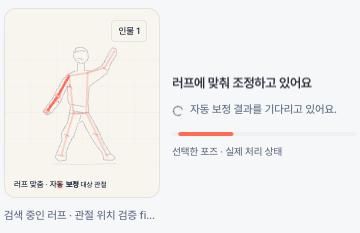
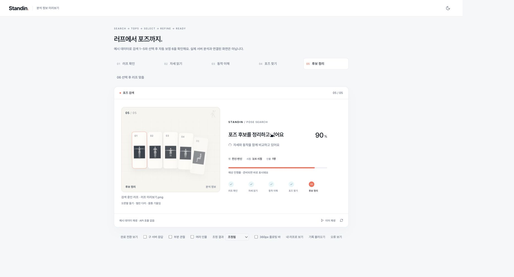
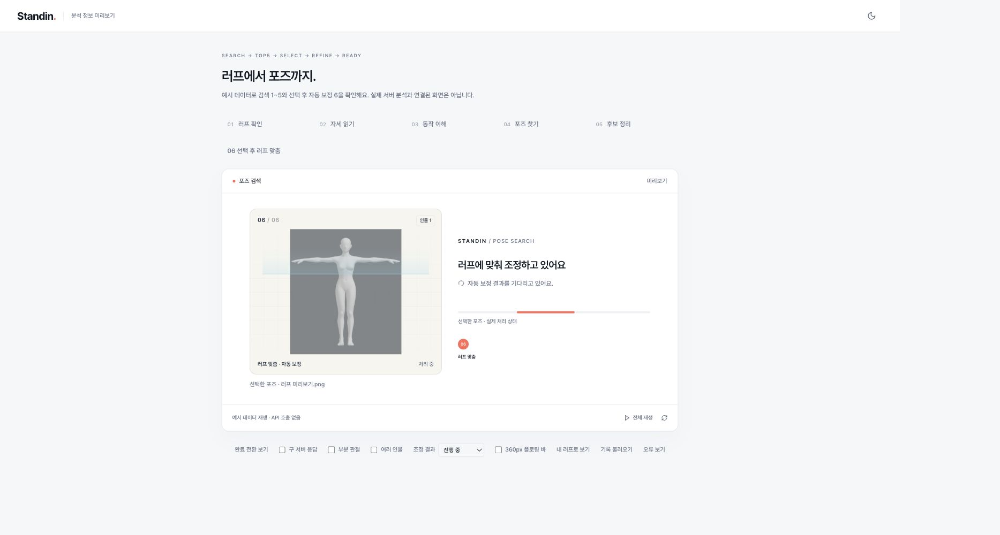
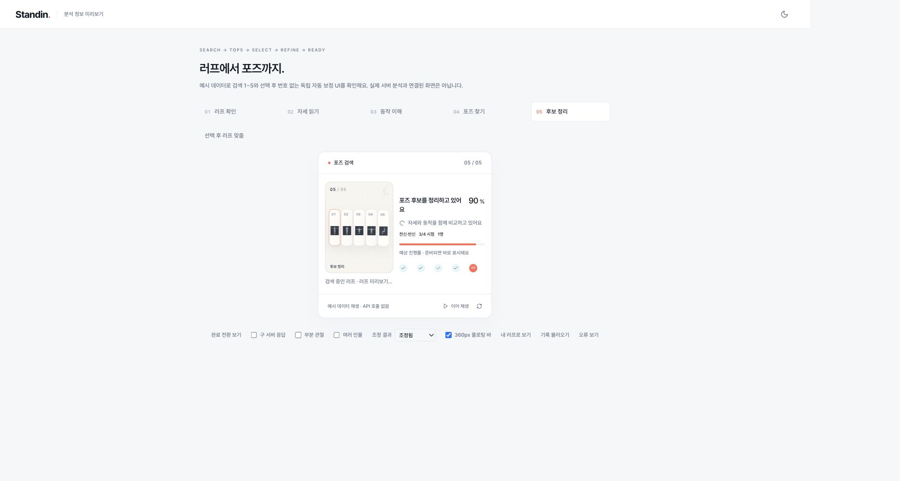
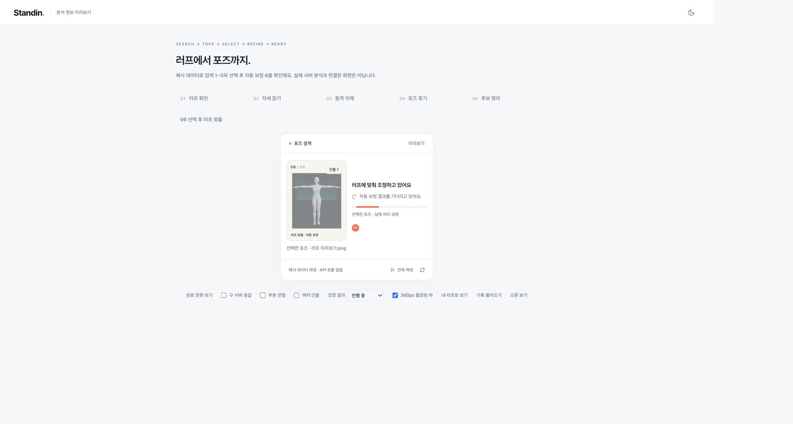
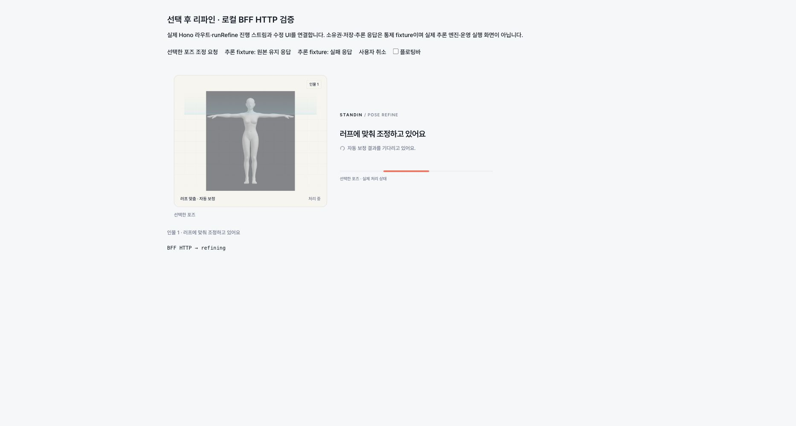
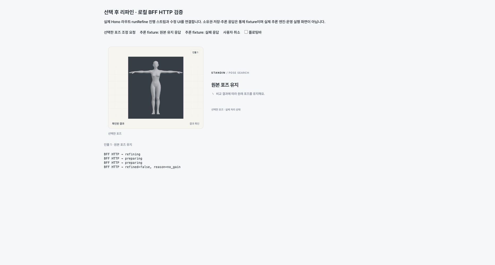
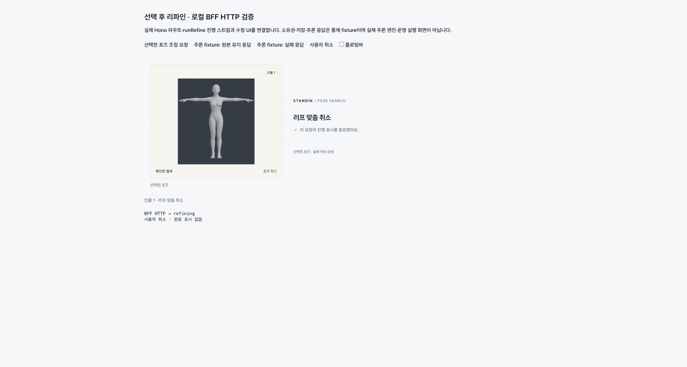

# 검색 1~5 / 선택 후 번호 없는 독립 보정 UI 검증 · 2026-11-19

## 관절 위치의 강조 링·4갈래 반짝임·점선 흐름

리파인 `refining` 이벤트의 선택 job/person/candidate와 연결된 `target`을 받으면,
선택 인형 대신 **원본 러프 위의 보정 대상 관절**에 효과를 표시한다. 처음 시연과 같은
코랄색 링, 직접 그린 4갈래 반짝임, 점선을 따라 관절로 들어가는 작은 빛이다.
가장자리의 Lucide 별 장식·전체 이미지 빛 쓸기·강조 광은 제거했다.

BFF #209는 이미 보관한 refine 입력의 유효 COCO17 좌표를 원본 이미지 크기로 정규화한다.
보정 허용 팔의 팔꿈치/손목, 관측된 허용 다리의 무릎/발목만 targetJoints에 넣는다.
얼굴·결측/무효 관절·미관측 하체·지원하지 않는 부위는 제외한다. 이는 **보정 대상 입력의
위치**이며 solver 내부 반복, 실제 회전 중인 관절, 조정 성공이나 after 결과를 뜻하지 않는다.
관절을 움직인 것처럼 좌표를 지어내지 않는다. 기존 before/after 렌더러는 실제 전후 좌표가
제공된 경우에만 이동하며 링과 반짝임도 그 900ms 이동을 따라간다.

정규화 좌표의 SVG와 러프 이미지는 같은 contain viewport를 쓴다. 마네킹 썸네일의 위치로
러프 좌표를 옮기지 않는다. 잘못된 target·구 BFF·러프 이미지 누락/실패는 관절 효과 없이
기존 준비 화면으로 폴백한다. 준비·성공/원본 유지/복구·실패·취소에는 효과가 없다.
모션 감소 설정에서는 정적 관절/링만 남는다. 검색 1~5와 번호 없는 독립 리파인을 유지한다.

- 전체 클라이언트 **1,765 passed / 기존 opt-in 6 skipped**, 타입/빌드/lint 오류0(기존경고2).
- BFF **1,205 passed / 기존 opt-in 2 skipped**, 후속 운영 설정 검사6 pass, 타입/빌드 통과.
- 실제 로컬 Hono HTTP → runRefine → 좌표 정규화 → NDJSON → 클라이언트 → SVG를 연결해
  앱/바 관절 위치와 원본 유지 응답 후 효과 제거를 확인했다. 아래는 이 연결의 캡처다.
- 소유권/저장/추론은 통제 fixture다. 실제 운영 추론·설치본 실기 검증은 아니다.
- 사용자 001 러프의 비공개 움직이는 샘플은 이미지 기반 수동 annotation으로 효과를 재현했다.
  원본 사용자 파일/annotation을 Git에 올리지 않았다.

## 기준과 범위

격리 clone `/private/tmp/standin-waiting-ui-20261119/client`, 브랜치
`codex/search-refine-progress-main-20261119`에서 운영 main `03fb7c985732e5c7e7242d670b22b94bc7f3ec1b`
기준으로 수정했다. 원격 develop은 `8b1708d4`이며 그 전체를 섞지 않았다.
GitHub Latest와 실제 `/Applications/Standin.app`의 Info.plist는 **v2.10.5**이다.
main의 v2.10.6은 Draft 릴리스이며 이번에 빌드/게시하지 않았다.

기존 main 운영 PR 중 동일 목적은 없었다. develop의 선행 보정 PR #178,
신규 인형 스테이징 #234, 시점 보정 develop #232 및 다른 세션 체크아웃을 수정하지 않았다.
BFF는 별도 main `d257c34`에서 분기한 [PR #209](https://github.com/04JUNG/Standin-app-server/pull/209)이다.
추론 서버의 원격 main `f04291df`, develop `2bb4ecbd`를 확인했으며 변경하지 않았다.

## 전후 흐름과 실행 판정

기존 화면: 러프 확인 → 자세 읽기 → 동작 이해 → 포즈 찾기(숨긴 ranking 포함) → 러프 맞춤.
선택 후 화면은 `mode="refine"`만으로 보정 단계를 강제했다.

수정: **01 러프 확인 → 02 자세 읽기 → 03 동작 이해 → 04 포즈 찾기 → 05 후보 정리 → Top5 → 사용자 선택 → 실제 실행 동안만 번호 없는 독립 러프 맞춤 UI → 최종 결과·파일 준비·저장**.

검색 snapshot의 legacy `refining`, 완료/생략 목록에 들어온 `refining`은 검색 화면에 노출하지 않는다.
`ranking`은 독립된 5번이다. 타이머는 검색 예상 숫자와 장식 모션에만 쓰며 단계를 진행시키지 않는다.
검색 성공 응답에서만 전체 검색 100%로 전환한다. 서버가 확인한 완료/생략을 유지하고,
선택 후 실행은 검색 퍼센트/완료 목록을 재사용하지 않는다.

선택 후 `refineHttp`가 BFF의 opt-in NDJSON POST 응답에서 현재 job/person/candidate와
일치하는 `refining` 이벤트를 수신해야 독립 리파인 UI를 표시한다. BFF가 로컬 정책·캐시·입력 확인을
마친 후 실제 upstream `/refine` 또는 이미 켜져 있던 RC4 호출을 실행하는 구간이다.
**BFF의 upstream 요청 실행 증거이며 solver 내부 반복이나 성공 보장은 아니다.**
해당 호출이 끝나면 `preparing`으로 전환하며 artifact 보관·미리보기 fetch/render·파일 준비에는 리파인 UI를 표시하지 않는다.
구 BFF의 JSON에는 실행 시작 증거가 없으므로 일반 준비 상태만 표시한다.

완료(`refined:true`), 원본 유지, 안전 복구, 스킵, 실패, 취소를 실제 응답/사유로 구분한다.
실패나 미실행을 완료로 표시하지 않는다. 검색/선택 진행은 별도 캐시이며 소유자·job·인물·후보에 묶는다.
앱↔바 이동은 같은 요청을 재사용하고 선택/소유자/job 변경은 클라이언트 요청을 abort한다.
오래된 progress/result와 완료한 요청의 늦은 callback은 무시한다. HTTP 이탈이 이미 실행 중인
서버 계산까지 중단했다고 주장하지 않는다.

## 자동 검증

- 클라이언트 전체 Vitest: **1,760 passed / 기존 외부 opt-in 6 skipped**.
- 타입 검사(프로덕션 build의 tsc 포함), 웹 빌드, lint 오류 0. 기존 Fast Refresh 경고 2와 큰 번들 경고 유지.
- icons:check Windows, release:check, 캠페인 publication gate 검사 통과.
- 검색 1~5/리파인 부재·ranking 독립, 선택만으로 리파인 UI 표시 불가, 실제 서버 실행에만 독립 리파인 UI, preparing/원본 유지/실패/취소에서 리파인 UI 제거,
  완료 경계·부분/다인물·활성 인물의 다른 사람 정보 대체 금지·기록 복원·자연어·재시도·늦은 job/선택 이벤트·앱↔바 요청 재사용·캐시 보정 결과의 기록 재방문 복구 검사.
- BFF 전체: **1,201 passed / 기존 opt-in 2 skipped**, 후속 패키지 검사 **6 passed**,
  CI 설정 스크립트 **27 passed**, typecheck/build/diff check 통과.
- BFF 추가 검사는 실제 upstream 구간 전에 정책/캐시 스킵이 이벤트를 만들지 않고,
  준비·보관을 실행 구간과 분리하며 소유권/후보 거절이 stream보다 앞선다는 것을 확인한다.

로컬 Node의 실험적 Web Storage와 jsdom 충돌을 피해 `NODE_OPTIONS=--no-experimental-webstorage npm test`로 실행했다.
CI는 기존 Node22 설정을 유지한다. loopback HTTP 테스트는 샌드박스의 listen 차단을 해제한 실행으로 검증했다.

## 브라우저 화면 증거

아래 이미지는 **수정한 실제 컴포넌트의 Chrome 캡처**다.
`search-*` / `refine-*`는 DEV 예시 snapshot이며 실제 추론 결과가 아니다.

| 검색 05/05 | 선택 후 실행 · 번호 없는 독립 UI |
| --- | --- |
|  |  |
|  |  |

추가로 실제 Hono 라우트 + 실제 `runRefine` orchestration + 실제 HTTP 스트림 parser를
브라우저 UI에 연결했다. 아래는 **로컬 BFF 서버 실행 화면**이며 소유권/저장/추론 응답은
통제된 fixture다. 실제 운영 추론 엔진 실행 화면으로 해석하면 안 된다.
타이머로 단계를 흉내내지 않고, upstream fixture의 응답을 수동 해제해 관찰했다.

재현: BFF PR #209에서 `npx tsx scripts/selected-refine-progress-qa.ts`,
클라이언트에서 `npm run dev -- --host 127.0.0.1 --port 1431` 후
`http://127.0.0.1:1431/selected-refine-wire.html`.
포트8000이 사용 중이면 기존 작업을 중단하지 말고 격리된 QA 환경에서 재현한다.
DEV entry는 loopback만 허용하고 production bundle에 포함되지 않는다.

## 미확인 및 반영 순서

실제 운영 추론 엔진·AWS proxy에서 스트림 flush/긴 RC4 실행, Windows/Tauri native 실행,
수정 앱 설치본·CSP 저장 실기는 이번에 확인하지 않았다. 이 증거는 UI/계약 검증이며 보정 품질 인증이 아니다.
운영 배포·공개 릴리스·병합은 수행하지 않았다.

추후 별도 배포 승인 시 **BFF #209 → 클라이언트** 순서로 반영한다. 역순에서도 구 BFF JSON
fallback은 동작하지만 리파인 실행을 추정하지 않는다. 최소 1명 실제 리뷰와 필수 CI를 유지한다.
develop에는 이번 main용 변경을 별도로 검토해 이식해야 하며 신규 인형/선행 보정 PR에 섞지 않았다.
