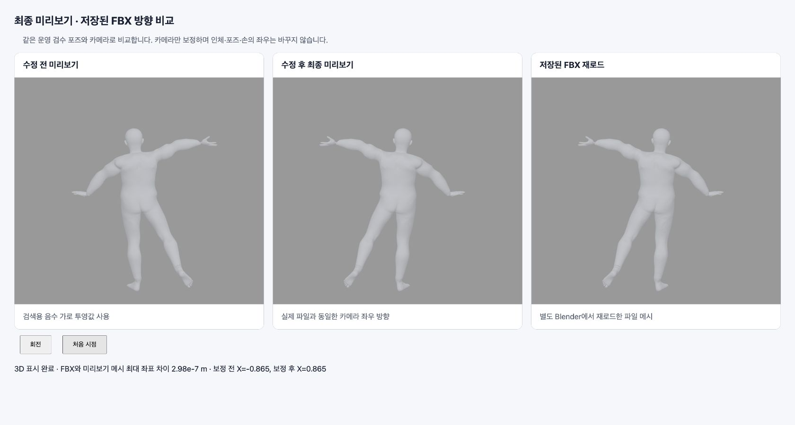

# 최종 미리보기 좌우 방향 보정

## 원인과 범위

Converter의 검색 카메라는 이미지 좌표 계약을 위해 가로 투영값(P00)이 음수입니다. 이 카메라를 최종 확인 화면에 그대로 사용하면, 같은 위치의 일반 3D 카메라로 보는 FBX에 비해 좌우가 반사됩니다. 최종 확인 화면 전용 `finalReviewCamera`에서 이 값만 양수로 정규화합니다.

- 최종 확인, 로컬 손 변경 미리보기, 해당 화면의 작업 기록 캡처가 같은 카메라를 사용합니다.
- 검색·Top5의 `solvedCamera` 계약, 원본 카메라/상태 해시, 포즈의 의도적인 `mirror` 값과 FBX 생성·다운로드 경로는 변경하지 않습니다.
- 시점 회전, 원근, 세로 투영, 비대칭 크롭 값은 보존합니다.

## 검증

- 직교·원근, 3개 시점, mirror true/false, 비대칭 크롭, 회전·확대·초기화와 화면 비율 변경을 회귀 테스트합니다.
- 운영 검수 때 저장한 실제 binary v2 모델과 대응 FBX를 사용했습니다. 새 운영 요청이나 배포는 하지 않았습니다.
- FBX를 배포와 같은 Converter 이미지의 별도 Blender 프로세스에서 재로드하고, 프로토콜의 Y-up/hip-origin 좌표계로 변환했습니다. 미리보기와 836,832개 삼각형 꼭짓점을 비교한 최대 좌표 차이는 **2.98e-7 m**입니다.
- 모델: `male-fat-max-v0-8-0`, 원본 손, 비대칭 팔·다리 포즈. 미리보기 상태 SHA256: `cba2c4829d956dd9ca88d0cf8b712366c07b44e48e00cac251b2cf3a5d6bb8b9`.
- 비교 화면은 실제 앱과 같은 `registerView`/`searchCamera` 렌더러를 쓰는 로컬 브라우저 검수 페이지입니다. 수정 후와 재로드한 FBX가 같은 방향으로 표시되고 회전·초기화 후에도 일치함을 확인했습니다. 배포 설치 앱/CSP 자체에서 이 수정본을 실행한 검증은 아닙니다.

